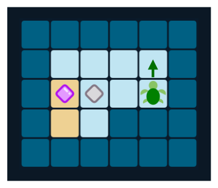

# What makes people think a puzzle is fun to solve?

**Junyi Chu, Kristine Zheng & Judith E. Fan**

Department of Psychology, Stanford University, United States. {junyichu,kxzheng,jefan}@stanford.edu

## Abstract

Many tasks feel like chores, while others are fun. Why? Here we leverage a popular puzzle game, Sokoban, to explore potential sources of variation in how enjoyable different levels of this game are to solve. In Sokoban, players navigate a grid world, pushing boxes onto goal locations while avoiding getting stuck. We first analyzed natural game play statistics ($n = 442$ puzzles) and found that some variation in enjoyment ratings could be jointly predicted by surface-level features (e.g., puzzle area) and solution complexity. Next, we measured how much participants reported enjoying a puzzle immediately after attempting it ($N = 250$ participants). We found that on successful attempts, participants enjoyed it more when they took fewer moves, whereas when unsuccessful, having made more moves was associated with greater enjoyment. Together, these studies advance understanding of how both features of the task environment and the dynamics of exploration make some activities more fun than others.

**Keywords:** play, problem solving, motivation

## Introduction

In 2022, the *New York Times* – one of the oldest newspapers in the United States – paid \$1 million USD to acquire *Wordle*, a puzzle game where players guess a 5-letter word. *Wordle* continues to be one of the most popular games in the *Times* app. Yet a similar guessing game, *Digits*, was taken down after just 4 months (Amlen, 2023). What explains why people find some games enjoyable, and others forgettable?

The question of why people prefer some activities over others has been a subject of extensive research across disciplines, including psychology, education, economics, and human-computer interaction. Classic theories proposed that specific stimulus properties – novelty, complexity, or uncertainty – evoke interest (Berlyne, 1960). Other work has documented the motivating effects of achievement (Harackiewicz & Elliot, 1993), optimal challenge (Czikszentmihalyi, 1990), or increased opportunities for learning and exploration (Oudeyer et al., 2007; Baranes et al., 2014; Brändle et al., 2023). Yet, theoretical debates remain lively, and a unified and detailed account of what makes some activities fun remains elusive (Andersen et al., 2023; Chu & Schulz, 2020).

Research on human problem solving and planning provides formal tools for understanding sequential decision making behavior in complex environments. People often consider possible future states before taking action, and appear to use mental simulation to evaluate different paths forward (Newell, 1979). The degree to which people do look-ahead seems to be affected by both cognitive constraints and the structure of the environment, with more extensive simulation when errors are costly but exploration is cheap (Gureckis & Markant, 2012; Dasgupta et al., 2018). More recently, these trade-offs have been formalized using rational models that weigh the computational costs of simulation against potential rewards, similar to how search algorithms like A\* balance the cost of expanding nodes in a search tree against their estimated value (Callaway et al., 2022). While initially developed to explain behavior in laboratory tasks rather than naturally occurring playful behavior, these frameworks may explain what makes some problems engaging: by being structured such that some planning is feasible and necessary, requiring people to look ahead just enough that it is challenging, while staying within cognitive limits.

Games offer an ideal environment to apply these formal tools in the study of fun. Like laboratory tasks, games offer well-defined objectives in controlled environments where it is possible to measure behavior at high resolution. However, games also have properties that make real-world problem solving enjoyable, including the satisfaction of discovering clever solutions and the reward of acquiring mastery over time. By studying how people approach games where engagement is driven by intrinsic motivation, we can begin to formalize the cognitive factors that make certain problems more fun to solve than others.

*Figure 1: Example Sokoban puzzle. Players use arrow keys to control the green turtle and push diamonds around (diamonds cannot be pulled). Dark blue tiles are solid walls that block movement. To complete a puzzle, every diamond must be pushed onto a yellow goal tile, such that all diamonds turn purple.*

Here, we explore the predictors of enjoyment in the Sokoban environment (Fig. 1). Sokoban is a well-known puzzle game first developed by Hiroyuki Imabayashi in 1981 (*Sokoban Wiki*, 2009). Each puzzle comprises a 2D gridworld with several boxes and just as many goal tiles. To complete a puzzle, every box must be placed onto a goal tile. Players control a character in the environment and push one box at a time. These simple rules create a vast array of puzzles, making Sokoban puzzles a popular domain for testing models of planning and problem solving (Jarušek & Pelánek, 2010; Racanière et al., 2017; Schaa et al., 2024). In fact, puzzles that are relatively small or even visually similar can show wide variability in solution complexity and solve times, ranging from a few seconds to more than an hour (Jarušek & Pelánek, 2010). Thus, Sokoban offers a simple but expressive domain to explore variability puzzle-solving behavior and enjoyment ratings. Further, Sokoban is a well-known puzzle with a large collection of community-designed levels, allowing us to examine natural variation in online communities alongside more controlled lab experiments.

*Figure 2: Study overview*

We have two goals. The first is to understand how differences between puzzle levels impact puzzle enjoyment. We examined this relationship in both an online corpus of 442 puzzles (Study 1), as well as a lab experiment (Study 2). Our second goal is to explore the degree to which participants can anticipate which puzzles will be more fun *before* attempting it, and explore how these rapid appraisals might be impacted by puzzle-solving practice using a pre-/post-test design. An overview of our approach is outlined in Fig 2. Our experiment and analysis code can be accessed at https://github.com/cogtoolslab/fun-puzzles_cogsci25

## Study 1: Characterizing relationship between puzzle features and enjoyment in the wild

We first sought to understand which aspects of a puzzle layout predict enjoyment in real-world human data. To do so, we use publicly available puzzle metadata from an online game website where people create, play, and vote on puzzles (*SokobanOnline.com*, 2011). For each puzzle in the dataset, we calculated measures of visual complexity, solution complexity, and enjoyment.

### Methods

**Dataset** We obtained puzzles from the "Web Archive" list available in December 2024, as these all follow classic Sokoban rules without custom extensions (e.g., portals, magnets). A total of 115,885 puzzles were available, but we focus our analysis on puzzles with at least 200 attempts (n = 680). We next excluded 254 puzzles that could not be solved by the A\* search algorithm within 1 million iterations Finally, we included 16 additional puzzles with at least 100 attempts from popular collections designed for novices, which we also use in Study 2. The final dataset comprised 442 puzzles from 26 different authors, with a total of 4031 like or dislike votes.

**Visual measures** Each puzzle is laid out on a grid consisting of wall, floor, and goal tiles, from which we computed three key measures. First, we computed the *total number of boxes*, which reflects how many subgoals must be completed. Puzzles ranged from 1 box to 11 boxes, with a median of 3 boxes ($SD = 1.39$). Second, we measured *puzzle area* as the total number of floor tiles ($M = 26.11$; $SD = 14.10$; $range = [3, 217]$). However, not all puzzles were equally navigable: some consisted of large empty spaces, while others were maze-like. Thus, we defined puzzle *openness* as the ratio of puzzle area (minus the number of boxes), to the number of wall tiles present. A higher value indicates more open space to navigate or push boxes around, while a lower value may suggest the map contains many inner walls or tight corridors. Puzzle openness ranged from 13.33% to 55.67% ($M = 36.87\%$; $SD = 42.60\%$).

**Solution complexity** We used the A\* planning algorithm (Hart et al., 1968; Todd et al., 2023) to solve each puzzle, stopping at a maximum of 1 million iterations. In our A\* implementation, the search is guided by the minimum sum of the Manhattan distances between each box and its closest goal. This yielded model-based measures of *solution complexity* (number of steps per box; $M = 21.68$; $SD = 16.48$; $range = [1, 133]$) and *search difficulty* (number of iterations required; $M = 86{,}938$; $SD = 179{,}160$, $range = [2, 994570]$). We also defined puzzle *completion rate* as the proportion of successful puzzle attempts ($M = 69.51\%$, $SD = 13.72\%$, $range = [5.81\%, 96.60\%]$).

**Enjoyment measures** Players can vote on each puzzle with a like or dislike, which we transform into an enjoyment measure by dividing total likes by the number of attempts to obtain a *like rate* ($M = 2.26\%$, $SD = 0.96\%$, $range = [0.30\%, 6.01\%]$). When people react to a puzzle, they typically give likes ($M = 98\%$, $SD = 4.4\%$, $range = [67\%, 100\%]$); only 30 puzzles have a like ratio below 90%.

![Panel A: horizontal bar chart of Pearson correlations with like rate, axis from -0.3 to 0.3: puzzle area about -0.11 (significant), openness about 0, number of boxes about -0.33 (significant), steps per box about +0.22 (significant), search complexity about -0.11 (significant). Panel B: scatter of like rate (0 to 6%) against completion rate (25% to 100%), points shaded by number of boxes 1 to 11, with marginal histograms and an orange quadratic fit that rises from about 1% at low completion to a flat peak near 2.3% around 70 to 75% completion](fig-3.png)

*Figure 3: Predictors of puzzle like rate in an online corpus of 460 puzzles. **(A)** Visual features (blue) were computed from the puzzle layout and include `puzzle area` (the number of floor tiles), `openness` ($(n_{floor} - n_{boxes})/(n_{floor} + n_{walls})$), and the `number of boxes` that must be correctedly placed. Solution-based features (green) show the results of using the A\* search algorithm to solve each puzzle. `Steps per box` reflects length of best solution divided by number of boxes; `search difficulty` reflects number of model iterations before a solution was achieved (max one million). Bars show Pearson correlations; asterisks indicate significant values at $p < 0.05$. **(B)** Relationship between puzzle completion rate and like rate, computed over all attempts. Best-fit line shows predictions of quadratic model with 95% CI.*

### Results

We first examined the association between like rate and each computed puzzle feature using Pearson correlations (Fig. 3A)[^1]. A lower like rate was observed for larger puzzles ($\rho(438) = -0.11$, $p = .01$) and puzzles with more boxes ($\rho(433) = -0.33$, $p < .0001$), though enjoyment was not related to the proportion of empty tiles (openness: $\rho(414) = 0.88$, $p = .01$). Puzzles that A\* could solve in fewer iterations also had a higher like rate ($\rho(413) = 0.11$, $p = .02$), suggesting an overall preference for simpler puzzles. Like rate was also higher for puzzles requiring more steps per box ($\rho(414) = 0.26$, $p < 0.0001$).

We next considered the relation between enjoyment and the probability of success. Puzzle like rate was not linearly predicted by puzzle completion rate ($F(1, 440) = 3.25$, $p = .07$; adjusted $R^2 = 0.0051$). Including a quadratic term significantly improved model fit ($F(1, 439) = 5.11$, $p = .02$; see Fig. 3B), suggesting that the most liked puzzles lay in a sweet spot of difficulty. The highest like rate was estimated at 73% completion rate, which is close to the average puzzle completion rate (69.5%). However, the quadratic model explained only a limited amount of variation in like rates (adjusted $R^2 = 0.014$), so we caution against generalizing this relationship beyond the present dataset.

While these relationships were robust, together they accounted for only a small fraction of total variation. A linear regression model with all features accounted for just under 10% of variation in like rates (adjusted $R^2 = 0.099$; $F(7, 434) = 7.94$, $p < .001$), with the greatest proportion of unique variance attributed to visual features alone (adjusted $R^2 = .091$).

[^1]: For each correlation analysis, we first removed high leverage points that were three Cook's distance away from the mean.

### Discussion

Across a large and diverse array of puzzles, we found that puzzles with simpler visual features had higher like rates, suggesting that salient surface-level properties may inform people's puzzle evaluation. Replicating prior work (Brändle et al., 2024), we also found some evidence that puzzles with medium difficulty elicited more enjoyment. Interestingly, puzzles that require more steps per box had higher like rates. Perhaps these puzzles afford longer durations of game play and sustain longer engagement. As these are correlational analyses, we refrain from making causal conclusions.

This data is valuable for capturing variation in puzzle designs and people's reactions in a naturalistic setting: on a game website where people are, presumably, playing for fun. However, we had no access to player-specific data, such as their level of experience, how often they repeated a puzzle, or how long they spent on each puzzle. Further, while individual players can only like a puzzle once, we do not know if they voted after their first attempt, or only after completing it. This uncertainty about the data generation process hinders inferring generalizable conclusions about the factors that impact puzzle enjoyment. In Study 2, we ran an experiment to investigate how such participant-specific and attempt-specific factors might impact puzzle appraisals.

## Study 2: Impact of puzzle-solving experience on enjoyment

In Study 2 we investigate the impact of puzzle-solving experience on how people rate puzzles. First, we standardized overall experience by imposing a time limit of 5 minutes per puzzle. After completing a puzzle, or when the time was up, participants rated how enjoyable the puzzle was on a scale of 1 to 10, thus providing more fine-grained appraisals than in Study 1.

Second, we probed how participants might appraise puzzles *just by looking* using a binary comparison task. This allowed us to study potential differences between participant's anticipated enjoyment and their self-reported enjoyment. In addition, we used a pre-/post-test design to assess how these appraisals may be impacted by puzzle-solving practice, for example, whether judgments become more consistent with post-attempt ratings or with ratings from other participants, or whether a preference for harder puzzles emerges.

While our primary aim was to characterize sources of consistency and variability in puzzle enjoyment ratings, we also ran a control group of participants who judged puzzle difficulty instead of enjoyment. This both provides a comparison benchmark for assessing the reliability of puzzle ratings, and also allows us to test if the U-shaped relationship between task difficulty and enjoyment found in Study 1 generalizes to this experimental context.

### Methods

**Participants** We recruited 250 US adults from Prolific and randomly assigned them to either an enjoyment (n=124) or difficulty (n=126) rating condition. The study took about 50 minutes to complete and participants received \$10 USD. An additional 27 participants were excluded for incomplete test trials (n=19), failing tutorial levels (n=6), or failing an attention check about their assigned condition (n=2).

Participants were relative novices, with most reporting no prior experience with Sokoban puzzles (n=146 or 58%) and the remainder having played Sokoban a few times (26%) or several times (11%). A small group of participants self-reported being very familiar with the game. Consistent with this, a majority of participants found the study quite challenging (mean rating 3.86 on a scale of 1=Very Easy to 5=Very Hard; 66% responding 4 or 5) with no differences across rating conditions.

**Stimuli** We identified puzzles from popular collections that were recommended for novices. All puzzles contained 3 boxes on a grid size ranging from 4x4 to 7x7 tiles. To ensure that participants would be able to complete at least some puzzles within 5 minutes, we only considered puzzles with an observed solution rate of at least 50% and that required no more than 99 moves to solve. We next sampled puzzles following a 2x2x2 design using a median split on three variables: difficulty (corpus completion rate, cutoff: 73% solved), enjoyment (corpus like rate; cutoff: 3.1%), and solution complexity (length of shortest observed solution; cutoff: 48 steps). The final stimuli comprised 24 puzzles: three sets of 8 puzzles, such that each set followed the 2x2x2 design.

*Figure 4: (Study 2) Amount of variation in self-reported enjoyment that is attributable to puzzle features. Y-axis show adjusted R-squared values from linear mixed effects models with different predictor terms, indicated on the X-axis. Noise ceiling shows maximal achievable $R^2$, estimated from the observed between-participant consistency in enjoyment ratings.*

**Procedure** All participants first completed a tutorial with videos explaining the game rules. To continue with the study, participants had to solve 3 practice puzzles (two 2-box puzzles and one 3-box puzzle) that required between 5 to 17 steps. Next, participants completed three tasks in fixed order: an initial puzzle comparison task ("Window Shopping"), a main puzzle solving and rating task ("Puzzle Testing"), and a final comparison task (Fig. 2). Each task comprised puzzles from a different stimuli set, with the set order counterbalanced across participants.

**Window Shopping task** Participants were instructed to "help us decide which puzzles seem more [difficult / enjoyable] at first glance". This task included eight forced-choice trials contrasting two puzzles. On each trial, one puzzle was first displayed alone. After 10 seconds had passed, participants could click to reveal the second puzzle, which was displayed beside the original puzzle for at least another 10 seconds. Trials ended when participants made a choice between the two puzzles; the median time spent per trial was 28 seconds.

Puzzle pairs were sampled from each stimuli set such that any given participant would see each puzzle appear in two comparison trials, with no repeated pairs. Overall, each puzzle appeared in 78 to 90 comparisons per condition and study phase (initial/final).

**Puzzle Testing task** In this main phase of the study, participants attempted 8 puzzles with 5 minutes allowed per puzzle. During a trial, participants could undo actions or restart the puzzle as many times as they wished. After completing a puzzle or reaching the time limit, participants rated the puzzle on a 10-point scale (from 1:Not at all [enjoyable/difficult] to 10:Extremely [enjoyable/difficult]). All 8 puzzles were displayed in a gallery and participants could choose which puzzle to attempt next.

### Results

**Enjoyment ratings were just as reliable as difficulty ratings** We observed a wider spread of enjoyment ratings (mean SD across puzzles = 2.80) than difficulty ratings ($SD = 2.37$; $t(23) = 3.07$, $p = .005$). This was consistent with the overall sentiment that Sokoban puzzles were difficult: 65% of trials in the difficulty condition received a score of 8 to 10 whereas enjoyment ratings were more uniformly distributed across the full scale.

Nonetheless, we found that both enjoyment and difficulty ratings were highly reliable across participants. We defined reliability as the (Spearman-Brown Formula corrected) correlation between split-halves of participants using a permutation approach (Parsons, 2021) with 10,000 random splits within each condition and stimuli set. The mean consistency in average puzzle ratings across participants for enjoyment was $r_{SB} = .86$, 95% CI = $[0.75, 0.92]$; for difficulty, $r_{SB} = .82$, 95% CI = $[0.69, 0.89]$, indicating strong internal consistency.

**Visual features and solution complexity did not predict self-reported enjoyment** Across puzzles, we found that average enjoyment ratings were *not* strongly predicted by either visual features (*i.e.,* puzzle area and openness) or solution complexity (*i.e.,* solution length and number of search iterations required). Figure 4 shows adjusted R-squared values from linear mixed effects (LME) models with random effects for participant and puzzle, and fixed effects for visual features ($R^2 = .005$), solution complexity ($R^2 = .010$), and average completion rate ($R^2 = .051$). Incorporating all puzzle features improves model fit ($R^2 = .073$), but is still far below the maximal achievable explanatory power estimated from split-half reliability ($R^2 = .72$). Thus, other participants are much better predictors of how much someone will enjoy a puzzle, compared to puzzle-specific features.

**Participants rate difficult puzzles as less enjoyable** Next, we examine how self-report measures correspond with measures of puzzle enjoyment and difficulty in Study 1. First, we examined the relationship between puzzle enjoyment and difficulty (Figure 5A). Unlike the quadratic relationship found in Study 1, here we found a strong linear relationship (Pearson's $\rho(22) = -.947$, $p < .001$): puzzles rated as more difficult were rated (by different participants) as less enjoyable. Consistent with this, we found that observed puzzle completion rates from Study 1 significantly predicted both average difficulty ratings (Pearson's $\rho(22) = -0.50$, $p = .013$) and enjoyment ratings (Pearson's $\rho(22) = 0.48$, $p = .017$).

![Panel A: per-puzzle mean self-reported enjoyment (y, about 3.8 to 7.9) against mean self-reported difficulty (x, about 5.4 to 9.4) for 24 puzzles with bootstrapped error bars, a tight falling line: easier puzzles more fun. Panel B: AIC of six mixed models (columns): null and puzzle-features-only and steps-only models near 8800 to 8850; any model with success near 7800; the full model with the steps by success interaction lowest. Panel C: trial-level enjoyment (1 to 10) against steps taken (0 to 500): solved trials (blue) fall from about 8.8 at 0 steps to about 6.5 at 480 steps; unsolved trials (red) rise from about 3.9 to about 4.9](fig-5.png)

*Figure 5: Predictors of self-reported enjoyment in Study 2. **(A)** The correlation between average enjoyment and difficulty judgments (between-subjects). Points show average self-reported enjoyment and difficulty for each puzzle; error bars show 95% bootstrapped CIs. **(B)** Model fits (AIC value) from fitting Linear Mixed Effects models with different combinations of features. Each column represents one model. The left-most column shows the null model with only random intercepts for participant and puzzle. Puzzle features included visual features (total area, layout openness) and solution complexity (average completion rate from Study 1, steps needed, and search complexity). **(C)** Trial-level enjoyment ratings reflect an interaction between total number of steps taken (x-axis) and whether participants solved that puzzle. Dots show responses on each trial, with color indicating success (blue) or failure to solve within allotted 5 minutes (red). Some vertical jitter has been added to reduce overplotting. Lines show predictions of the full regression model (right most column of panel B), marginalizing over puzzle features.*

Unexpectedly however, self-reported enjoyment ratings were not monotonically associated with corpus like rates (Spearman's $\rho = -.032$, $p = .88$) nor with the raw number of likes (Spearman's $\rho = .33$, $p = .33$). This result is consistent with the possibility that enjoyment ratings may be strongly impacted by task context (e.g., total time allowed, whether information about other players' outcomes are available) or aspects of an individual participant's puzzle-solving experience. We test this latter possibility next.

**Puzzle-solving traces account for significant variability in self-reported enjoyment** As a first step towards accounting for variability in enjoyment ratings across individual trials, we focus on two high-level metrics of puzzle-solving behavior: whether participants successfully completed the puzzle, and the total number of steps taken throughout the attempt. As before, we constructed LME models with random intercepts for participants and puzzles.

Fig. 5B shows AIC values for models with different fixed effects. Our base model includes all puzzle-specific visual and solution-based features. Including fixed effects of steps taken and success improved model fit, with *success* contributing the majority of improved predictive power. Including an interaction between success and steps taken further improves model fit ($\chi^2(1) = 39.3$, $p < .001$). Fig. 5C shows model predictions for this interaction effect: When participants solve a puzzle, they report greater enjoyment when they attempted fewer steps in total (including repeated attempts). However, when participants did not solve a puzzle, having attempted more steps predicts greater self-reported enjoyment.

**How might practice change which puzzles people think will be more fun?** We analyzed responses on the Window Shopping task by transforming participants' binary choices into ELO scores. This is a common approach for assigning skill scores to winners and losers in head-to-head matches, and captures how likely a puzzle will be selected in a new comparison against another randomly selected puzzle. We use the R package EloChoice (Clark et al., 2018) to compute participant-specific ELO scores across 10,000 permutations of trial order, before aggregating across participants to obtain a puzzle-specific ELO score for each study phase and rating condition.

One way that puzzle appraisals may change from pre- to post-test is that choices can become more consistent across different participants. We found no evidence for this: split-half reliability for ELO scores ranged from 0.31 to 0.56, with no differences of condition, study phase, or stimuli set. This relatively low consistency score is perhaps unsurprising given that visual features (e.g., puzzle area or openness) predicted less than 1% of variance in self-reported enjoyment.

Another possibility is the factors shaping participants' choices may change after practice. For example, participants may begin to prefer harder puzzles. While neither pre-test nor post-test ELO scores were significantly correlated with average puzzle completion rates or other measures of, we observed increased association between enjoyment and difficulty ELO scores as the study progressed (see Fig. 6). Anticipated enjoyment and difficulty was not correlated at pretest (Pearson's $\rho = -0.02$, 95% bootstrapped CI = $[-0.27, 0.28]$) but was positively correlated at post-test (Fig. 6; Pearson's $\rho = 0.61$, 95% bootstrapped CI = $[0.31, 0.81]$), reflecting a significant increase (bootstrapped 95% CI for difference: $[0.19, 0.98]$).

*Figure 6: Changes in anticipated puzzle enjoyment and difficulty in Study 2. Each point shows average ELO scores for one puzzle, computed from binary comparisons in the Window Shopping task. Best fit lines show linear estimate with 95% CI.*

## General Discussion

Intuitions about task enjoyment pervades everyday decisions and actions. Yet, the information and computations people use to make such appraisals are not well understood. Here, we combined a natural dataset and an experimental study to chart sources of consistency and variability in enjoyment ratings.

We focused on enjoyment in Sokoban, a puzzle game with simple rules yet vastly complex solutions. Both visual features and solution complexity predicted the "like rate" across puzzles in the online dataset (Study 1). Specifically, puzzles with greater enjoyment were visually smaller and more easily solved by a search algorithm. In Study 2, we analyzed participant's self-reported enjoyment immediately after attempting a puzzle. We found that trial-level exploration accounted for significant variability in enjoyment ratings. On successful attempts, people reported greater enjoyment when they took fewer moves. However, for unsuccessful attempts, having made more moves was associated with greater enjoyment.

While informative, these results explain only a small amount of variation in puzzle enjoyment relative to the between-participant agreement observed in Study 2. To make progress on this predictive gap, future work should go beyond the high-level summary statistics used (i.e., success or number of steps taken) to examine other ways that puzzle attempts differed both within and across participants, such as how broadly they explored different actions and what search strategies they use. For example, recent work suggests that more expert game play can be modeled with a greater search depth (van Opheusden et al., 2023). Computational models thus offer a fruitful way to better understand individual differences in how people attempt and evaluate puzzles.

Another open question is what inferences third-party observers can make about a player from how they approach a puzzle. For example, can observers reliably infer a players' enjoyment, frustration, or competence? The ability to notice such psychological states may be especially important in collaborative and pedagogical contexts, such as choosing what hints to give or which puzzles to recommend next.

As an exploratory measure, participants in Study 2 also judged which of two puzzles seem more enjoyable from brief viewing. These responses were not as reliable as post-attempt ratings, and stands in contrast to recent work finding that people can quickly evaluate how fun a variety of simple board games will be (Zhang et al., 2024). This discrepancy may be due to differences in game complexity and study design: Our participants made head-to-head matches in about 20 seconds, while participants in (Zhang et al., 2024) had up to a minute to rate each game and had access to a scratch pad. This comparison suggests that reducing the cognitive cost of generating and reasoning about future states may support more accurate task appraisals. To test this hypothesis, future work can investigate how varying the ease of forward simulation (e.g., providing roll outs) impacts people's anticipated enjoyment.

We look forward to these lines of future research that will help us better understand how people both appraise past experiences and anticipate how rewarding future experience can be.

## Acknowledgments

The authors would like to thank Graham Todd for implementation of the A\* search algorithm, and members of the Cognitive Tools Lab at Stanford University for helpful discussion. J.C is supported by the Stanford Accelerator for Learning. K.Z. is supported by the Stanford Institute for Research in the Social Sciences (IRiSS). J.E.F is supported by NSF CAREER Award #2436199, NSF DRL #2400471, and awards from ONR Science of Autonomy, the Stanford Human-Centered AI Institute (HAI) and Stanford Accelerator for Learning.

## References

- Amlen, D. (2023, April). How we make games at the times. *The New York Times*.
- Andersen, M. M., Kiverstein, J., Miller, M., & Roepstorff, A. (2023, March). Play in predictive minds: A cognitive theory of play. *Psychological Review*, *130*(2), 462–479.
- Baranes, A. F., Oudeyer, P.-Y., & Gottlieb, J. (2014, October). The effects of task difficulty, novelty and the size of the search space on intrinsically motivated exploration. *Frontiers in Neuroscience*, *8*.
- Berlyne, D. E. (1960). *Conflict, arousal, and curiosity.* McGraw-Hill.
- Brändle, F., Stocks, L. J., Tenenbaum, J. B., Gershman, S. J., & Schulz, E. (2023). Empowerment contributes to exploration behaviour in a creative video game. *Nature Human Behaviour*, *7*(9), 1481–1489.
- Brändle, F., Wu, C. M., & Schulz, E. (2024, Mar). *Leveling up fun: Learning progress, expectations, and success influence enjoyment in video games.* PsyArXiv. Retrieved from osf.io/preprints/psyarxiv/vg8dz_v3
- Callaway, F., van Opheusden, B., Gul, S., Das, P., Krueger, P. M., Griffiths, T. L., & Lieder, F. (2022). Rational use of cognitive resources in human planning. *Nature Human Behaviour*, *6*(8), 1112–1125.
- Chu, J., & Schulz, L. E. (2020). Play, curiosity, and cognition. *Annual Review of Developmental Psychology*, *2*, 317–343.
- Clark, A. P., Howard, K. L., Woods, A. T., Penton-Voak, I. S., & Neumann, C. (2018, January). Why rate when you could compare? using the "elochoice" package to assess pairwise comparisons of perceived physical strength. *PLOS ONE*, *13*(1), e0190393.
- Czikszentmihalyi, M. (1990). *Flow: The psychology of optimal experience*. New York: Harper & Row.
- Dasgupta, I., Smith, K. A., Schulz, E., Tenenbaum, J. B., & Gershman, S. J. (2018). Learning to act by integrating mental simulations and physical experiments. *BioRxiv*, 321497.
- Gureckis, T. M., & Markant, D. B. (2012). Self-directed learning: A cognitive and computational perspective. *Perspectives on Psychological Science*, *7*(5), 464–481.
- Harackiewicz, J. M., & Elliot, A. J. (1993). Achievement goals and intrinsic motivation. *Journal of personality and social psychology*, *65*(5), 904.
- Hart, P. E., Nilsson, N. J., & Raphael, B. (1968). A formal basis for the heuristic determination of minimum cost paths. *IEEE transactions on Systems Science and Cybernetics*, *4*(2), 100–107.
- Jarušek, P., & Pelánek, R. (2010). Human problem solving: Sokoban case study. *Technická zpráva, Fakulta informatiky, Masarykova univerzita, Brno*.
- Newell, A. (1979). Reasoning, problem solving and decision processes: The problem space as a fundamental category.
- Oudeyer, P.-Y., Kaplan, F., & Hafner, V. V. (2007, April). Intrinsic motivation systems for autonomous mental development. *IEEE Transactions on Evolutionary Computation*, *11*(2), 265–286.
- Parsons, S. (2021). Splithalf: Robust estimates of split half reliability. *Journal of Open Source Software*, *6*(60), 3041.
- Racanière, S., Weber, T., Reichert, D., Buesing, L., Guez, A., Jimenez Rezende, D., ... others (2017). Imagination-augmented agents for deep reinforcement learning. *Advances in neural information processing systems*, *30*.
- Schaa, H., Del Solar-Zavala, J. A., & Barriga, N. A. (2024). Predicting solvability and difficulty of sokoban puzzles. In *2024 43rd International Conference of the Chilean Computer Science Society (SCCC)* (pp. 1–4).
- *Sokobanonline.com.* (2011). Uphill Studio LLC. Retrieved from www.sokobanonline.com
- *Sokoban wiki.* (2009). MediaWiki. Retrieved from http://www.sokobano.de/wiki
- Todd, G., Earle, S., Nasir, M. U., Green, M. C., & Togelius, J. (2023). Level generation through large language models. In *Proceedings of the 18th international conference on the foundations of digital games* (pp. 1–8).
- van Opheusden, B., Kuperwajs, I., Galbiati, G., Bnaya, Z., Li, Y., & Ma, W. J. (2023, May). Expertise increases planning depth in human gameplay. *Nature*, *618*(7967), 1000–1005.
- Zhang, C. E., Collins, K. M., Wong, L., Weller, A., & Tenenbaum, J. B. (2024). People use fast, goal-directed simulation to reason about novel games. *arXiv preprint arXiv:2407.14095*.
