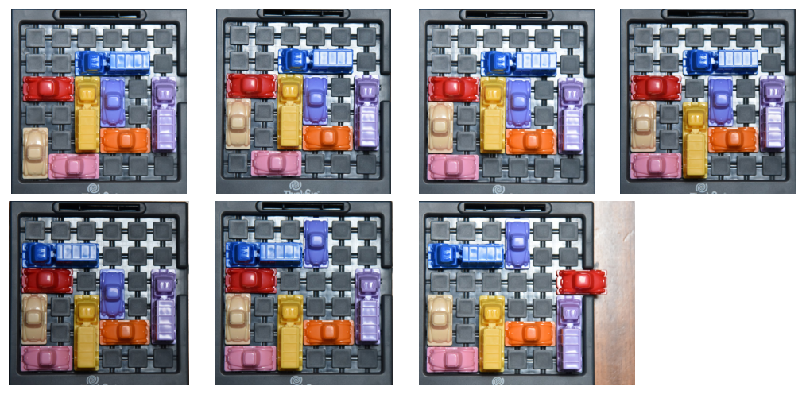
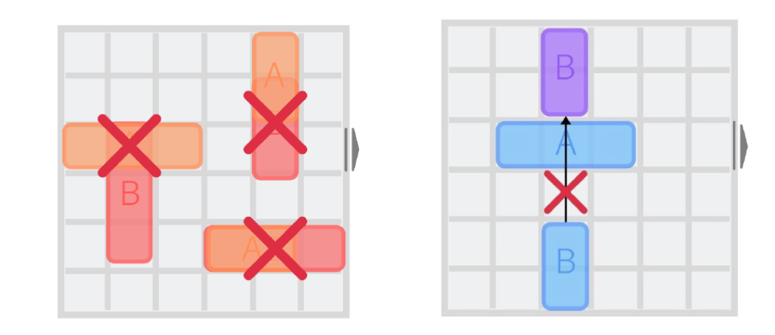
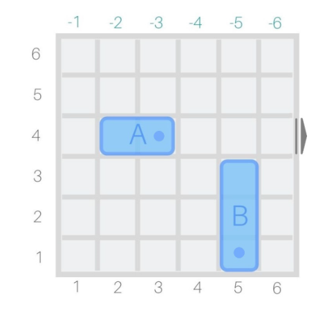
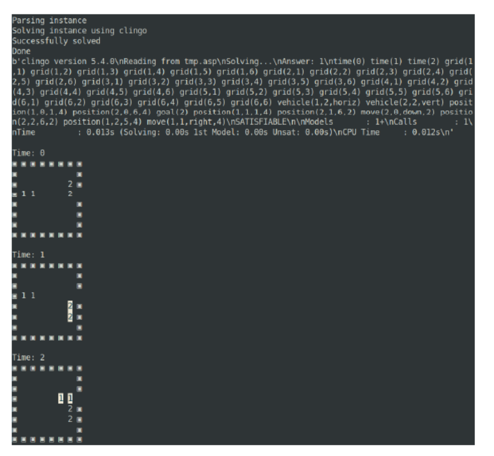

# Modeling and Solving the Rush Hour puzzle

Lorenzo Cian, Talissa Dreossi and Agostino Dovier

*University of Udine, DMIF, Via delle Scienze 206, 33100 Udine, Italy*

agostino.dovier@uniud.it (A. Dovier) · www.dimi.uniud.it/dovier · ORCID 0000-0003-2052-8593 (A. Dovier)

Research partially supported by Fondazione Friuli/Università di Udine project on *Artificial Intelligence for Human Robot Collaboration* and by INDAM GNCS projects NoRMA and InSANE (CUP E55F22000270001).

## Abstract

We introduce the physical puzzle Rush Hour and its generalization. We briefly survey its complexity limits, then we model and solve it using declarative paradigms. In particular, we provide a constraint programming encoding in MiniZinc and a model in Answer Set Programming and we report and compare experimental results. Although this is simply a game, the kind of reasoning involved is the same that autonomous vehicles should do for exiting a garage. This shows the potential of logic programming for problems concerning transport problems and self-driving cars.

**Keywords:** Rush Hour, Planning, MiniZinc, ASP, Autonomous vehicles

## 1. Introduction

Rush Hour is a physical puzzle created by Nob Yoshigahara in 1970 and sold in USA for the first time in 1996. The game is played on a $6 \times 6$ board, on which there are a number of cars (of size 2) and trucks (of size 3). Cars and trucks can only move forwards or backwards (but not sideways). There is a unique exit door. The aim is to move the vehicles in such a way that the only red car can be driven out of the exit (see Figure 1 for an example).



*Figure 1: A six-moves exit plan for the red car on the physical game (the curious reader might find a plan with only five moves)*

The generalized rush hour problem, which has an arbitrary $m \times n$ grid size and allows to place the exit at any point on the perimeter of the grid, has been proved to be PSPACE-complete [1]. Due to this intrinsic limit we focus on the problem of finding a plan that allows to exit the red car with a fixed number $t$ of moves. Then the solver will be run with $t = 1, 2, 3, \ldots$ until a solution (if any) is found.

Apart from [2, 1] where parameterized complexity is studied, in [3] the authors use model checking techniques for developing initial configurations that require high values for $t$ making the instances *difficult*.

In [4] the authors studied the reasons why the transport puzzles are that complex, studying the sokoban, rush hour, and replacement puzzle. The complexity and a solution of sokoban in declarative programming was also presented in [5].

In this paper, as made in [6] and recently in [7] for other problems/puzzles, we model the (generalization) of the rush hour puzzle in declarative programming using the language MiniZinc for a constraint programming encoding and Answer Set Programming for a logic programming encoding. We show the good results and the limits of the two approaches and set the basis for future development.

Although this is a game, self driving cars need to solve these kinds of puzzles for leaving a garage without damaging each other.

The paper is organized as follows: in Section 2 we set the background of the problem. We assume that the readers are aware of Constraint Programming and Answer Set Programming so we decided to avoid the definitions of those languages. The modeling in MiniZinc and ASP are presented in Sections 3 and 4, respectively. In Section 5 we report on the running time of the two approaches. Finally some conclusions are drawn in Section 6.

## 2. The problem and its complexity

A $m \times n$ board is a subset of the Cartesian plane identified by points $\mathcal{B} = \{(x, y) : 1 \le x \le m \wedge 1 \le y \le n\}$. Let us assume $(1,1)$ is the bottom-left cell, and $(m,n)$ the top-right cell. $(x,y)$ is on the border of the grid if $x \in \{1, m\}$ or $y \in \{1, n\}$.

Let $s$ be a function reporting the size of vehicles. A vehicle $c$ can be of size $s(c) = 2$ (a car) or $s(c) = 3$ (a truck). A vechicle occupies exactly $s(c)$ adjacent cells. Given the position $(x,y)$ of its front and its polar orientation north, south, east, west, the remaining cells occupied by the vehicle are univocally determined. For instance, if the orientation of a truck is toward south, the rest of the truck occupies $(x, y+1), (x, y+2)$.

A *garage* is a set $\mathcal{G} = \{(c_1, s_1), \ldots, (c_r, s_r)\}$ of pairs $(c_i, s_i)$ where $c_i$ is the name/index of a vehicle and $s_i = s(c_i) \in \{2, 3\}$ denotes its size.

An *allocation* of a garage in a $m \times n$ board is a set of triplets $\mathcal{T} = \{t_1, \ldots, t_r\}$ of the form $t_i = (x, y, o)$ where $(x,y)$ is the grid cell occupied by the nose of the vehicle $c_i$ and $o \in \{N, S, E, W\}$ (north, south, east, west, respectively) is its cardinal orientation, such that (1) all pieces of the vehicles are on the grid and (2) no pairs of them overlap.


*Figure 2: Allowed moves (right). The grey arrow denotes the exit gate $(6,4)$*

**Definition 2.1.** *A* generalized rush hour *(briefly, GRH) instance is a tuple*

$$\langle \text{board-size}, \text{door}, \mathcal{G}, \mathcal{I} \rangle$$

*where*

- board-size *is a pair $(m,n) \in \mathbb{N}^2$ defining the grid size*
- door *is a pair $(x_e, y_e) \in \mathbb{N}^2$ on the border of the grid where the exit door is located*
- *$\mathcal{G} = \{(c_1, s_1), \ldots, (c_r, s_r)\}$ is a garage*
- *$\mathcal{I} = \{t_1, \ldots, t_r\}$, called the* initial state*, is an allocation of $\mathcal{G}$*

*We assume that $c_1$ identify the "red" car of the physical instance.*

Every vehicle $c_i$ can be moved of one or more units, in one or the other direction consistent with its orientation $o$ (see Fig 2). The car cannot exit from the board. If the vehicle moves of $k$ units, the $k$ cells must be free in the current state.

**Definition 2.2.** *Given a* generalized rush hour *(briefly, GRH) instance $\langle \text{board-size}, \text{door}, \mathcal{C}, \mathcal{I} \rangle$ a* plan *of length $\ell$ is a sequence of $\ell$ moves such that at the end a part of the vehicle $c_1$ occupies the door cell, and it is properly oriented to be allowed to exit the door.*

Let us observe that due to the kind of moves allowed, if $t_1 = (x_1, y_1, E)$ or $t_1 = (x_1, y_1, W)$ then $y_e = y_1$, and if $t_1 = (x_1, y_1, N)$ or $t_1 = (x_1, y_1, S)$ then $x_e = x_1$. If this does not holds then a plan cannot exist and the problem becomes trivial. Thus, we consider only instances that satisfy the above constraint.

As common in planning, there are two decision problems associated with GRH:



*Figure 3: Vehicles cannot overlap, and cannot jump*

1. Given an instance of GRH and $\ell \in \mathbb{N}$, establishing whether a a plan of lenght $\ell$ exists, and
2. Given an instance of GRH establishing if there is an $\ell \in \mathbb{N}$ such that a plan of lenght $\ell$ exists

Flake and Baum in [1] show how to encode Boolean formulas into instances of GRH proving NP-completeness of the former and PSPACE completeness of the latter.

Of course, the physical, $6 \times 6$ game has a finite number of possible instances, so, in principle it admits a constant time complexity using a program of huge size, storing features of all the possible instances. This size is of course not acceptable, thus we develop a program for GRH that, as particular case, solves $6 \times 6$ instances without making use of simplifications due to particular cases.

## 3. MiniZinc modeling

We describe our constraint programming encoding using the modeling language MiniZinc [8]. As common in planning we refer to a pair of garage (the set and kind of vehicles) $\mathcal{G}$ and their allocation $\mathcal{T}$ on a $m \times n$ grid as a *state*. We have to model states, actions, and the state change. The main constraints to be considered are the following:

- A vehicle cannot exit the board (neither completely nor partially)
- A vehicle cannot change its initial row or column or orientation
- Two different vehicles cannot overlap each other (see Figure 3)
- When the state is updated, a vehicle cannot jump over another (see Figure 3)

There are two main choices for the representation of a state:

- Focusing on the grid, namely defining a matrix $B$ of size $m \times n$ where $B[i,j] = 0$ means that the cell is free and $B[i,j] = k$ that the cell is occupied by the vehicle $k$
- Focusing on the vehicles, namely using vectors of size $r$ storing, in some way, the initial point and the orientation of all vehicles



*Figure 4: Example of representation: `size[A]=2`, `size[B]=3`, `versus[A]=4`, `versus[B]=-5`, `initial[A]=2`, `initial[B]=1`*

Each representation has its pros and cons. For instance the matrix representation implements implicitly the non overlap constraint, while the vechicle representation uses less space and allows an easy update (only one vehicle per time-step). After the first empirical tests, we decided to focus on the second approach. Let us present it in some more detail.

For the sake of simplicity we'll use the standard board in what follows (i.e., $m = n = 6$). The encoding is easy to generalize.

The input consists in three arrays of length $r$. An array `size` stores for each vehicle its size (2 or 3). Changing direction of a vehicle is not possible. This means that once we know if it is horizontal (resp., vertical), the $y$ coordinate (resp., $x$ coordinate) is the same for all the computation. We store this info with a unique array `versus` that takes values in -6..6. If `versus`$[i] > 0$ then the vehicle is horizontal, and `versus`$[i]$ denotes its $y$ coordinate (row). If `versus`$[i] < 0$ then the vehicle is vertical, and `versus`$[i]$ denotes its $x$ coordinate (column). The GRH instance is completed by the array `initial` that fixes the other coordinates of each vehicle. For breaking symmetries, we do not store where the front of the vehicle is located. We store instead the smallest coordinate of the cells occupied by the vehicle (see Figure 4 for an example). Without loss of generality we assume that the red car is horizontal and that the exit door is located in the eastern cell of its row.

These were the static and input information. The dynamic behavior depends on two matrices that include the decision variables: `pos[i,j]` stores the smallest cell occuped by vehicle `i` at time `j`. `move[i,j]` is 0 if vehicle `i` does not move at time `j`, and $\delta \neq 0$ if it moves (positively or negatively) of $\delta$ positions. Although we don't need a matrix for the latter information (two vectors are sufficient) the matrix will allow an easy encoding of the inertia laws (as shown later).

The initial state can be stated as follows:

```minizinc
constraint
    forall(v in 1..vehicles)(pos[v,1]=initial[v]);
```

We will omit the declaration `constraint` before the following constraints.

The goal should be reached by a plan of exactly $t$ time steps¹

```minizinc
pos[1,t]=5;
```

The constraint stating that vehicles cannot exit the board is set in this way ($\texttt{pos}[\texttt{v},\texttt{s}] \ge 1$ is guaranteed by the domain of the variable):

```minizinc
forall(v in 1..vehicles, s in 1..steps)
     (pos[v,s]+size[v]-1<=6);
```

We need to state the non overlapping constraint. First we deal with pairs of vehicles in the same column or row:

```minizinc
forall(v1,v2 in 1..r,s in 1..t
        where (v1 < v2 /\ versus[v1] = versus[v2]))
    (pos[v1,s]+size[v1]-1 < pos[v2,s] \/
     pos[v2,s]+size[v2]-1 < pos[v1,s]);
```

Then we deal with pairs of hortogonal vehicles. In this case we explicitly avoid that they form a "cross"

```minizinc
forall(v1,v2 in 1..r,s in 1..t
        where (versus[v1] > 0 /\ versus[v2] < 0))
    (not (pos[v1,s] <= -versus[v2] /\
         -versus[v2] <= pos[v1,s]+size[v1]-1  /\
         pos[v2,s] <= versus[v1]  /\
         versus[v1] <= pos[v2,s]+size[v2]-1));
```

Let us focus now on the moves. We need to state that there is exactly one move per time step.

```minizinc
forall(s in 1..t-1)
     (sum(v in 1..r)(move[v,s]!=0) = 1);
```

Other lower level, and slightly faster definitions have been tested, as well. The effect of a move action can be defined by this constraints. The fact that `move[v,s]` contains 0 for all vehicles `v` but one allows us to easily deal with inertia.

```minizinc
forall(v in 1..r, s in 1..t-1)
      (pos[v,s+1] = pos[v,s] + move[v,s]);
```

It remains to state that cars cannot jump during the move. This can be made as follows. For jumps on vehicles in the same row/column:

```minizinc
forall(s in 1..t-1, v1,v2 in 1..r
        where  ((v1<v2) /\ versus[v1]=versus[v2]))(
    not (pos[v1,s]<=pos[v2,s] /\ pos[v1,s+1] > pos[v2,s+1]) /\
    not (pos[v2,s]<=pos[v1,s] /\ pos[v2,s+1] > pos[v1,s+1]));
```

And for vertical and horizontal jumps on orthogonal cars

```minizinc
forall(s in 1..t-1, v1,v2 in 1..r
        where (versus[v1] < 0 /\ versus[v2] > 0))(
    (pos[v2,s] <= -versus[v1] /\
    -versus[v1] <= pos[v2,s]+size[v2]-1)
 -> (pos[v1,s] < versus[v2] -> pos[v1,s+1] < versus[v2]) /\
    (pos[v1,s] > versus[v2] -> pos[v1,s+1] > versus[v2]));

forall(s in 1..t-1, v1,v2 in 1..r
        where (versus[v1] > 0 /\ versus[v2] < 0))(
    (pos[v2,s] <= versus[v1] /\
     versus[v1] <= pos[v2,s]+size[v2]-1)
 -> (pos[v1,s] < -versus[v2] -> pos[v1,s+1] < -versus[v2]) /\
    (pos[v1,s] > -versus[v2] -> pos[v1,s+1] > -versus[v2]));
```

Finally, some symmetry breaking can be obtained by forbidding consecutive moves of the same vehicle:

```minizinc
forall(v in 1..r,s in 1..steps-2) (move[v,s] * move[v,s+1]=0);
```

¹ Or alternatively, of at most $t$ steps by defining a variable `min` as `var 1..t: min` and requiring `pos[1,min]=5`.

## 4. Answer Set Programming Modeling

We developed two ASP models, one of them is based on the same ideas of the just described MiniZinc model. We explain below another approach that proved to be faster. As for the MiniZinc encoding we use the $6 \times 6$ grid, but the code is written in order to be easily generalizable. The code is tested with the ASP solvers clingo [9] and DLV [10].

First of all we set the grid size, the exit location and other domain predicates including the time range

```prolog
grid(1..6, 1..6).
exit(6-1, 6/2 + 1).
move_amount(1..6).
direction(up; down; left; right).
time(0..t).
```

Vehicles are represented by facts of the kind

```prolog
vehicle(Index, Size, Direction).
```

Where `Index` is the index (the name) of the car, `Size` is its size (2 or 3) and Direction states if it is `horizontal` or `vertical`, and its initial posizion is given as

```prolog
position(Index, 0, X, Y).
```

where `0` stands for time 0, and `X` and `Y` are its initial coordinates. Precisely, if its an horizontal vehicle `X` is its minimal coordinate, if it is a vertical vehicle `Y` is its minimal coordinate (as made for the constraint modeling in the previous section).

We use intervals in the head of the rules to establish whether a grid cell is occupied or not:

```prolog
busy(X, Y..Y+S-1, T) :- grid(X, Y), time(T),
         vehicle(A, S, vert), position(A, T, X, Y).

busy(X..X+S-1, Y, T) :- grid(X, Y), time(T),
         vehicle(A, S, horiz), position(A, T, X, Y).

free(X, Y, T) :- not busy(X, Y, T), grid(X, Y), time(T).
```

We use input allocations that do not overlap vehicles, however it would be simple checking consistency with a variation of the predicate `busy`. It is sufficient to add a parameter in the head and say that a cell is made busy by vehicle `A` and then requiring that it is impossible that a cell is made busy by two different vechicles. Similarly, we assume that the vehicles do not exit the board in the input allocations. These kind of constraints are instead controlled when actions are applied.

Let us set the executability conditions of a move:²

```prolog
movable(A, T, up, N) :- grid(X,Y), grid(X,Y+S+N-1), time(T),
      vehicle(A, S, vert), position(A, T, X, Y),
      N {free(X, Y+S..Y+S+N-1, T)} N, move_amount(N).

movable(A, T, down, N) :- grid(X,Y), grid(X,Y-N), time(T),
      vehicle(A, S, vert), position(A, T, X, Y),
      N {free(X, Y-N..Y-1, T)} N, move_amount(N).

movable(A, T, left, N) :- grid(X,Y), grid(X-N,Y), time(T),
      vehicle(A, S, horiz), position(A, T, X, Y),
      N {free(X-N..X-1, Y, T)} N, move_amount(N).

movable(A, T, right, N) :- grid(X,Y), grid(X+S+N-1,Y), time(T),
      vehicle(A, S, horiz), position(A, T, X, Y),
      N {free(X+S..X+S+N-1, Y, T)} N, move_amount(N).
```

The four cases above are very similar: for a move of `N` steps, there must be `N` free cells in that direction. Let us observe how the aggregate is used in clause body.

Exactly one move per time is made:³

```prolog
1 {move(A, T, D, N) : vehicle(A, S, D), direction(D),
                movable(A, T, D, N), move_amount(N) } 1 :-
      time(T).

moved(A, T) :- move(A, T, D, N), direction(D), move_amount(N).
```

The following rules compute the new position for moved and not moved vehicles:

```prolog
position(A, T+1, X, Y+N) :-  move_amount(N) vtime(T), time(T+1),
      move(A, T, up, N), movable(A, T, up, N),
      vehicle(A, S, O), position(A, T, X, Y), grid(X, Y).

position(A, T+1, X, Y-N) :- move_amount(N) vtime(T), time(T+1),
      move(A, T, down, N), movable(A, T, down, N),
      vehicle(A, S, O), position(A, T, X, Y), grid(X, Y).

position(A, T+1, X-N, Y) :- move_amount(N) vtime(T), time(T+1),
      move(A, T, left, N), movable(A, T, left, N),
      vehicle(A, S, O), position(A, T, X, Y), grid(X, Y).

position(A, T+1, X+N, Y) :- move_amount(N) vtime(T), time(T+1),
      move(A, T, right, N), movable(A, T, right, N),
      vehicle(A, S, O), position(A, T, X, Y), grid(X, Y).

position(A, T+1, X, Y) :- grid(X, Y), time(T), time(T+1),
      not moved(A, T), position(A, T, X, Y),
      vehicle(A, S, O).
```

And finally we set the goal:

```prolog
goal  :- position(1, t, X, Y), exit(X, Y).
:- not goal.
```

A Python interface has been written to call clingo and provide a graphical view of the plan. The input can be also given in command line using a string of chars. In the string, empty cells are represented by `o`, while vehicles are labeled by letters `A`, `B`, `C`, .... The 36 char string is obtained by storing the content of the rows, starting from the top one. The number of steps $t$ is also passed. An example is reported in Figure 5.

² The rules have been unfolded for `N` from 1 to 4 in the DLV encoding.

³ The first rule was substituted with a choice rule and four constraints in the DLV encoding

## 5. Experimental Results

We compared the running time of the two proposed encodings on a set of benchmarks on the "official" $6 \times 6$ grid. Instances require increasing plan length. We run the codes on the minimum plan length leading to a solution. Tests are run on a system equipped with a AMD Ryzen 7 4700U CPU system, 16GB RAM, with OS 20.04 OS. We used version 2.5.5 of the MiniZinc to FlatZinc converter, the version 0.10.4 of the Chuffed solver [11], the version 5.4.0 of clingo, and the version 2.1.1 of DLV (for linux-x86_64). We set a timeout of 5 minutes.



*Figure 5: Example of the execution of the script:*
`Python3.8 rush_hour.py "02 oooooooooooBAAoooBoooooooooooooooooo" lp`
*Let us observe that the vehicle that just moved is highlighted*

We used two benchmark sets. The first one was developed by us, it contains several instances of the physical game (there are cards with instances on them in the toy box) and other similar instances; globally it is a set of one hundred of instances from 5 to 17 steps. The second one is a set of 35 instances extracted from Michael Fogleman's database of Rush Hour configurations [12]. In this case, the plan length goes from 6 to 51 steps.

As far as the MiniZinc is concerned, we tested other solvers compatible with MiniZinc, namely Gecode version 6.3.0 and OR Tools version 9.3.10497. Both the solvers, with or without search annotations, performed considerably worse than Chuffed on simple instances, so we did not use them. The model without search annotations is the one which leads to the best performance with Chuffed. The default settings of both the MiniZinc compiler and Chuffed seem to be the ones which lead to the best performance. The default settings for clingo are also the ones that lead to the best performance.


*Figure 6: Comparison of the running time of the two encodings on a set of instances ordered by plan leght (maximum 17)*

Read off the plot (approximate): MiniZinc/Chuffed $\le 0.06$ s on every instance; DLV $0.05$–$0.3$ s up to instance ~80, max ~1.45 s; clingo $0.1$–$0.5$ s up to instance ~65, max ~1.35 s. 92 instances are plotted.

Both the approaches are sufficienlty efficient to solve all the instances of the first step of Figure 6 whitin the time limit, actually most of them in less than 0.2 seconds. Instead, with the second test, it can be oberved that the constraint modeling scales better as the number of steps increases. The problems arise when the plan length is more than 30. We have noticed that it is not simply a grounding problem, since for the most difficult instances (plan length 51), the grounded file has 71K lines, with a size in the text format of 6 MB, still not an issue. By the way, the solution in this case is found in 20 minutes (the timeout was set to 5 minutes). On these instances, with the default settings, DLV performs slightly better than clingo.


*Figure 7: Comparison of the running time of the two encodings on a set of 35 instances (plan lenght from 6 to 51, timeout 5 minutes)*

Read off the plot (approximate): MiniZinc/Chuffed solves all 35 instances, the slowest in about 2 s. Clingo and DLV are under ~12 s up to instance 12, reach 20–90 s on instances 13–20 and 63–276 s on instances 21–30 (some points missing there, i.e. timeouts); neither ASP solver has a point for instances 31–35 (timeout at 300 s).

## 6. Future work and conclusions

We have presented two declarative encodings of the Rush Hour transport puzzle. Both of them are written using declarative code, without particular optimizations. The Mininizinc code, also thanks to the efficiency of the solver Chuffed is capable of solving hard instances in less than one second. The ASP code is extremely fast for plan lengths less than 30. Then solving takes more time, in any case within 20 minutes.

As future work, we would like to experiment the whole set of tests of Fogleman [12] (we have used only a sampling of it) and the whole set of instances of the physical game (printed on cards sold with the toy). We will embed some domain heuristics [13, 14] and adding a graphical interface for generating the input and for the animation of the solutions.

Moreover, in order to add some realism to the game, we would like to admit cars and trucks to turn right/left of $90^\circ$. Another interesting aspects would be the one of a multiagent systems where more cars can move in parallel.

The codes are written almost completely in the paper, however, we will report them together with the set of instances in http://clp.dimi.uniud.it/sw/.

## References

1. G. W. Flake, E. B. Baum, Rush hour is pspace-complete, or "why you should generously tip parking lot attendants", Theor. Comput. Sci. 270 (2002) 895–911. doi:10.1016/S0304-3975(01)00173-6.
2. H. Fernau, T. Hagerup, N. Nishimura, P. Ragde, K. Reinhardt, On the parameterized complexity of the generalized rush hour puzzle, in: Proceedings of the 15th Canadian Conference on Computational Geometry, CCCG'03, Halifax, Canada, August 11-13, 2003, 2003, pp. 6–9. URL: http://www.cccg.ca/proceedings/2003/22.pdf.
3. S. Collette, J. Raskin, F. Servais, On the symbolic computation of the hardest configurations of the RUSH HOUR game, in: H. J. van den Herik, P. Ciancarini, H. H. L. M. Donkers (Eds.), Computers and Games, 5th International Conference, CG 2006, Turin, Italy, May 29-31, 2006. Revised Papers, volume 4630 of *Lecture Notes in Computer Science*, Springer, 2006, pp. 220–233. doi:10.1007/978-3-540-75538-8_20.
4. P. Jarusek, R. Pelánek, What determines difficulty of transport puzzles?, in: R. C. Murray, P. M. McCarthy (Eds.), Proceedings of the Twenty-Fourth International Florida Artificial Intelligence Research Society Conference, May 18-20, 2011, Palm Beach, Florida, USA, AAAI Press, 2011. URL: http://aaai.org/ocs/index.php/FLAIRS/FLAIRS11/paper/view/2518.
5. N. Zhou, A. Dovier, A tabled prolog program for solving sokoban, Fundam. Informaticae 124 (2013) 561–575. doi:10.3233/FI-2013-849.
6. A. Dovier, A. Formisano, E. Pontelli, An empirical study of constraint logic programming and answer set programming solutions of combinatorial problems, J. Exp. Theor. Artif. Intell. 21 (2009) 79–121. doi:10.1080/09528130701538174.
7. N. Rizzo, A. Dovier, 3cosoku and its declarative modeling, J. Log. Comput. 32 (2022) 307–330. doi:10.1093/logcom/exab086.
8. P. J. Stuckey, K. Marriott, G. Tack, The minizinc handbook, 2022. URL: https://www.minizinc.org/.
9. University of Potsdam, Potassco, the potsdam answer set solving collection, 2022. URL: https://potassco.org/.
10. M. Alviano, F. Calimeri, C. Dodaro, D. Fuscà, N. Leone, S. Perri, F. Ricca, P. Veltri, J. Zangari, The ASP system DLV2, in: M. Balduccini, T. Janhunen (Eds.), Logic Programming and Nonmonotonic Reasoning - 14th International Conference, LPNMR 2017, Espoo, Finland, July 3-6, 2017, Proceedings, volume 10377 of *Lecture Notes in Computer Science*, Springer, 2017, pp. 215–221. doi:10.1007/978-3-319-61660-5_19.
11. G. Chu, M. G. de la Banda, C. Mears, P. J. Stuckey, Symmetries, almost symmetries, and lazy clause generation, Constraints An Int. J. 19 (2014) 434–462. doi:10.1007/s10601-014-9163-9.
12. M. Fogleman, Solving rush hour, the puzzle, 2022. URL: https://www.michaelfogleman.com/rush/.
13. M. Gebser, B. Kaufmann, J. Romero, R. Otero, T. Schaub, P. Wanko, Domain-specific heuristics in answer set programming, in: M. desJardins, M. L. Littman (Eds.), Proceedings of the Twenty-Seventh AAAI Conference on Artificial Intelligence, July 14-18, 2013, Bellevue, Washington, USA, AAAI Press, 2013. URL: http://www.aaai.org/ocs/index.php/AAAI/AAAI13/paper/view/6278.
14. C. Dodaro, P. Gasteiger, N. Leone, B. Musitsch, F. Ricca, K. Schekotihin, Combining answer set programming and domain heuristics for solving hard industrial problems (application paper), Theory Pract. Log. Program. 16 (2016) 653–669. doi:10.1017/S1471068416000284.
