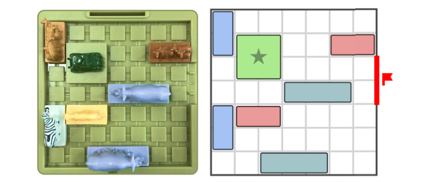
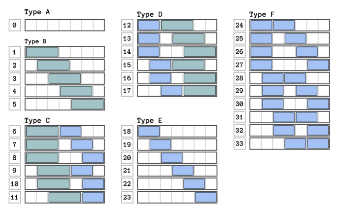
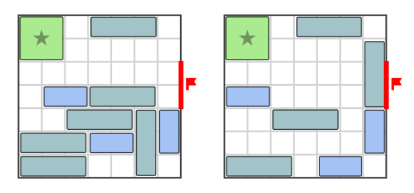
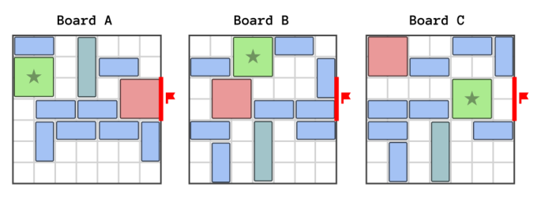
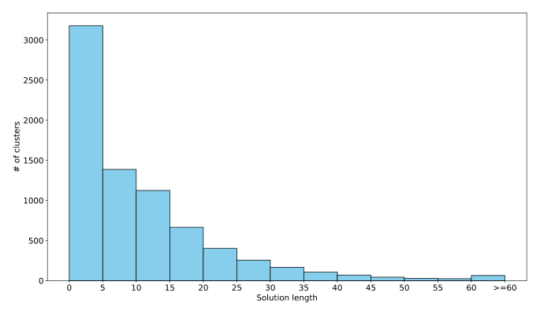
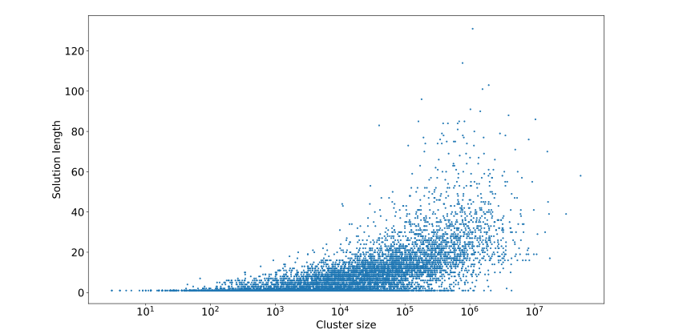
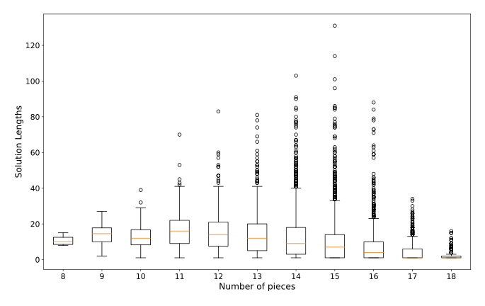
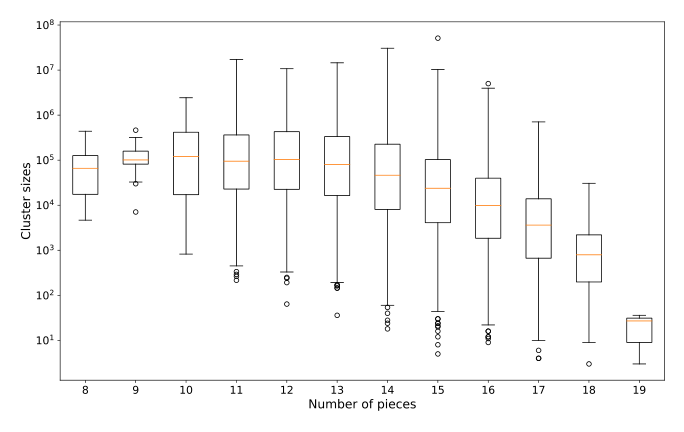
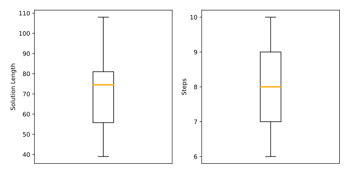

# Using Effective State Representations and Search to Identify Interesting Safari Rush Hour Puzzle Instances

Jose A. del Solar-Zavala<sup>1,2</sup> (Graduate Student Member, IEEE), Michael Buro<sup>3</sup>, and Nicolas A. Barriga<sup>2</sup> (Member, IEEE)

1. Doctoral Program in Engineering Systems, Faculty of Engineering, Universidad de Talca, Curico 3340000, Chile
2. Department of Interactive Visualization and Virtual Reality, Faculty of Engineering, Universidad de Talca, Talca 3460000, Chile
3. Department of Computer Science, University of Alberta, Edmonton, AB T6G 2E8, Canada

Corresponding author: Nicolas A. Barriga (nbarriga@utalca.cl)

Received 29 July 2026, accepted 20 August 2026, date of publication 28 August 2026, date of current version 3 September 2026. Digital Object Identifier 10.1109/ACCESS.2026.3728357. © 2026 The Authors. This work is licensed under a Creative Commons Attribution 4.0 License (https://creativecommons.org/licenses/by/4.0/).

Nicolas A. Barriga's work is supported by Fondo Nacional de Desarrollo Científico y Tecnológico (FONDECYT Iniciación) under Grant 11220438. Jose A. del Solar-Zavala's postgraduate studies are supported by the National Agency for Research and Development (Agencia Nacional de Investigación y Desarrollo, ANID Chile) through ANID-Subdirección del Capital Humano, Doctorado Nacional under Grant 2023-21231709. Powered@NLHPC: This research was partially supported by the supercomputing infrastructure of the NLHPC (ECM-02).

**Abstract.** Players find solving puzzle game instances engaging, but have no incentive to replay them once they are solved. Additionally, puzzle games often present vast search spaces that are impractical to explore exhaustively. Searching for possible interesting instances in these spaces can aid puzzle designers in offering players novel challenges that can help keep them engaged. Different algorithmic strategies, known as Procedural Content Generation (PCG), can be applied, which require a representation that enables the algorithm to explore the game's state space effectively. This paper presents different PCG approaches to traverse the state space of combinatorial grid-based puzzles, which we demonstrate on Safari Rush Hour. We introduce an enumeration system that groups states into clusters represented by an integer value, facilitating exploration. Our methods traverse entire clusters in parallel and can identify boards within them based on metrics such as difficulty or diversity. We compare the effectiveness of these approaches in exploring the state space of the commercial puzzle game Safari Rush Hour and analyze the clusters explored based on solution length. The results show that a search at a cluster level helps us explore more states in less time without losing information compared to solving each state individually. Furthermore, we analyze topological features of clusters such as size, and number of pieces which can influence the solution length. These observations create opportunities for search-based procedural content generation in puzzle games. By identifying and prioritizing promising clusters, we can achieve better results more efficiently.

**Index terms:** Heuristic search, puzzle games, procedural content generation, representation, combinatorial puzzles, state space exploration, IDA*, retrograde analysis, safari rush hour.

## I. INTRODUCTION

Combinatorial puzzle games often feature vast state spaces that are infeasible to explore exhaustively because of time and memory constraints. While players enjoy solving puzzle levels, they typically have limited replay value once a solution is discovered. These characteristics make the automatic generation of puzzle levels an appealing challenge [1]. Procedural Content Generation (PCG) refers to the algorithmic creation of elements that make up a game, which includes puzzle levels. In this research, we define PCG approaches as comprising three main components: a state encoding or *representation*, which is the manner in which the content and its rules are abstracted to be utilized in a PCG approach; a *generative algorithm*, which is the set of steps through which the state space induced by the representation is explored to generate content; and an evaluator, which is the method that assesses the quality of the generated content, thus guiding the algorithm towards a measurable goal and outlining its limitations. The major benefits of applying PCG methods in games include enhancing replayability, which can improve player engagement by providing fresh and novel content, and scalability, which allows the automatic creation of large amounts of content unfeasible to design manually.

The development of PCG has advanced considerably throughout the years alongside the development of Artificial Intelligence (AI). Initially, approaches employed constructive generators based on numeric seeds to generate novel challenges for every session in *Rogue* (1980) [2], while also serving as data compression methods in games such as *Elite* (1984), to achieve game worlds impossible to store directly with the technology at the time. These fast, deterministic methods have been effectively used to generate immersive game spaces, such as dungeons and labyrinths [3], [4]. Around the same time these methods surfaced, the graphics community developed algorithms based on fractals and noise that replicated natural processes [5], such as landscapes, rock formations, and vegetation textures. The use of these algorithms contribute to the generation of game environments [6]. In the past few decades, framing generation problems as optimization tasks to be solved through search algorithms has become a standard PCG approach, called search-based PCG [7]. More recently, the rise of machine learning [8] and deep learning [9] approaches, popularly coined as *generative AI* has also seen applications in PCG [10], [11], with techniques such as Generative Adversarial Networks (GANs) [12] and Large Language Models (LLMs) [13] being recent popular methods to generate content. Despite its consistent evolution tied to the development of AI technology, PCG research often focuses on the use of games as a testbed for novel generative algorithms, with the representation and evaluation components being secondary to most studies even though representation has been previously identified as a critical factor in search-based PCG approaches [14], as it can influence results related to computational efficiency, control, and the content that is generated by an algorithm [15].

In this article, we propose a method for representing game states for combinatorial grid-based puzzles. Besides the aforementioned interest in PCG in puzzle games, most of them also present state spaces that are big enough as to not make their exploration trivial, due to their combinatorial nature. Our key contributions include an approach to structuring the state space of combinatorial grid-based puzzles by grouping up to millions of states into a single cluster, where each cluster can be represented by an integer value. This approach facilitates exploration and iteration through the state space. We propose and compare two strategies for state traversal, along with comparing the representations used for each one: (1) systematic iteration and solving each board within a cluster, and (2) applying retrograde analysis, which simultaneously solves multiple instances at the same time.

We validate this approach by applying it to the combinatorial puzzle game Safari Rush Hour (see Figure 1), with the objective of generating difficult boards, which is estimated through the number of moves required to solve the puzzle (solution length). Although other methods of automatic difficulty estimation exist, such as entropy [16], [17] or statistics from search-based puzzle solvers [18], solution length is commonly used in sliding puzzles [19], [20] and has been shown to have a strong correlation with official labels of difficulty by designers [21] and perceived difficulty in the original Rush Hour [22]. We compare our representation with two other board representations. Our proposal is generic enough to be applied with other heuristics, and we also provide an analysis of the features of the game that might influence the difficulty of the case study.



*Figure 1: An example board of Safari Rush Hour. The left image depicts the game's physical version, while the right image shows the abstraction used in this article. The objective is to slide the pieces across the grid, clearing the path so that the green square piece, which represents the explorer rover, passes through the exit line.*

```
a . . . . . .
a R R . . b b
. R R . . . .  <exit
. . . c c c .  <exit
d e e . . . .
d . . . . . .
. . f f f . .
```

(Right-hand board of Figure 1 as text: `R` = rover ($2\times 2$), `a`, `b`, `d`, `e` = $2\times 1$ pieces, `c`, `f` = $3\times 1$ pieces, `.` empty, exit on the right edge of rows 3-4. The same board appears in Figure 2.)

The remainder of this document is organized as follows: Section II reviews prior work on PCG and how content representation, generation, and evaluation has been approached for puzzle games. Section III broadly introduces the representation approach, and the retrograde analysis algorithm for state space traversal. Section IV describes the clustering approach, the retrograde analysis solver, and the board representations for comparison applied to Safari Rush Hour. Section V presents and discusses the results obtained from exploring the state space induced by the proposed representation, and an analysis of the features of the encountered clusters. Finally, Section VI provides concluding remarks and outlines potential directions for future research.

## II. BACKGROUND

This section provides background on PCG for puzzle game levels. An eleven-category taxonomy has been previously proposed in the literature [1], aiming to group puzzles based on the method of interaction with the player. This research focuses on only a subset of these categories, specifically Sokoban-style, Sliding, Logic, and Tile-matching puzzles, as they align with our clustering proposal. We refer to the category of puzzles that includes these types as *combinatorial puzzles*. They share the features of single-player puzzle games played on constrained grids, with each element containing one item from a finite (usually small) number of possible elements to reach a particular state (or set of states). Examples include games such as Sokoban, Rush Hour, Fling!, Sudoku, Bejeweled and Safari Rush Hour.

### A. GENERATORS FOR COMBINATORIAL PUZZLES

Early work on the generation of instances for combinatorial puzzle games utilized constructive approaches, such as the examples of Rogue and Elite described in the previous section. In combinatorial puzzles a classic example of a puzzle game which has seen a myriad of approaches is Sokoban, a game where a character pushes boxes around a constrained grid towards different objectives, is one of the major domains explored in puzzle game research. Initial constructive approaches generated instances by using a base map of filled space and then randomly placing precomputed patterns of empty space. In the resulting structure, goals, boxes and the player characters are placed in feasible positions. The instances are evaluated based on the moves required to solve them, removing unsolvable and trivial instances from the final database [23].

Variations of this approach have improved the efficiency and quality of generated instances by systematically searching for the states farthest away after initial generation steps [24], [25]. Results have shown that players are as engaged when solving these generated levels as when solving human-generated ones [26]. Other studies applied Monte Carlo Tree Search algorithm to generate engaging, solvable instances for players [27]. Recent work has generated difficult Sokoban instances using a backward greedy best-first search with novelty and difficulty metrics, starting from human-created instances [28]. Others utilize a hybrid approach where a level template is constructed, and the positioning of the objectives is optimized through evolutionary algorithms [29]. Constraint-based approaches such as WaveFunctionCollapse are also popular for the procedural generation of puzzle game levels [30], [31]. Various generative AI approaches such as Generative Adversarial Networks (GANs), Variational Autoencoders and hybrid models have been compared with reinforcement learning [32] to generate Sokoban levels of high quality and diversity [33]. LLMs have also risen as powerful tools in recent years that can be used to generate puzzle games including Sokoban [20] and other domains such as Connections [34].

In domains related to Safari Rush Hour, such as the classic Rush Hour game, several studies have attempted to exhaustively generate all board configurations [35], [36], [37]. These exhaustive databases have been used to train predictors of solvability, and through transfer learning, attempt to generalize to boards of different sizes [38]. Additionally, some researchers have made a case for not dismissing complete search (uninformed or informed) for combinatorial puzzles [39], [40], arguing that good abstractions, constraints, parallelism, and current computational power can allow the use of exhaustive search. Recent exhaustive efforts in puzzle games have used search-based PCG to exhaustively explore the state space of constrained puzzle games such as Snakebird [39] and Tangram [41].

### B. EVALUATORS FOR COMBINATORIAL PUZZLES

An automatic level generator is expected to produce instances that offer value to players, often evaluated by how effectively a level maintains player interest [42]. Several criteria have been proposed to assess what makes games engaging, including diversity [43], which measures the variety the content experienced by the player, and difficulty, which is considered an important factor influencing player interest and is frequently used when evaluating generated levels [16]. However, estimating difficulty is challenging because collecting data from human players is costly [44], and perceived difficulty is inherently subjective [45]. Consequently, many PCG approaches rely on computational proxies for difficulty.

Various methods have been proposed to automatically estimate difficulty in puzzle games, including entropy of the solution path [16], [17], agent-based calculations [46], and state space analysis [44]. Among these, the shortest path length between an initial and a goal state [47] is a commonly used metric, and it has been applied to several puzzle domains, including sliding [19], [21], [48], Sokoban [20], [49] and chess puzzles [50]. In particular, previous work has shown that the optimal solution length is related to the perceived difficulty in Rush Hour puzzles [22]. Although alternative metrics may better reflect human perceptions of difficulty in some settings [16], solution length also often exhibits a strong correlation with difficulty labels assigned by game designers in sliding puzzles [21]. Consequently, in this work we adopt solution length as a computational proxy for difficulty, while recognizing that it represents only one factor contributing to player interest.

Most generative algorithms cannot guarantee the solvability of a generated puzzle instance. Thus, they often need to be solved as part of their evaluation, which can be slower compared to the evaluation methods in other domains such as constraint satisfaction problems. Various search algorithms can be used to find a solution if it exists. Search algorithms can be classified as complete or incomplete based on whether they guarantee the existence of an optimal solution.

Complete algorithms are typically applied to simpler problems, while incomplete methods are more suited for larger state spaces. Additionally, the algorithms can be categorized as informed or uninformed, depending on whether they use heuristics to avoid exploring unpromising branches or rely on brute-force methods to go through the state space exhaustively [39]. The choice of heuristics depends on their suitability for a given problem. While simpler complete algorithms such as Breadth-First Search (BFS) and iterative deepening search have been widely applied, incomplete approaches such as Evolutionary Algorithms are often used in more complex domains. Complete uninformed algorithms, such as BFS, can solve generated instances for combinatorial puzzle games [23], [39], with parallelization and external storage being used to mitigate time and memory constraints when solving larger instances [51].

More commonly, a complete informed heuristic search is used when exhaustive enumeration of the state space is infeasible. For example, IDA* with standard enhancements [52] or A* with pattern databases [53] have been used to solve Sokoban instances. However, while these approaches are mainly helpful in solving single instances, they can be slow for evaluating large numbers of generated boards. In particular, algorithms such as BFS and A* tend to not scale well as evaluators, and alternatives such as IDA* can take too long to find solutions if they are not located on the most promising search paths.

### C. REPRESENTATIONS FOR COMBINATORIAL PUZZLES

One of the problems recently outlined in PCG for puzzle games is the lack of studies focusing on developing and assessing adequate representations for generative tasks [54]. This raises uncertainty about whether existing representations in the literature yield optimal results for PCG problems. For Safari Rush Hour, prior research has compared the efficiency of representations when using different metaheuristics, showing that choosing an appropriate representation depends on the experimental conditions [55]. By assessing and evaluating representations, the gap can be bridged by providing researchers and practitioners with more informed choices. Such advancements could enhance the state of the art in exploring combinatorial puzzles and benefit other combinatorial optimization problems, which already use similar techniques to the ones applied in PCG [56], [57].

In contrast, in related areas of AI research such as heuristic search the proposal of adequate representations has historically been a relevant research topic [58], with applications in improving the efficiency of planning approaches, which is still relevant to this day [59], [60]. In combinatorial optimization, it is argued that part of the points of intervention to guide algorithms is the definition of neighborhood operations [61]. Studies have compared conventional codifications, such as the case of binary individuals and floating-point numbers for dynamic control [62]. The improvement of representations has seen relevancy in the development of efficient solvers for Sokoban, combining expert domain knowledge with concepts such as macro moves to reduce the branching factor of the search [52], [63].

For PCG, representations have been labeled as ranging from "direct" to "indirect" [64]. For the former, an example would be the use of matrices to represent 2D grid-based maps, with each element corresponding one-to-one to a game piece [32]. The latter considers approaches such as constructing entire levels from a numeric seed. More direct representations can encapsulate a game's state space with minimal loss of information and typically offer high locality, where small changes in a representation result in minor content variations. In contrast, indirect representations have a higher loss of information and often have low locality, where small changes can lead to substantial changes in the content [64]. A common mistake is assuming that a direct representation would always be the best choice, but a highly direct representation makes it difficult to find diverse solutions that differ from the original content. Conversely, a highly indirect representation makes it difficult to control the generation. Finding a state representation that balances the locality and the search space yielded by each representation is not an easy task. For instance, previous work has identified three general types of representations— sequences, grids, and graphs—for machine learning PCG [8]. However, these studies primarily detail how these data structures are used for state representation without comparing their differences in the generation of content.

In the context of puzzle games, a variety of representations with different levels of locality have been compared for generating maze-like levels through search-based PCG, highlighting differences in the resulting content [14]. For games with levels that can be represented as tile maps, such as Sokoban, various state space exploration strategies have been proposed, with applications with tree search [15] and reinforcement learning methods [32], where generative agents use different rules to generate the content, altering the final output level.

Various approaches have also been used to fully enumerate the state space of Rush Hour, each utilizing distinct state representations. These include binary decision diagrams [35] and the enumeration of all possible row and column combinations [36]. The latter approach inspired the creation of a complete database of initial 6 × 6 Rush Hour boards [37]. Representations for boards of arbitrary size have also been proposed [65]. The first representation utilizes a grid to determine whether pieces are present on the board, with the grid values representing empty spaces or parts of a piece occupying that space. For this representation, states can be invalid if the adjacent cells of an occupied cell do not match the state of the occupied cell. On the other hand, the second representation is based on listing the properties of the pieces without explicitly stating the presence or absence of determined pieces in a grid space. Although both can represent the same states, the total space they induce can differ by several orders of magnitude compared to the set of valid states from the original game.

However, there is still a lack of research focusing solely on representations used for PCG of puzzle game levels, focusing on the development and application of novel generative techniques instead. Moreover, there is a lack of an explicit methodology to use to select a representation in the literature, with most research using ad hoc solutions. In this research, we define a representation that can be used in sliding puzzles and use it to generate instances for the Safari Rush Hour case study, with applications in other similar games.

## III. METHODS

In this section, a general overview of the cluster representation proposal is presented alongside an analytical comparison with commonly used representations for combinatorial puzzle games used in the literature. We also propose a retrograde analysis method to analyze the instances generated through this representation.

### A. CLUSTER REPRESENTATION PROPOSAL

Combinatorial puzzle games are usually played on grids of size $n\times m$. The game pieces are distributed across the grid, occupying a fixed set of cells along a row and/or column. By decomposing the board into its constituent rows and columns, it is possible to analyze them independently to determine the $r$ ways of arranging the pieces in a row, and the $c$ ways of arranging the pieces in a column. Each one of these arrangements can be enumerated, and the board grid can be represented as a permutation of these enumerations. For square grids, the number of total permutations is $r^n c^m$, corresponding to an upper bound of the total state space. It is trivial to see that depending on the game, this value can be simplified to $(rc)^n$, if $n=m$, or $r^{n+m}$, if $r=c$. The actual state space, however, is generally much smaller because many combinations correspond to illegal states, i.e. boards that violate the rules of the game and therefore cannot be physically constructed. We exemplify this method using Rush Hour [37], where $n=m=6$, as the game is played on a $6\times 6$ board, and $r=c=22$, as only the arrangements of rows and columns with at least one space available are considered, resulting in $22^{12}$ permutations. This upper bound can be reduced by considering certain constraints from the game, such as the car that has to exit has to be placed in the second row and must be the only horizontal piece in that row, reducing the bound to $22^{11}\times 5$. Other rules that lower the upper bound are the number of allowed pieces per board, and the removal of permutations which cause pieces to overlap.

This approach can also potentially apply to similar combinatorial puzzle games, such as Anti-Virus,<sup>1</sup> where pieces also slide across a grid and a specific piece must also reach a target position. The main difference is that the pieces move diagonally as opposed to horizontally and vertically. The proposed enumeration approach can be adapted to encode the diagonals from the grid instead of the rows and columns. Alternatively, the rows and columns from a rotated board can be considered.

Sokoban is another puzzle game example where a similar approach can be used to encode states, with the difference being that the grid is not always square or even convex. In this game, the objective is to move boxes to their designated positions. To use the proposed encoding, an alternative is to encode the rows and columns independently for each room. Other options include padding the shortest part of the grid (rows or columns) to simulate a square grid, thereby circumventing the need for additional values for non-square grids, albeit at the cost of vastly increasing the number of invalid board configurations.

Representations structure the state space and define the possibilities that an algorithm can explore. In puzzle games, states can be related to one another in various ways, such as by being reachable from one another or sharing similar piece distribution. A representation that can express relationships between states offers several potential benefits, including the ability to cluster related boards based on these relationships, which can drastically reduce the state space and improve the effectiveness of exploration. This is useful for games where the state space presents large unfeasible regions, as a valid cluster can be used to describe multiple states at once, which also can also help minimize redundancy of the search. Clusters tend to be independent, where a set of moves applied to the state within a cluster cannot reach a state from another, allowing for parallelization of the search.

Although the method to cluster boards can vary between the puzzle domains being explored, we add to the previous Rush Hour example, where two different attempts to cluster Rush Hour boards have been proposed [36], [37], and are used as inspiration for the clustering method we apply to Safari Rush Hour. In both methods, the enumeration of rows and columns previously mentioned is extended, instead of separating by every possible distribution of all pieces, the rows and columns are instead enumerated by the pieces that are present in them, regardless of position. This works for this type of game as the pieces cannot leave the row or column they are initially placed in, only move across it. Using this logic, boards can be grouped structurally by using the distribution of rows and columns, or by obtaining all connected components from solving backwards from a goal state.

Notes:
1. https://www.smartgames.eu/uk/try-smartgames-online/one-player-games/anti-virus

### B. RETROGRADE ANALYSIS

As mentioned in Section II, in the context of measuring the difficulty of a generated puzzle instance using the shortest solution path metric, search algorithms can be employed to solve instances, but tend to not scale efficiently. An alternative approach for mitigating the scalability problem is solving many instances simultaneously at the cluster level, for which the *retrograde analysis* approach is presented, where pseudo code can be seen in Algorithm 1.

The algorithm, in its minimization form, operates by first identifying the goal states within the cluster, and marks them with a value ($V$) of 0, initializing all other states within the cluster to $\infty$. If no solutions are found, then the algorithm returns that the cluster has a value of $\infty$, meaning that it is unsolvable. For all the non-solution states, the algorithm iteratively calculates a local value for the metric ($v_{local}$), representing the cost of a single transition, such as a constant 1 for solution length, or derived from the number of decisions for cumulative entropy [16], [17] or branching factor.

Then, the total value for the state is calculated by finding $v_{min\_child} = \min(v_{local} + V[c])$, for every successor $c$. If the value of $v_{min\_child}$ is less than the current stored value of $V[state]$, then the value is updated for that state. This inequality breaks positive-cost cycles, as states evaluating themselves through a loop will yield higher costs and fail the update condition. This iterates until the map $V$ stabilizes and suffers no more changes in an iteration. However, to guarantee convergence in edge cases where zero-cost or negative-cost loops exist, an explicit cycle-breaking mechanism must be introduced, such as bounding the loop to a maximum of $|S|-1$ iterations, which is the longest acyclic path in a state space $S$. If the metric is constant, such as solution length (where line 20 returns 1 for every state), the algorithm can be optimized by removing the states from the open set as their values $V$ are assigned. As the values stored in $V$ only change in a single direction, the algorithm will always converge. The return value ($M_{max}$) is the maximum of the minimum metrics calculated, which in using solution length is the maximum value of the shortest path to a goal, or the shortest distance required for the state that is furthest apart from a goal state.

```
Algorithm 1  Retrograde Analysis (Metric minimization)
 1: V <- {}                                  ▷ Map of states to their metric values
 2: open <- {}                               ▷ Set of unsolved states
 3: hasGoal <- false
 4: for state ∈ S do                         ▷ Initialization
 5:     if IsGoal(state) then
 6:         V[state] <- 0
 7:         hasGoal <- true
 8:     else
 9:         V[state] <- ∞
10:         open <- open ∪ {state}
11:     end if
12: end for
13: if not hasGoal then return ∞
14: end if
15: valuesChanged <- true
16: while valuesChanged do
17:     valuesChanged <- false
18:     M_max <- 0
19:     for state ∈ open do
20:         v_local <- LocalMetric(state)    ▷ 1, if metric is solution length
21:         v_min_child <- ∞
22:         for child ∈ GenerateSuccessors(state) do
23:             v_min_child <- min(v_min_child, v_local + V[child])
24:         end for
25:         if v_min_child < V[state] then
26:             V[state] <- v_min_child
27:             valuesChanged <- true
28:         end if
29:         if V[state] ≠ ∞ then
30:             M_max <- max(M_max, V[state])
31:         end if
32:     end for
33: end while
34: return M_max
```

The time complexity of the algorithm is $O(n^3)$ in its worst case, where every node within the graph is connected to each other (having a total of $n^2$ edges) and $V$ converges after a maximum $n$ iterations. However, this theoretical upper bound is rarely encountered in practical applications, while the average time complexity is closer to $\Theta(d\cdot b\cdot n)$, where $d$ is the number of iterations, which corresponds to the solution length when it is being used as the objective metric, while $b$ is the average branching factor of the states in the cluster. For example, in a Safari Rush Hour cluster $C$ (see Section IV), with a solution length of $d_C = 15$ moves, a branching factor $b_C = 8.21$ and $n_C = 8{,}498$ states would have a worst case time complexity of $8{,}498^3$, however in practice $1{,}045{,}370$ evaluations (calls to line 23) are required for $V$ to converge, which is consistent with $d_C\cdot b_C\cdot n_C$.

Note that the algorithm marks the minimum metric for every state within the cluster, and returns the maximum of these values, therefore this also provides the maximum value among every connected component within the cluster. At the cost of a larger space complexity, paths can be stored for every state and updated based on the values of $v_{min\_child}$ to find the minimum metric for every connected component within the cluster.

## IV. SAFARI RUSH HOUR PUZZLE GENERATION

In this section, we apply the concepts described above to the combinatorial puzzle game Safari Rush Hour, which is derived from the previously mentioned Rush Hour game. We chose this game for several reasons: Its state space is large enough to prevent complete enumeration, yet not so large as to make its exploration impractical. Additionally, although the Rush Hour state space has been previously fully enumerated [35], [36], which lead to a database of all states of size $6\times 6$ [37]. However, these methods fail to scale to larger board sizes, such as those in Safari Rush Hour. The game also introduces pieces that can move vertically and horizontally, occupying multiple rows and columns simultaneously, making the game more complex than Rush Hour. The following subsections provide more details about Safari Rush Hour's rules, our state representation and method used for generating challenging boards. The methodology is summarized in Figure 2.


*Figure 2: Graphical summary of the approach taken in this study to explore the state space of Safari Rush Hour. (a) shows an abstract graphical representation of the game used in this study. (b) shows the proposed enumeration system for rows and columns. (c) shows the result of the ranking algorithm for the board, which can be unranked back to (b). (d) shows that boards with similar piece distributions can be grouped into clusters, which can then be solved through search algorithms illustrated in (e), obtaining statistics that can be analyzed as portrayed in (f).*

Data in Figure 2 (a)-(c): the board is the one of Figure 1. Column indices (left to right) are 26, 0, 0, 0, 0, 0, 0; row indices (top to bottom) are 0, 23, 0, 4, 19, 0, 3. The array in (c) is the columns followed by the rows, and its base-34 rank is $\texttt{0x725C8627BB1673A4CF}$ (checked: Algorithm 2 with possibleValues = 34 gives exactly this value). Cleaner's note: panel (b) labels the bottom row "26", but the piece there sits on cells 2-4 (index 3), and the array in (c) and the rank both use 3, so the "26" is a drawing error.

### A. GAME DESCRIPTION

The game's objective is for the rover piece to move through the exit marked red in Figure 1. This is achieved by sliding the various pieces on a $7\times 7$ square grid. The exit location stays the same across all levels. In Safari Rush Hour, a move is defined as sliding a single piece any distance on the board. Whether a piece moves one square or many squares in a single slide, it is still only considered one move. A solution is any sequence of moves that causes the rover to cross the goal line. In addition to the mandatory rover, a Safari Rush Hour board can feature up to 18 other pieces representing six animal types. Non-square pieces can be placed either horizontally or vertically and can only move in the same orientation in which they are placed, akin to Rush Hour. Square pieces, which include the rover, can move in both horizontal and vertical directions.

Although pieces represent different animals, those of the same size are functionally identical, which allows for pieces to be classified based on the space they use on the board rather than the animal they represent. The rover, a square $2\times 2$ piece, differs from other pieces of this size because it is the only piece that can exit the board. A Safari Rush Hour state is defined by distributing non-overlapping pieces on an empty board, including exactly one rover. There are in total 11 pieces of size $2\times 1$, 5 of size $3\times 1$, 2 of size $2\times 2$ and a single rover.

### B. REPRESENTATION

As described by the methods in Section III-A, a Safari Rush Hour state can be decomposed into rows and columns, with each being empty or populated by non-square pieces. In this case, the decomposition does not consider square pieces that use more than one row or column simultaneously. The pieces can be arranged in 45 distinct ways within a single row or column, of which 11 do not leave enough space for a hypothetical rover to move across, and thus are omitted from the enumeration due to effectively shrinking the board, which results in uninteresting states. The remaining 34 valid arrangements are labeled and indexed in Figure 3. Using this, the vertical and horizontal pieces of a Safari Rush Hour state can be represented as a sequence of these indices. This representation can be compressed into an integer by treating every index of the array as a digit in base-34.

There are different alternatives that can be used to encode the position of square pieces. One of them is to consider the distribution of the parts of the square pieces in the enumeration of rows and columns, increasing the number of types and indices. As this approach would largely increase the size of the state space, for the purposes of this research we opt to encode them separately from the rest of the board. Using the top-left of each piece as their position. There are 36 positions within the grid where each square piece can be placed, meaning that up to three numbers between 0 and 35 describes the position of a square piece on the board. In our implementation, for a board with a square piece configuration $(r, s_1, s_2)$, we check if the configuration $(r, s_2, s_1)$ was previously encountered during exploration, as those boards are functionally identical.



*Figure 3: Piece configurations for a row or column, each labeled with a corresponding index and grouped according to the pieces they contain. The first index (0) corresponds to an empty row or column, classified as type A. Indices 1-5 represent the different ways a single $3\times 1$ piece can be distributed along a row or column and are classified as type B. Indices 6-17 describe how one $3\times 1$ piece and one $2\times 1$ piece can be distributed. When the $3\times 1$ piece appears first, the configuration is type C; when the $2\times 1$ piece appears first, the type is D. Indices 18-23 represent the different ways a single $2\times 1$ piece can be distributed along the row or column (type E). Finally, indices 24-33 describe the possible distributions for two $2\times 1$ pieces (type F).*

The 34 arrangements of Figure 3 as text (cells 0-6 left to right, or top to bottom for columns; `T` = cell of the $3\times 1$ piece, `d` = cell of a $2\times 1$ piece, `.` = empty). Cluster type digits: A=0, B=1, C=2, D=3, E=4, F=5.

| Index | Type | Cells | Index | Type | Cells | Index | Type | Cells |
|---|---|---|---|---|---|---|---|---|
| 0 | A | `.......` | 12 | D | `ddTTT..` | 24 | F | `dddd...` |
| 1 | B | `TTT....` | 13 | D | `dd.TTT.` | 25 | F | `dd.dd..` |
| 2 | B | `.TTT...` | 14 | D | `dd..TTT` | 26 | F | `dd..dd.` |
| 3 | B | `..TTT..` | 15 | D | `.ddTTT.` | 27 | F | `dd...dd` |
| 4 | B | `...TTT.` | 16 | D | `.dd.TTT` | 28 | F | `.dddd..` |
| 5 | B | `....TTT` | 17 | D | `..ddTTT` | 29 | F | `.dd.dd.` |
| 6 | C | `TTTdd..` | 18 | E | `dd.....` | 30 | F | `.dd..dd` |
| 7 | C | `TTT.dd.` | 19 | E | `.dd....` | 31 | F | `..dddd.` |
| 8 | C | `TTT..dd` | 20 | E | `..dd...` | 32 | F | `..dd.dd` |
| 9 | C | `.TTTdd.` | 21 | E | `...dd..` | 33 | F | `...dddd` |
| 10 | C | `.TTT.dd` | 22 | E | `....dd.` | | | |
| 11 | C | `..TTTdd` | 23 | E | `.....dd` | | | |

(In type F, `dddd` is two adjacent $2\times 1$ pieces. Every kept arrangement leaves at least 2 free cells, not necessarily adjacent, so pieces can still slide. Cleaner's count: a 7-cell line admits 44 ordered arrangements of $2\times 1$/$3\times 1$ pieces, of which 10 leave fewer than 2 free cells (two $3\times 1$: 3; three $2\times 1$: 4; one $3\times 1$ plus two $2\times 1$: 3), whereas the paper says 45 and 11; the 34 kept arrangements agree either way.)

Not every sequence of indices represents a legal board, as they may contain pieces that overlap or more than are available in the game's physical version. These are called *illegal boards*, as they cannot be constructed with the elements provided by a physical copy of the game. Even if a board is legal, it might not have a solution, meaning that no sequence of moves can reach a goal state. The group of illegal and unsolvable boards is referred to as *invalid board configurations*. Conversely, a valid board configuration is one that is physically constructible and a reachable goal position. Figure 4 shows some invalid configuration examples.

For this research, we cluster types based on the piece configuration types (A-F) from Figure 3, and a suffix number that determines the number of non-rover square pieces. If two boards share the same piece distribution and number of square pieces, then they are part of the same cluster. As a representative of the cluster, we use the board that requires the most moves among the solvable boards to reach a goal position. This categorization reduces the number of indices used from the original 34 to just 6. A board cluster for Safari Rush Hour is then defined as a sequence of these six indices for each row and column accompanied by a number describing the presence of non-rover square pieces, considering that the rover is mandatory for every board.



*Figure 4: Example of invalid board configurations for Safari Rush Hour. The left board cannot be constructed with the pieces in the standard game, as it contains six pieces of size $3\times 1$, making it an illegal board. The right board cannot be solved, as the exit is blocked by an obstacle that cannot be removed, making it an unsolvable board.*

```
illegal (six 3x1)    unsolvable
R R . a a a .        R R . a a a .
R R . . . . .        R R . . . . b
. . . . . . .  <exit . . . . . . b  <exit
. b b c c c .  <exit c c . . . . b  <exit
. . d d d e f        . . d d d . e
g g g h h e f        . . . . . . e
i i i . . e .        f f f . g g .
```

(Text grids, rows top to bottom; `R` = rover ($2\times 2$), each other letter one $2\times 1$ or $3\times 1$ piece, `.` empty; the exit is on the right edge of rows 3-4 (counting from 1). In the right board the vertical $3\times 1$ piece `b` in the last column can only slide between the top edge and piece `e`, so it always covers row 3 or 4.)



*Figure 5: Example of a board cluster for Safari Rush Hour. All boards are in the same cluster because their rows and columns follow the same type of piece arrangement, and the boards also have the same number of square pieces. Boards A and B belong to different connected components within the cluster because they are not reachable from each other through any sequence of legal moves. Board C, however, is in the same connected component as Board B because they are reachable from each other. A and C belong to different connected components within the same cluster by transitivity.*

As with individual boards, entire clusters can be deemed illegal because every possible board arrangement within it is physically impossible to construct. Clusters can also be unsolvable if none of the boards within it have a solution. Although boards can belong to the same cluster, it does not confirm that two states within the same cluster are reachable from each other, as combination of rows and columns can still block certain moves. For this, we note that a connected component is a set of states within a cluster that are confirmed reachable from one another, where a cluster can hold multiple connected components. To find the connected component that a certain state belongs to within the cluster, search algorithms such as BFS can be employed to exhaustively generate all possible moves going backwards and starting from a goal position. A cluster having a solution does not mean that every connected component within it will have a solution, but clusters without a solution do not have connected components within it that have a solution. Figure 5 shows examples of boards that belong to the same cluster, but to different connected components.

### C. STATE SPACE SIZE UPPER BOUND ESTIMATION

An advantage of clustering based on piece distribution rather than reachability is that an upper bound of the state space cardinality can be estimated more easily than over an unknown number of connected components per cluster. This, in turn, allows us to better estimate the required computational resources. Using the proposed state representation, it is possible to estimate an upper bound on the total number of Safari Rush Hour states. Using a similar analysis method as the examples in Section III, Safari Rush Hour boards can be described as a combination of 14 indices (as it is played on a board of size $7\times 7$), which range from 34 possible values (see Figure 3). Then, using our representation there are in total $34^{14}$ permutations of indices.

As for the square pieces, each have initially 36 possible positions where they can be placed, as the position is considered the top left of the piece, thus they cannot be placed on the last row or column. Also, no square pieces can overlap, so it can be deduced that there are 36 positions for when only the rover is present, $36\times 35$ for the rover and another square piece, and $36\times 35\times 34$ for the rover and two square pieces. However, the order of the two square pieces does not matter, therefore the total positions can be reduced to $(36\times 35\times 34)/2$, which is around 45.91% less than without considering restrictions ($36^3$). Therefore, the upper bound for all the boards using this representation is $36\times 34^{14}$ ($\approx 9.93\times 10^{22}$) for boards with a single $2\times 2$ piece (the rover), $36\times 35\times 34^{14}$ ($\approx 3.48\times 10^{24}$) for two $2\times 2$ pieces, and $(36\times 35\times 34)/2\times 34^{14}$ ($\approx 5.91\times 10^{25}$) possible board configurations for three $2\times 2$ pieces, a much larger space than $6\times 6$ Rush Hour ($22^{11}\times 5$, using a similar enumeration method). The estimated upper bound can be reduced by calculating the number of permutations of the board indices (0-33, see Figure 3) of length 14 that do not exceed the number of allowed non-square pieces (5 of size $3\times 1$ and 11 of size $2\times 1$), giving a total of $1.903\times 10^{18}$ ($\approx 0.07\%$ from $34^{14}$) permutations where this is the case, or $\approx (36\times 35\times 34)/2\times 1.903\times 10^{18}$ considering the square pieces.

For clusters, there are $6^{14}$ different type of permutations. Due to the square pieces, each of these permutations has three different versions based on the number of square pieces. Thus, the upper bound is calculated $3\times 6^{14}$ ($\approx 2.35\times 10^{11}$), greatly reducing the space from the total boards. By applying a similar cluster method to the original Rush Hour, we find $6^{11}$ total permutations, meaning that there is an upper bound of around $3\times 6^3$ times more clusters in Safari Rush Hour than the original by considering this representation. Using a similar method to find the boards that do not exceed the number of pieces, we find that $5.88\times 10^9$ clusters do not exceed the number of allowed pieces. Including the square pieces, brings the total legal clusters to $\approx 1.76\times 10^{10}$, which is 7.5% of the total cluster permutations expressed by the representation. Note that this calculation only considers the piece cardinality. Boards and clusters in the subset of 7.5% clusters with allowed pieces can still have individuals where boards are not constructible due to unavoidable piece overlap, which further reduces the number of legal boards and clusters.

To store Safari Rush Hour clusters in memory, around 38 bits of memory are required ($2^{38} > 3\times 6^{14} > 2^{37}$) for each cluster to store the raw, unique identifier. Algorithm 2 can be applied to encode the clusters as integers, where `possibleValues` represents the six types from Figure 3, and `arraySize` represents the number of indices in the arrangement (14 in Safari Rush Hour).

```
Algorithm 2  Ranking Algorithm
Input: indices[arraySize], possibleValues
Output: rank
1: rank <- 0
2: i <- 0
3: while i < arraySize do
4:     rank <- rank × possibleValues + indices[i]
5:     i <- i + 1
6: end while
7: return rank
```

As an example of the ranking process in Safari Rush Hour, cluster 0x1000_0 contains all boards described by unranking the number 0x1000 into rows and columns (giving the configuration 0, 0, 0, 0, 0, 0, 0, 0, 0, 3, 0, 5, 4, 4), and consider all possible positions for the rover and no other square pieces (due to the number 0 in the cluster identifier). Similarly, cluster 0x1000_2 contains all boards from unranking 0x1000, but with all positions possible for the rover and two regular square pieces. Conversely, the reverse mapping can be done by a similar process to the one described by steps (a) to (c) in Figure 2, where the rows and columns can be enumerated according to the cluster type described in Figure 3 (A-F), which are interpreted as digits in base-6. The cluster identifier then is a 14-digit sequence of these values. The second value (after the _ in the identifier) is just the number of non-rover square pieces in the board (0, 1 or 2).

(The PDF typesets these identifiers as "0 × 1000_0"; they are hexadecimal, 0x1000 = 4096, whose base-6 digits are 3,0,5,4,4, matching the configuration given. Cluster identifiers are therefore written as hex of the base-6 rank, then `_` and the number of extra $2\times 2$ pieces.)

### D. SEARCH AND EVALUATION OF SAFARI RUSH HOUR CLUSTERS

In this research, the interest is in evaluating the effectiveness of our proposed representation in finding instances that contain boards with long solution lengths, which we use as a proxy for difficulty. We acknowledge that the lack of validation of this difficulty proxy against human perceived difficulty is a limitation of the present work. Nevertheless, solution length provides a practical heuristic for guiding the exploration of clusters, and has been shown to correlate with perceived or designer-assigned difficulty in games from similar domains [21], [22].

With the proposed representation, the upper bound was calculated as $3\times 6^{14}$ clusters, from which around 7.5% ($\approx 1.76\times 10^{10}$) can be potentially constructed physically. To obtain the clusters to evaluate, we sample integers from a random uniform distribution (meaning that every cluster in the space has the same chance of appearing) as we attempt to evaluate if the representation is capable of finding instances with a high solution length without assumptions on the distribution. The obtained clusters are unranked through Algorithm 3, then we first check if its illegal first by counting the pieces, which can be done by mapping the unranked index to the pieces in Figure 3. For example, an unranked index value of 3 corresponds to type D, which has a $2\times 1$ and a $3\times 1$ piece according to the enumeration system (2 pieces), and this is checked and added for each of the 14 indices. If the number of non-square pieces exceeds the allowed number of pieces in the game, the cluster is marked as illegal. After passing the piece count check, a second legality check is conducted, where every possible permutation of board indices determined by the cluster types is tested to generate the valid boards. Following the previous example, for an index value of 3 in the unranked cluster, each distribution from 12 to 17 is tested in that row or column. The boards within the cluster that have overlapping pieces are discarded, and if all boards within the cluster are discarded, then the cluster is also marked as illegal.

After passing both legality checks, the clusters are solved through Algorithm 1. The results of this process is compared to using the same method, but solving each board within the cluster systematically through Iterative Deepening A* with Transposition Tables (IDA*+TT) [66]. The heuristic used for Safari Rush Hour with IDA*+TT is calculated as the number of pieces blocking the shortest path to the exit, plus the minimum number of moves the rover must make to reach the exit. Note that because the moves are a required part of the heuristic, and the other part is concerned with counting blocking pieces, it is trivial to understand that it is a consistent and admissible heuristic. It is important to note that both Algorithm 1 and IDA*+TT return the shortest distance between the furthest board within a cluster and a goal position, the difference is in the former solving simultaneously multiple boards within the cluster, while the latter solves every board systematically.

IDA*+TT is chosen over some other alternatives as it uses less memory than A* by only remembering the current path being traversed in a depth first search. Our implementation is also enhanced with the use of a cache memory to avoid redundancy when exploring solution paths. The results of generating through the use of the cluster representation is compared to other representations that can be used for boards of Safari Rush Hour, which are based on previous work on the subject [55]. A summary of the features of the representations is shown in Table 1.

*Table 1: Comparison between representations used to generate instances of $7\times 7$ Safari Rush Hour. For simplicity, these calculations do not consider invalid board configurations. $L$ refers to the number of pieces already on the board, as one of the neighbors considered is removing a piece.*

| | Cluster | RowCol | VarList |
|---|---|---|---|
| Upper bound of states | $2.351\times 10^{11}$ | $5.909\times 10^{25}$ | $7.846\times 10^{42}$ |
| Neighborhood size | 72 | 21,896 | $345 + L$ |

```
Algorithm 3  Unranking Algorithm
Input: arraySize, rank, possibleValues
Output: indices[arraySize]
1: i <- arraySize - 1
2: while i >= 0 do
3:     enumeratedIndices[i] <- rank mod possibleValues
4:     rank <- floor(rank / possibleValues)
5:     i <- i - 1
6: end while
7: return indices
```

The first representation that we compare against, which we call "Row Columns" (*RowCol*), is the indexation of rows and columns without clustering the boards. To generate boards using this representation, the indices are initialized as 0, then a random index is selected and randomized with values between 0 to 33 (see Figure 3). The board is tested for feasibility, and if the change would provoke the board to become illegal, the current board is returned, unless the failing piece is the rover, which in that case the board is marked as invalid. If the board is illegal, then another index is randomized. This process is repeated $n$ times, with $n$ being obtained randomly at the start being a number between 1 and 14 (the total number of indices). As for the case of square pieces, the position on the board is also randomized, along with the presence of the square pieces that are not the rover. The upper bound of states for this representation is calculated in Section IV-C as $(36\times 35\times 34)/2\times 34^{14}$, which is approximately $5.909\times 10^{25}$. By considering a neighborhood of swapping the value of one index to any other, or altering the position of the $2\times 2$ pieces (not the presence), then the neighborhood size can be estimated as $36\times 35\times 34/2 + 34\times 14 = 21{,}896$.

The other board representation that our cluster approach is compared to, which we call "Variable Piece List" (*VarList*), uses a list, where each element describes the properties of a piece (position, type and orientation). To generate instances using this representation, $n$ pieces are generated randomly and sequentially placed on an empty list, constrained so that at least one of these pieces is the rover. If during the addition sequence the next piece would cause the generation to fail due to overlapping positions or exceeding the allowed number of pieces, then the generation ends and the board is returned as completed (unless the piece causing the failure is the rover, which in that case the board is marked as invalid).

The upper bound of states for this representation can be calculated by first considering all positions as the top left of each piece, where $2\times 1$ pieces have 42 possible positions, since they can be placed either horizontal or vertical, there are 84 total possibilities for $2\times 1$ pieces. Similarly, $3\times 1$ pieces have 35 possible positions, and considering the orientations there are 70 total possibilities. Finally, $2\times 2$ pieces have 36 possibilities, as they do not consider an orientation. Then, the sum of possible pieces is $42\times 2 + 35\times 2 + 36 = 190$.

Considering there are 0 to 19 pieces in a Safari Rush Hour board, the upper bound is calculated as $\sum_{k=0}^{19} 190!/(190-k)!$ ($\approx 7.846\times 10^{42}$). By considering a neighbor for this representation as adding, removing or modifying a piece, then the neighborhood size can also be estimated. Adding a random piece on one of the 49 positions of any of the 3 types in any of the 2 orientation means there is an upper bound of 294 possible pieces to add; for modifying, there are 48 other positions on the board besides the current one, 2 other types of pieces to change to, and 1 other orientation, with a total of 51 possibilities; for removing, there is not a set value, as it depends on the number of pieces ($L$) on the board. Then, there are $345 + L$ estimated neighbors for this representation. Because individual boards are solved independently rather than in clusters, with a high chance of unrelated boards being generated, A* is used for both of these representations, trading higher memory usage for the ability to avoid node re-expansions.

## V. RESULTS AND DISCUSSION

This section reports the results from applying the methods from Section IV. These include the results from generating, and a comparison with other representations that can be used to generate Safari Rush Hour instances. We also provide an analysis on the features of the clusters obtained through our search.

### A. RESULTS FROM GENERATING INSTANCES

All of the found clusters evaluated are publicly stored in a GitHub repository.<sup>2</sup> Figure 6 shows a comparison between searching and solving instances of Safari Rush Hour using the representations and algorithms described in Section IV-D, compared to the RowCols and VarList representations that use an A* solver. Given a limit of 100,000 seconds (around 28 hours) of computation time individually to each method. The experiments were ran on an AMD Ryzen 7 2700X CPU @ 3.7GHz, with 32GB of RAM. All the approaches only solved boards and clusters respectively after checking for validity. As each instance was obtained randomly from a uniform distribution, and each instance is independent from one another. The hypothetical longest instance can be found at any moment in time during the duration of the experiments. To address this, we use a resampling approach where each data point is considered a time series, with the maximum solution length found and the time each algorithm takes to solve it. For every sample, an instance is randomly selected, without repetition, within the current resampling iteration, from the data obtained from the respective algorithm. Posterior to obtaining each shuffled sample, the results are averaged. The number of reshuffles conforms to recommendations from the literature, where the reshuffles ($B$) must conform to $\alpha(B+1)$ being an integer [67]. Due to the nature of the data, 399 reshuffles were enough to balance power loss and remove stochasticity from the statistical tests.


*Figure 6: Comparison of solution lengths of clusters achieved by systematically solving states using the RowCol representation (dotted line), VarList representation (dashdot line), and the cluster proposal representation. Boards obtained with the RowCol and VarList representations were solved using A\*, while for the cluster representation, all boards were solved using IDA\*+TT, and the Retrograde Analysis proposal (solid line). The $x$-axis shows the total computation time for each experiment in hours, with a maximum of around 28 hours or 100,000 seconds. The $y$-axis shows the average solution length reached by each algorithm during that time. The values were obtained by resampling our results 399 times [67], with the shaded areas representing an error of one standard deviation.*

(The plot's legend actually draws RowCol dashed and VarList dash-dot.) Approximate values read from the curves:

| Method | at 1 h | at 5 h | at 28 h (end) | ±1 SD band at end |
|---|---|---|---|---|
| Cluster, Retrograde Analysis | ~60 | ~78 | ~100 | ~95-105 |
| Cluster, IDA*+TT | ~40 | ~60 | ~86 | ~75-98 |
| RowCol, A* | ~24 | ~31 | ~54 | ~45-64 |
| VarList, A* | ~17 | ~21 | ~26 | ~24-27 |

The results obtained show that our cluster representation, combined with retrograde analysis tends to find instances with longer solutions faster than the other alternatives, which is followed by systematically solving each board within the cluster with IDA*+TT. RowCol using A* is in third place, which despite not using the clustering approach proposed, it is still based on the concepts explained of the enumeration of rows and columns in Section II-C, and shows to be faster than the alternative of using a simple list of pieces, which is in last place. The resampled data for the maximum length achieved by each generative method was evaluated for normality through the Shapiro-Wilk test with a significance level $\alpha = 0.05$, where the results of each method was found to not be normal with $p_{shap} < 0.01$. Due to this, the Kruskal-Wallis test (KW) was conducted to find statistical significance between the medians of the maximum lengths obtained by the resampled data, again with a significance threshold of $\alpha = 0.05$. Significant differences ($p_{KW} < 0.05$) were found between the medians of the groups, with a post hoc analysis conducted through the Dunn test with Bonferroni correction showing significant differences for each compared group pair ($p_{dunn} < 0.001$ for all pairs), showing that the observed variation between the solution length obtained by each representation is not attributed to stochastic noise.

As the alternative with the best results during our experiments, the random search of clusters using Retrograde Analysis ran for another 400,000 seconds (around 140 hours), with the purpose of compiling a dataset for analysis on the features of the cluster, ending up with 331,552 clusters. Where 321,428 (96.95%) clusters were illegal, either by exceeding the allowed number of pieces or not having boards that could be constructed within the cluster. 2,608 (0.78%) clusters from the sample were legal but contained no boards with a solution, and 7,516 (2.27%) were legal and contained at least one board with a solution. In the obtained dataset, the probability $p$ of finding a random legal cluster is $10{,}124/331{,}552 \approx 0.031$, while clusters that have a solution, given that they are legal, appear with a probability of $7{,}516/10{,}124 \approx 0.742$.

From this second batch of experiments, 27.8% of the time was allocated to detect clusters where all of the board configurations are illegal; this percentage can be attributed to this group being the large majority of clusters obtained. Meanwhile, 5.6% of the generation time is used to detect clusters that are legal, but do not have a solution, leaving around 66.5% of the total time used to solve legal clusters which have a solution. A predictive model capable of identifying features of clusters such as its legality and if it is solvable, could save time that is spent evaluating the illegal and unsolvable clusters.

Preliminary experiments were conducted using a fully connected model implemented in Keras. The model was trained on a dataset comprising 1,262 clusters containing solutions and 1,252 clusters without solutions. The input consisted of a one-hot encoding of the unranked cluster representation, i.e., the one-hot encoding of the piece distribution types shown in Figure 3. The dataset was split into training and test sets using a 80/20 ratio. The architecture consisted of two fully connected layers with 32 and 16 units respectively, plus an output layer with a sigmoid activation function. After training for 100 epochs, with 20% of the training data reserved for validation, the model achieved a training accuracy of 0.870 and a validation accuracy of 0.717. Evaluation on the held-out test set yielded an accuracy of 0.738.

A similar experiment was conducted using the same architecture, but swapping the 1,252 clusters without solution for 1,257 illegal clusters. Using the same training ratio and epochs, the model obtained a training accuracy of 0.990, validation accuracy of 0.933 and a test accuracy of 0.946. Although the model architecture and training procedure have not yet been optimized, and only a small subset of the data is used, these preliminary results suggest that the proposed representation can serve as a promising base for future machine learning approaches.

Notes:
2. https://github.com/ISILab-Utalca/SafariRushHourClusterDataset

### B. ANALYSIS OF GENERATED CLUSTERS

The expected size of a legal cluster is of 168,829.5 boards. Though it is worth noting that the standard deviation of the sizes is 894,788.9 boards, while the median is 8,560, showing that a few of the found clusters have a large number of states. A logarithmic scale histogram of the size of legal cluster sizes is shown in Figure 7, separating clusters with and without solutions. Illegal clusters are not included, as it is impossible to construct boards from them (essentially having a size of 0). Clusters with solutions are shown to contain more boards than those without solutions, especially when clusters are bigger. The highest concentration of boards lies between sizes $10^4$ and $10^5$, while the highest concentration for clusters without solution is between $10^2$ and $10^3$ boards. The trend shows that clusters with more boards are more likely to have a valid solution. This information can be useful in building models to predict whether a cluster is legal and if it has a solution, which can reduce some of the time spent by the retrograde analysis in detecting those characteristics.


*Figure 7: Histogram describing how the sizes of a random sample of 10,124 legal clusters are distributed. The x-axis shows the logarithmic scale of the number of boards within the cluster. The y-axis shows the number of clusters in each of the 50 intervals. The blue bars represent the number of clusters of the respective size that do not have a solution, while the orange bars represent the number of clusters of the respective size that have a solution. The line shows the proportion of clusters with a solution for each interval. Highest concentration of clusters are between $10^2$ and $10^3$ for clusters without solution and between $10^4$ and $10^5$ for clusters with solution.*

Figure 8 shows the solution length histogram for the 7,516 legal clusters with solutions. In 3,465 (around 46.102%) clusters, solution lengths are between 1 and 5 (exclusive). The average solution length of a cluster is 10.22, with a standard deviation of 12.02 and a median of 7. A strategic search of clusters could obtain a more balanced dataset of the solution lengths of clusters that could be used to estimate the solution lengths of clusters using a prediction model, which can help prune unpromising clusters that might have a short solution length while focusing on clusters predicted to be more interesting.



*Figure 8: Histogram describing the frequency of solution lengths of 7,516 clusters with solution from a random sample of 331,552 clusters. The $x$-axis shows the cluster's solution length (the highest minimum solution length of a board in the cluster). Columns are grouped in intervals of 5 moves, ranging from 0 to 60. The last interval groups every cluster with a solution length higher than 60. The $y$-axis shows the number of clusters that belong to each interval.*

Approximate bar heights (read from the plot; they sum to about 7,520):

| Solution length | 0-5 | 5-10 | 10-15 | 15-20 | 20-25 | 25-30 | 30-35 | 35-40 | 40-45 | 45-50 | 50-55 | 55-60 | ≥60 |
|---|---|---|---|---|---|---|---|---|---|---|---|---|---|
| # clusters | ~3180 | ~1390 | ~1120 | ~665 | ~405 | ~255 | ~165 | ~105 | ~70 | ~45 | ~30 | ~25 | ~65 |

(The first bar reads about 3,180, not the 3,465 given in the text for lengths 1-4; the bin edges are not stated precisely enough to reconcile the two.)

The size of the clusters is compared to their solution length to determine if there is a possible correlation that can aid in exploring the search space. Figure 9 plots the size (in boards) of each legal cluster with a solution from the sample of 331,552 clusters evaluated by the retrograde analysis algorithm on a logarithmic scale against the solution length of each cluster. The data shows a moderately strong correlation between the size of the clusters and the solution length with a Spearman coefficient of 0.72 ($p < 0.001$), supporting the idea that clusters with a larger size could have a higher solution length.



*Figure 9: Scatter plot mapping the logarithmic scale of the size (x-axis) and the solution length of 7,516 clusters with solution taken from a random sample of 331,552 clusters (y-axis). The highest solution found was 131 moves, with the cluster having $1.105\times 10^6$ boards within it (requiring around 9MB to explore without considering overheads). The largest cluster size found is approximately $5.121\times 10^7$ boards (requiring around 410MB to explore without considering overheads or optimizations) and a solution length of 51 moves. The shortest solution was only one move, with the cluster having approximately 100 boards.*

(The rightmost point in the scatter sits near $y\approx 58$ rather than 51.)

Regarding the connected components, the trend persists, with a Spearman correlation of 0.68. Moreover, the clusters from the sample have an average of 101.200 with a standard deviation of 188.780 and a median of 40 connected components. The average number of boards in a connected component is 105,990.170, with a standard deviation of 821,958.140 boards and a median of 944 boards. 62.78% of boards are in the largest connected component of each cluster. These strong correlations between cluster size and solution length seem to be driven by the sample size, as more populated clusters have a larger sample to draw boards from. Nevertheless treating this correlation as an optimistic upper bound still justifies using cluster size as a lightweight, predictive feature to prioritize high complexity regions during search space exploration.

Of the 7,516 clusters from the sample with a solution, the connected component with the longest solution is also the largest connected component in 2,320 (30.87%) cases, in one of the five largest, 3,785 cases (50.36%). Even though not necessarily the longest, a solution is still found in the five largest connected components in 4,380 cases (58.28%), meaning that for 3,136 clusters with a solution from the sample, a solution is out of the top five largest connected components. Figure 10 plots the largest connected components and the one with the longest solution from each cluster, respectively, highlighting the cases where the biggest component also holds the longest solution. This analysis of the clusters and solution lengths supports the idea of focusing on clusters and connected components with more boards, which can be estimated easily before generating and solving them, by counting the possible board ranks within each cluster. A predictor could detect, prior to solving, if the cluster has a chance of being interesting and if it is worth solving, by estimating the solution length based on the cluster size or detect if the solution length would be above a certain threshold, which could avoid using time in clusters that do not have boards with long solutions.


*Figure 10: Results from evaluating each connected component in a cluster separately. The x-axis shows the size of the particular connected component, and the y-axis shows the solution length for that same connected component. Only one connected component per cluster is plotted for each graph. The left graph plots the connected component with the biggest size against their solution length. The right graph plots the connected component with the longest solution against their size. If the connected component with the biggest size is the same as the connected component with the highest length, it is plotted in red in both graphs. Conversely, it is plotted in blue if they are not the same connected component.*

We also evaluated other factors that might influence the solution length, such as the number of pieces per cluster. Figure 11 shows the distribution of the solution length based on the number of pieces within a cluster, where the highest length is found in clusters with 15 pieces. However, higher lengths are more typically found in clusters of 11 to 14 pieces. These findings also show that a higher number of pieces does not necessarily imply that the solution length will be higher, with a spearman correlation of $-0.446$ ($p < 0.001$). This can be attributed to there being less space available the more pieces are added, with 15 being the threshold in which adding more pieces could hinder movement.



*Figure 11: Total number of pieces in the cluster (x-axis) against the solution length of the cluster (y-axis). Each boxplot contains a portion of the 7,516 clusters with solution obtained through retrograde analysis.*

Approximate values read from Figure 11 (solution length):

| Pieces | 8 | 9 | 10 | 11 | 12 | 13 | 14 | 15 | 16 | 17 | 18 |
|---|---|---|---|---|---|---|---|---|---|---|---|
| Median | ~10 | ~15 | ~12 | ~16 | ~14 | ~12 | ~9 | ~7 | ~4 | ~1 | ~1 |
| Max (incl. outliers) | ~15 | ~27 | ~39 | ~70 | ~83 | ~81 | ~103 | 131 | ~88 | ~34 | ~16 |



*Figure 12: Total number of pieces in the cluster (x-axis) against the logarithmic scale of the size of the clusters (y-axis). The logarithm of the cluster sizes are rounded to the second decimal value. Each boxplot contains a portion of the 7,516 clusters with solution obtained through retrograde analysis.*

Approximate median cluster sizes read from Figure 12: 8 pieces ~$6.5\times 10^4$, 9 ~$1\times 10^5$, 10 ~$1.2\times 10^5$, 11 ~$9.5\times 10^4$, 12 ~$1\times 10^5$, 13 ~$8\times 10^4$, 14 ~$4.5\times 10^4$, 15 ~$2.4\times 10^4$, 16 ~$1\times 10^4$, 17 ~$3.5\times 10^3$, 18 ~800, 19 ~30.

The previous assessment of the solution length against the pieces can be complemented by analyzing their sizes as shown in Figure 12. The found clusters show that the highest number of boards within a cluster lies within the ones between 11 and 14 pieces, with the clusters with largest sizes being typically found in clusters of 14 pieces. Once more pieces are added, the size of the clusters found start to diminish, which can also be attributed to the boards being cluttered with pieces, which hinders piece movement. This is noted by a spearman correlation of $-0.403$ ($p < 0.001$). It is also worth noting that despite the clusters with 15 pieces reaching the highest solution and the largest size, this does not correspond to the same cluster (indicated in Figure 10), as cluster 0xb8dd0474_2 holds around 51 million boards with a solution length of 51, with the cluster having 1 piece of $3\times 1$, 11 pieces of $2\times 1$ and 3 square pieces. Considering storing every board within the cluster using 64-bit hash, without actively applying memory optimizations or considering overhead caused by containers, around 410MB of memory are required to store this cluster. Meanwhile, cluster 0xf8ba29954_2 holds around 1.1 million boards (requiring 9MB of memory), and has a solution length of 131 moves. The cluster has 3 pieces of $3\times 1$, 9 of $2\times 1$ and 3 square pieces. Further exploring clusters within this range of pieces could yield bigger and longer solutions, considering this analysis is done only on 7,516 random clusters.

Additionally, we conducted preliminary experiments into the application of local search over the proposed representation. Specifically, we define two clusters, $\mathcal{C}$ and $\mathcal{C}'$, to be topological neighbors if and only if they differ in either a single piece-type index or the number of $2\times 2$ pieces. For example, consider the cluster containing only the explorer rover (0x0_0), two of its neighboring clusters are 0x1_0 and 0x0_1, as each differs from 0x0_0 by exactly one component of the representation.

Using the neighbor definition, simple local search algorithms such as first-choice stochastic hill climbing can be applied, where random neighbors are evaluated through retrograde analysis until the first one with a higher solution length than the current highest one is found, until no higher solutions are found. The results of 10 runs are summarized in Figure 13. Each of the runs have start on cluster 0x20aab516c_1, which is the cluster to which board "Beginner 1", the first board of the official ones in the game, belongs to.



*Figure 13: Results of the preliminary experiments using local search for solution length optimization in cluster 0x20aab516c_1. Left graph shows the distribution of the maximum solution length obtained through 10 runs, while the right graph shows the distribution of the steps required to reach the maximum solution length.*

Values read from Figure 13: final solution length min ~39, Q1 ~56, median ~74.5, Q3 ~81, max ~108; hill-climbing steps min 6, Q1 7, median 8, Q3 9, max 10. (Cleaner's note: so 10 short hill-climbing runs of 6-10 accepted moves from the "Beginner 1" cluster reach lengths comparable to the best clusters of the 140-hour random sample, whose maximum was 131.)

## VI. CONCLUSION

This work presents the use of a state representation that abstracts the key features from combinatorial puzzle games, using Safari Rush Hour as a case study. The proposed enumeration system compresses millions of board states into clusters that can be represented as a sequence of integers, which can be stored in 38 bits of memory. This is achieved by dividing the board into rows and columns and assigning an integer value to each based on the pieces present, which can then be used to determine a combinatorial rank to describe the board. Boards can be grouped into clusters if they share the same piece distribution, with further grouping into connected components within these clusters to ensure connectivity between the boards. This allows for a systematic exploration of the puzzle's state space to find interesting instances through procedural content generation methods. Although empirical evaluations are conducted solely on Safari Rush Hour, we provided indications of potential applications of these methods in similar games such as Rush Hour and Sokoban.

Using the proposed enumeration system, we tested different strategies for exploring Safari Rush Hour's state space: systematically solving states within a cluster through IDA*+TT and solving the entire cluster through retrograde analysis. This was compared to two different state representations: one based on the distribution of pieces along rows and columns without clustering, and the other a simple list of pieces to describe a board, both solved through A*. The results for generating states for approximately 28 hours show that the cluster representation combined with retrograde analysis ended up finding instances with a higher solution length, but also that even without clustering, or the use of retrograde analysis, our enumeration system combined with our solver was superior to naive implementations such as list of pieces in finding boards with longer solutions in less time, all evaluated through resampling.

This representation and algorithms used provide a framework for identifying challenging instances of Safari Rush Hour based on their estimated difficulty. While solution length was used in this article as a proxy for difficulty, the methods proposed are adaptable to other metrics, such as solution entropy [16], [17], cumulative branching factor or observing the number of cycles on the graph while solving. Ideally, to find which estimation fits better with the human perceptions of difficulty, user studies of the boards need to be conducted.

Various conclusions can be drawn from the results obtained. First, our retrograde analysis implementation was around three times faster than systematically solving each board within the cluster through a standard search algorithm. The results obtained were skewed toward lower solution lengths, which could be improved by using an alternative method to the random search used to find clusters, such as local search or metaheuristics. A method to systematically search and find clusters could potentially result in a more balanced dataset, which can be used to train prediction models and overall provide better insight in what makes a cluster interesting.

Our findings also indicate that clusters with more boards tend to have longer solutions, which supports the idea of training prediction models to know beforehand if a cluster would be promising or not before generating. This is also supported by the correlations between the size of a cluster, its connected components and their solution length. The number of pieces in each cluster and their relation to the size and the solution length was also analyzed, where the findings suggested that the range of 11 to 14 pieces per cluster tends to maximize the sizes and the length of the boards. Although the findings are positive, the small dataset is insufficient to draw full conclusions on the general state space of Safari Rush Hour, and more experiments are required, such as the use of local search or other generation strategies.

### A. LIMITATIONS & FUTURE WORK

Several limitations exist for this research. The most significant concerns the evaluation of whether a Safari Rush Hour board is genuinely interesting. In this work, we used constructible, feasible boards with high estimated difficulty as a proxy for interestingness, where difficulty was approximated solely by solution length, as the primary objective of this research was to explore the state space rather than validating metrics for interesting content. Consequently, our approach is optimized to generate boards with long solutions, which, although can be computationally challenging, are not necessarily engaging or enjoyable for human players. A comprehensive user study involving participants with diverse skill levels is therefore required to establish a more reliable model of board interestingness and to identify the characteristics that contribute to an engaging player experience in Safari Rush Hour beyond solution length. Additionally, the correlation between cluster size and solution length indicates that targeting larger clusters is an effective strategy for generating boards with a high solution length. Our analysis highlights the 11 to 14 piece range as particularly conducive to long solutions, providing an actionable heuristic for puzzle generation, though further experiments are needed.

As for the proxies used, various alternatives exist which might have a potentially stronger correlation with perceived difficulty by players. For example, the entropy of a solution path has been shown to correlate better with human perceptions of difficulty in some games such as The Witness [16], [17]. In contrast, solution length has shown stronger correlations with difficulty in sliding puzzles [21], [22].

Although analytically comparing it in other domains, the enumeration method has only been empirically tested in Safari Rush Hour, and even if the general idea might be applicable in other games, it would still require domain-dependent adjustments. For example, the encoding of 2 × 2 pieces in this study is something specifically tailored to the requirements of this game based on domain knowledge, and it is not applicable to all cases. We outline some possible changes for a couple of example games, Anti-Virus and Sokoban, in Section III. Future work should leverage the application of this representation against alternatives in these domains.

In the same context, we only compare two methods of solving cluster instances, IDA*+TT and Retrograde Analysis. Although the latter was faster in our experimental setup, it cannot be ensured that the same applies in other domains. Future work could expand the corpus of games to which our methods can be used, and also test different solving algorithms to determine the most suitable for specific domains. Furthermore, the comparison against other representations was conducted between complete generators (differing in their solver), future studies should attempt to minimize variables that can influence the final results, such as the usage of different solvers. Although we found that the retrograde analysis approach was faster to obtain at solving clusters of boards, developing better heuristics for this game might also provide benefits to the solving through search approaches. Future work could also make use of powerful benchmarking tools for analysis such as IOHprofiler [68], to make use of the representation usage in different contexts which could outline its advantages and disadvantages.

Another limitation identified is that our method for exploring was a random uniform search. Future work should focus on a strategy that obtains clusters through other search approaches. For example, it is possible to define a neighborhood relation between clusters, such as changing a singular row or column index to another, which opens the possibility of improving results with local search and metaheuristic methods by obtaining the best cluster from the neighborhood. In this work, we provide an example by evaluating 10 runs of stochastic hill climbing. Additionally, guiding the search at a cluster level could help in building a more balanced dataset than the one used in this study. These could be used to build predictive models to potentially improve search efficiency by skewing exploration towards promising clusters and discarding less interesting ones before the use of a solver, which would be especially useful when time constraints are present. Although our preliminary experiments using basic predictive models show promise, hyperparameter optimization and a more refined dataset can further improve the obtained results.

Furthermore, another limitation of our experimental setup is that the clusters were processed sequentially in a C++ implementation on a single machine. Although standard compiler optimizations (e.g. -O3) were enabled, additional software and hardware level optimizations could further improve performance. In particular, because clusters are independent and cannot reach one another, they can be explored in parallel, making the proposed approach well suited to multi-core and large-scale distributed computing environments. Moreover, external storage techniques could be employed to reduce memory overhead, enabling a broader exploration of the search space.

## ACKNOWLEDGMENT

During the preparation of this work, the author(s) used ChatGPT-5 and Grammarly to improve the grammar and readability of the manuscript. After using this tool/service, they reviewed and edited the content as needed and take full responsibility for the content of the article.

## REFERENCES

[1] B. De Kegel and M. Haahr, "Procedural puzzle generation: A survey," *IEEE Trans. Games*, vol. 12, no. 1, pp. 21–40, Mar. 2020.

[2] A. Amato, *Procedural Content Generation in the Game Industry*. Cham, Switzerland: Springer, 2017, ch. 2, pp. 15–25.

[3] R. van der Linden, R. Lopes, and R. Bidarra, "Procedural generation of dungeons," *IEEE Trans. Comput. Intell. AI Games*, vol. 6, no. 1, pp. 78–89, Mar. 2014.

[4] G. S. Etchebehere and M. A. Eliseo, "L-systems and procedural generation of virtual game maze sceneries," in *Proc. SBGames*, 2017, pp. 1–4.

[5] K. Perlin, "An image synthesizer," *ACM SIGGRAPH Comput. Graph.*, vol. 19, no. 3, pp. 287–296, Jul. 1985, doi: 10.1145/325165.325247.

[6] A. Bernardi, D. Gadia, D. Maggiorini, C. E. Palazzi, and L. A. Ripamonti, "Procedural generation of materials for real-time rendering," *Multimedia Tools Appl.*, vol. 80, no. 9, pp. 12969–12990, Apr. 2021, doi: 10.1007/s11042-020-09141-9.

[7] J. Togelius, G. N. Yannakakis, K. O. Stanley, and C. Browne, "Search-based procedural content generation: A taxonomy and survey," *IEEE Trans. Comput. Intell. AI Games*, vol. 3, no. 3, pp. 172–186, Sep. 2011.

[8] A. Summerville, S. Snodgrass, M. Guzdial, C. Holmgård, A. K. Hoover, A. Isaksen, A. Nealen, and J. Togelius, "Procedural content generation via machine learning (PCGML)," *IEEE Trans. Games*, vol. 10, no. 3, pp. 257–270, Sep. 2018.

[9] J. Liu, S. Snodgrass, A. Khalifa, S. Risi, G. N. Yannakakis, and J. Togelius, "Deep learning for procedural content generation," *Neural Comput. Appl.*, vol. 33, no. 1, pp. 19–37, Jan. 2021, doi: 10.1007/s00521-020-05383-8.

[10] X. Mao, W. Yu, Y. Okawara, X. Zhan, K. D. Yamada, and M. R. Zielewski, "Procedural content generation via generative artificial intelligence," *Interdiscipl. Inf. Sci.*, Mar. 2026, doi: 10.4036/iis.2026.r.01.

[11] S. Alyaseri, "Generative AI in procedural content generation for computer games: Key contributions and trends," in *Proc. 10th IEEE Region Symp. (TENSYMP)*, Jul. 2025, pp. 1–8.

[12] D. F. Silva, R. P. Torchelsen, and M. S. Aguiar, "Procedural game level generation with GANs: Potential, weaknesses, and unresolved challenges in the literature," *Multimedia Tools Appl.*, vol. 84, no. 28, pp. 34179–34205, Jan. 2025, doi: 10.1007/s11042-025-20612-9.

[13] M. F. Maleki and R. Zhao, "Procedural content generation in games: A survey with insights on emerging LLM integration," in *Proc. AAAI Conf. Artif. Intell. Interact. Digit. Entertainment*, vol. 20, 2024, pp. 167–178.

[14] D. Ashlock, C. Lee, and C. McGuinness, "Search-based procedural generation of maze-like levels," *IEEE Trans. Comput. Intell. AI Games*, vol. 3, no. 3, pp. 260–273, Sep. 2011.

[15] D. Bhaumik, A. Khalifa, M. C. Green, and J. Togelius, "Tree search vs optimization approaches for map generation," 2019, *arXiv:1903.11678*.

[16] E. Y. C. Chen, A. White, and N. R. Sturtevant, "Entropy as a measure of puzzle difficulty," in *Proc. AAAI Conf. Artif. Intell. Interact. Digit. Entertainment*, vol. 19, Oct. 2023, pp. 34–42.

[17] J. Shen and N. R. Sturtevant, "Generalized entropy and solution information for measuring puzzle difficulty," in *Proc. AAAI Conf. Artif. Intell. Interact. Digital Entertainment*, vol. 20, Nov. 2024, pp. 117–126.

[18] E. Valenzuela, H. Schaa, N. A. Barriga, and G. Patow, "Using search algorithm statistics for assessing maze and puzzle difficulty," *Entertainment Comput.*, vol. 53, Mar. 2025, Art. no. 100925. [Online]. Available: https://www.sciencedirect.com/science/article/pii/S1875952125000059

[19] Z. Pizlo and Z. Li, "Solving combinatorial problems: The 15-puzzle," *Memory Cognition*, vol. 33, no. 6, pp. 1069–1084, Sep. 2005.

[20] G. Todd, S. Earle, M. U. Nasir, M. C. Green, and J. Togelius, "Level generation through large language models," in *Proc. 18th Int. Conf. Found. Digit. Games*. New York, NY, USA: Association for Computing Machinery, Apr. 2023, pp. 1–8, doi: 10.1145/3582437.3587211.

[21] J. A. D. Solar-Zavala, H. Schaa, and N. A. Barriga, "Using entropy for modeling difficulty in the asteroid escape sliding puzzle," in *Proc. IEEE CHILEAN Conf. Electr., Electron. Eng., Inf. Commun. Technol. (CHILECON)*, Dec. 2023, pp. 1–6.

[22] M. Bockholt and K. A. Zweig, "Why is this so hard? Insights from the state space of a simple board game," in *Proc. Serious Games*. Cham, Switzerland: Springer, 2015, pp. 147–157.

[23] Y. Murase, H. Matsubara, and Y. Hiraga, "Automatic making of Sokoban problems," in *Topics in Artificial Intelligence*. Berlin, Germany: Springer, 1996, pp. 592–600.

[24] J. Taylor and I. Parberry, "Procedural generation of sokoban levels," in *Proc. Int. North Amer. Conf. Intell. Games Simul.*, 2011, pp. 5–12.

[25] J. Taylor, "The procedural generation of interesting Sokoban levels," Ph.D. dissertation, Univ. North Texas, Denton, TX, 2015.

[26] J. Taylor, I. Parberry, and T. D. Parsons, "Comparing player attention on procedurally generated vs. hand crafted sokoban levels with an auditory stroop test," in *Foundations of Digital Games*, Pacific Grove, California, USA: Society Advancement Science Digital Games (SASDG), 2015, pp. 1–5.

[27] B. Kartal, N. Sohre, and S. Guy, "Data driven sokoban puzzle generation with Monte Carlo tree search," in *Proc. AAAI Conf. Artif. Intell. Interact. Digital Entertainment*, vol. 12, Jun. 2021, pp. 58–64.

[28] D. S. Bento, A. G. Pereira, and L. H. S. Lelis, "Procedural generation of initial states of sokoban," in *Proc. 28th Int. Joint Conf. Artif. Intell.*, Aug. 2019, pp. 4651–4657.

[29] H. Schaa and N. A. Barriga, "Generating entertaining human-like sokoban initial states," in *Proc. 40th Int. Conf. Chilean Comput. Sci. Soc. (SCCC)*, Nov. 2021, pp. 1–6.

[30] K. Facey and S. Cooper, "Toward space-time WaveFunctionCollapse for level and solution generation," in *Proc. AAAI Conf. Artif. Intell. Interact. Digit. Entertainment*, vol. 20, 2024, pp. 25–34.

[31] H. Kim, B. Seo, and S. Kang, "Puzzle-level generation with simple-tiled and graph-based wave function collapse algorithms," *IEEE Trans. Games*, vol. 17, no. 1, pp. 52–61, Mar. 2025.

[32] A. Khalifa, P. Bontrager, S. Earle, and J. Togelius, "PCGRL: Procedural content generation via reinforcement learning," in *Proc. AAAI Conf. Artif. Intell. Interact. Digit. Entertainment*, Oct. 2020, vol. 16, no. 1, pp. 95–101.

[33] Y. Zakaria, M. Fayek, and M. Hadhoud, "Procedural level generation for sokoban via deep learning: An experimental study," *IEEE Trans. Games*, vol. 15, no. 1, pp. 108–120, Mar. 2023.

[34] T. Merino, S. Earle, R. Sudhakaran, S. Sudhakaran, and J. Togelius, "Making new connections: LLMs as puzzle generators for The New York Times' connections word game," in *Proc. AAAI Conf. Artif. Intell. Interact. Digital Entertainment*, vol. 20, 2024, pp. 87–96.

[35] S. Collette, J.-F. Raskin, and F. Servais, "On the symbolic computation of the hardest configurations of the RUSH HOUR game," in *Computers and Games*. Berlin, Germany: Springer, 2007, pp. 220–233.

[36] J. V. Assema, "On the hardness of 6×6 rush hour—An exploration of the entire configuration space," M.S. thesis, Fac. Sci., Math. Inform., Universiteit van Amsterdam, Amsterdam, The Netherlands, 2014.

[37] M. Fogleman. (Jul. 2018). *Solving Rush Hour, the Puzzle*. [Online]. Available: https://www.michaelfogleman.com/rush/

[38] G. D. B. de Trenquelleon, A. Choukarah, M. Roucairol, M. Addoum, and T. Cazenave, "Procedural generation of rush hour levels," in *Computers and Games*. Cham, Switzerland: Springer, 2023, pp. 181–190.

[39] N. Sturtevant, "An argument for large-scale breadth-first search for game design and content generation via a case study of fling!" in *Proc. AAAI Conf. Artif. Intell. Interact. Digit. Entertainment*, vol. 9, Jun. 2013, pp. 28–33.

[40] N. Sturtevant and M. Ota, "Exhaustive and semi-exhaustive procedural content generation," in *Proc. AAAI Conf. Artif. Intell. Interact. Digit. Entertainment*, vol. 14, Sep. 2018, pp. 109–115.

[41] Y. Mahmoud and N. R. Sturtevant, "Using EPCG for designing a hexagon tangram puzzle," in *Proc. AAAI Conf. Artif. Intell. Interact. Digital Entertainment*, vol. 20, 2024, pp. 199–207.

[42] Z. Halim, A. R. Baig, and H. Mujtaba, "Measuring entertainment and automatic generation of entertaining games," *Int. J. Inf. Technol., Commun. Converg.*, vol. 1, no. 1, pp. 92–107, 2010.

[43] Y. Li, Z. Wang, Q. Zhang, B. Yuan, and J. Liu, "Measuring diversity of game scenarios," *IEEE Trans. Games*, vol. 17, no. 3, pp. 1–29, Sep. 2025.

[44] Ł. Spierewka, R. Szrajber, and D. Szajerman, "Procedural level generation with difficulty level estimation for puzzle games," in *Computational Science— ICCS 2021*. Cham, Switzerland: Springer, 2021, pp. 106–119.

[45] M. van Kreveld, M. Löffler, and P. Mutser, "Automated puzzle difficulty estimation," in *Proc. IEEE Conf. Comput. Intell. Games (CIG)*, Aug. 2015, pp. 415–422.

[46] S. Roohi, C. Guckelsberger, A. Relas, H. Heiskanen, J. Takatalo, and P. Hämäläinen, "Predicting game difficulty and engagement using AI players," *Proc. ACM Hum.-Comput. Interact.*, vol. 5, pp. 1–17, Oct. 2021.

[47] P. Jarušek and R. Pelánek, "Difficulty rating of sokoban puzzle," in *Proc. Starting AI Researchers' Symp. (STAIRS)*, 2010, pp. 140–150.

[48] G. B. Balogun, D. Ibisagba, A. Bajeh, T. O. Debo, A. Muyideen, and O. J. Peter, "Comparative analysis of AI-based search algorithms in solving 8 puzzle problems," *Bull. Nat. Res. Centre*, vol. 48, no. 1, p. 119, Nov. 2024, doi: 10.1186/s42269-024-01274-3.

[49] J. Chu, K. Zheng, and J. E. Fan, "What makes people think a puzzle is fun to solve?" in *Proc. Annu. Meeting Cognit. Sci. Soc.*, vol. 47, 2025, pp. 1196–1202.

[50] L. Cen, J. Cen, M. Song, and Z. Yu, "A multi-stage framework for chess puzzle difficulty prediction," in *Proc. Ann. Comput. Sci. Inf. Syst.*, vol. 43, Oct. 2025, pp. 807–812.

[51] R. E. Korf and P. Schultze, "Large-scale parallel breadth-first search," in *Proc. 20th Nat. Conf. Artif. Intell. (AAAI)*, 2005, pp. 1380–1385.

[52] A. Junghanns and J. Schaeffer, "Sokoban: Improving the search with relevance cuts," *Theor. Comput. Sci.*, vol. 252, nos. 1–2, pp. 151–175, Feb. 2001. [Online]. Available: https://www.sciencedirect.com/science/article/pii/S0304397500000803

[53] A. G. Pereira, M. Ritt, and L. S. Buriol, "Optimal sokoban solving using pattern databases with specific domain knowledge," *Artif. Intell.*, vol. 227, pp. 52–70, Oct. 2015.

[54] J. A. D. Solar-Zavala and N. A. Barriga, "Representations for the procedural content generation of puzzle game instances: A systematic literature review," *IEEE Access*, vol. 14, pp. 50396–50413, 2026.

[55] J. A. Del Solar-Zavala and N. A. Barriga, "Encodings effect on the procedural content generation of safari rush hour puzzles," in *Proc. 44th Int. Conf. Chilean Comput. Sci. Soc. (SCCC)*, Chile, Oct. 2025, pp. 1–7.

[56] N. Mazyavkina, S. Sviridov, S. Ivanov, and E. Burnaev, "Reinforcement learning for combinatorial optimization: A survey," *Comput. Oper. Res.*, vol. 134, Oct. 2021, Art. no. 105400.

[57] F. Peres and M. Castelli, "Combinatorial optimization problems and metaheuristics: Review, challenges, design, and development," *Appl. Sci.*, vol. 11, no. 14, p. 6449, Jul. 2021.

[58] G. J. Vanderbrug, "Problem representations and formal properties of heuristic search," *Inf. Sci.*, vol. 11, no. 4, pp. 279–307, Jan. 1976. [Online]. Available: https://www.sciencedirect.com/science/article/pii/0020025576900098

[59] A. La Farciola, A. Valentini, and A. Micheli, "Automatic selection of macro-events for heuristic-search temporal planning," in *Proc. AAAI Conf. Artif. Intell.*, Apr. 2025, vol. 39, no. 25, pp. 26579–26586. [Online]. Available: https://ojs.aaai.org/index.php/AAAI/article/view/34859

[60] D. Höller and G. Behnke, "Encoding lifted classical planning in propositional logic," in *Proc. Int. Conf. Automated Planning Scheduling*, Jun. 2022, vol. 32, no. 1, pp. 134–144. [Online]. Available: https://ojs.aaai.org/index.php/ICAPS/article/view/19794

[61] J. K. Falkner, D. Thyssens, A. Bdeir, and L. Schmidt-Thieme, "Learning to control local search for combinatorial optimization," in *Machine Learning and Knowledge Discovery in Databases*. Cham, Switzerland: Springer, 2023, pp. 361–376.

[62] C. Z. Janikow, and Z. Michalewicz, "An experimental comparison of binary and floating point representations in genetic algorithms," in *Proc. 4th Int. Conf. Genetic Algorithms*, Jul. 1991, pp. 31–36.

[63] A. Botea, M. Müller, and J. Schaeffer, "Using abstraction for planning in Sokoban," in *Computers and Games*. Berlin, Germany: Springer, 2003, pp. 360–375.

[64] J. Togelius and N. Shaker, *The Search-Based Approach*. Cham, Switzerland: Springer, 2016, ch. 2, pp. 17–30, doi: 10.1007/978-3-319-42716-4_2.

[65] L. Cian, T. Dreossi, and A. Dovier, "Modeling and solving the rush hour puzzle," in *Proc. CILC Italian Conf. Comput. Log.*, 2022, pp. 294–306.

[66] Y. Akagi, A. Kishimoto, and A. Fukunaga, "On transposition tables for single-agent search and planning: Summary of results," in *Proc. Int. Symp. Combinat. Search*, Aug. 2010, vol. 1, no. 1, pp. 2–9. [Online]. Available: https://ojs.aaai.org/index.php/SOCS/article/view/18164

[67] R. Davidson and J. G. MacKinnon, "Bootstrap tests: How many bootstraps?" *Econ. Rev.*, vol. 19, no. 1, pp. 55–68, Jan. 2000.

[68] C. Doerr, H. Wang, F. Ye, S. van Rijn, and T. Bäck, "IOHprofiler: A benchmarking and profiling tool for iterative optimization heuristics," 2018, *arXiv:1810.05281*.

## Author biographies

JOSE A. DEL SOLAR-ZAVALA (Graduate Student Member, IEEE) received the B.S. degree in engineering in videogame development and virtual reality from the Universidad de Talca, Talca, Chile, in 2022. He is currently pursuing the Ph.D. degree in engineering systems with the Universidad de Talca, Curico, Chile. From 2022 to 2023, he was a full-time Research Engineer at the Universidad de Talca prior to starting his Ph.D. studies in 2023. His research interests include the development of procedural content generation algorithms for games research and search-based optimization. His honors include the Beca al Mérito Estudiantil from the Universidad de Talca, in 2021.

MICHAEL BURO received the Ph.D. degree in 1994, for his work on Logistello—an Othello program that later defeated the reigning human world champion 6-0. He is currently a Professor with the Computing Science Department, University of Alberta, Edmonton, Canada. His current research interests include heuristic search, machine learning, abstraction, state inference, and agent modeling applied to games. In these areas, he and his students have made numerous contributions, ranging from developing fast geometric pathfinding algorithms, over hierarchical search methods, to creating the World's best program for Skat—a popular 3-player card game.

NICOLAS A. BARRIGA (Member, IEEE) received the Ph.D. degree from the University of Alberta, Canada, for his work on state and action abstraction mechanisms for RTS games. He is currently a Professor with the Department of Interactive Visualization and Virtual Reality, University of Talca, Chile. His current research interests include procedural content generation for videogames and the broad area of video game AI.
