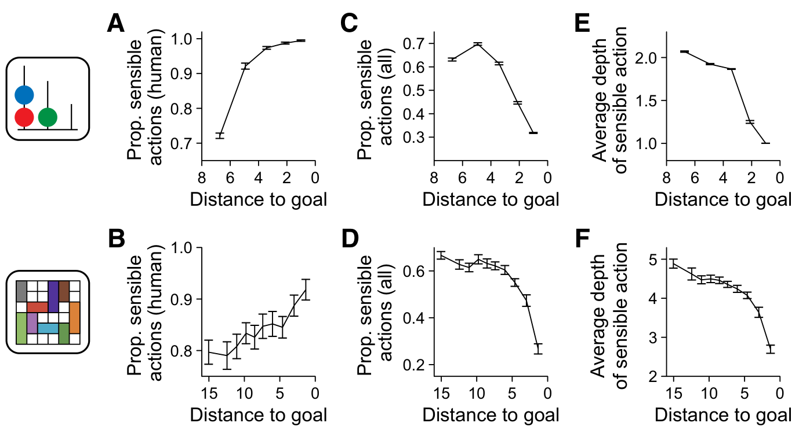
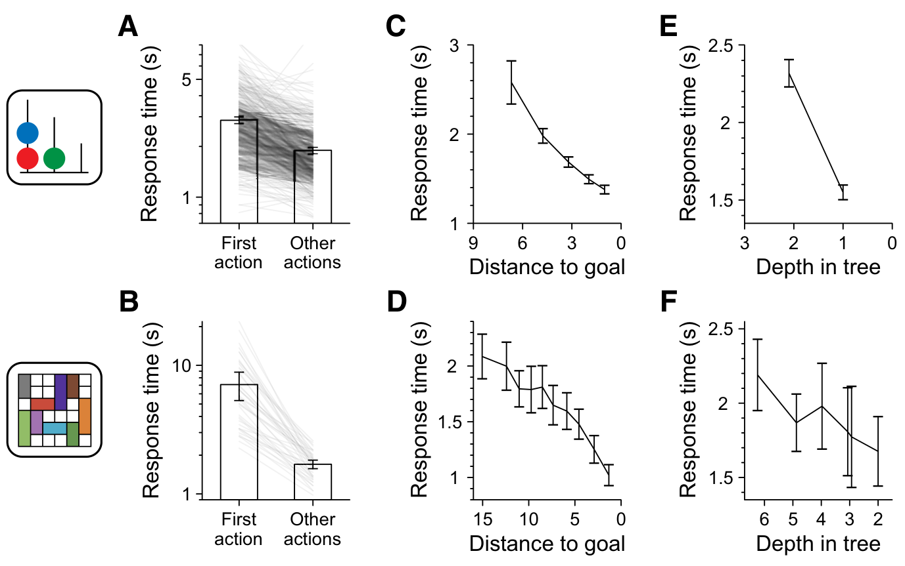
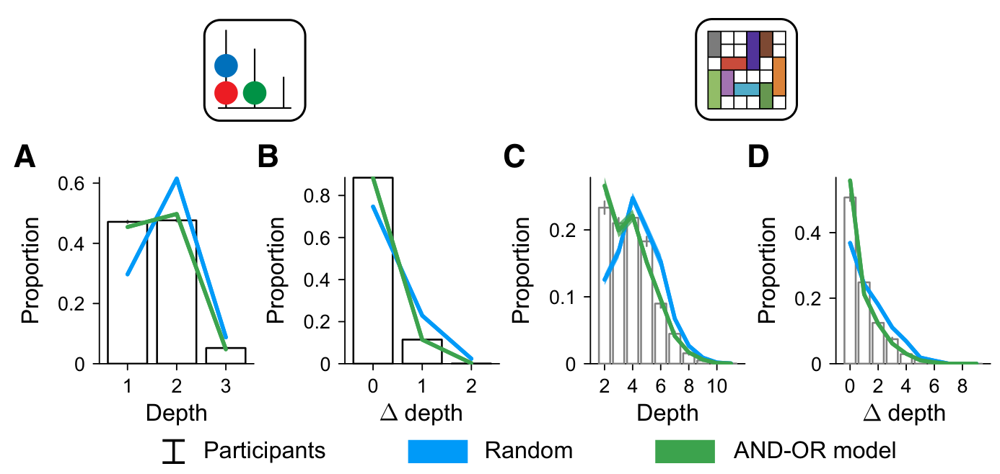
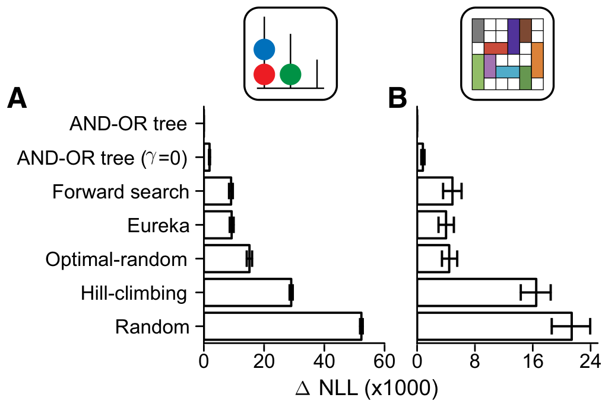

# A Computational Model of Backward Reasoning in Human Problem Solving

**Jeroen Olieslagers**<sup>1</sup> · **Zahy Bnaya**<sup>1</sup> · **Daisy Xinlei Lin**<sup>1</sup> · **Wei Ji Ma**<sup>1,2</sup>

<sup>1</sup> Center for Neural Science, New York University, New York, NY 10003, USA
<sup>2</sup> Department of Psychology, New York University, New York, NY 10003, USA

Correspondence: Jeroen Olieslagers (jeroen@nyu.edu); Zahy Bnaya (zahy.bnaya@gmail.com); Daisy Xinlei Lin (xl1005@nyu.edu); Wei Ji Ma (weijima@nyu.edu)

Received: 17 February 2026 / Accepted: 17 August 2026 / Published online: 25 September 2026. © The Author(s) 2026

## Abstract

When solving a problem with a clear goal, people often break down the problem into subgoals, a form of reasoning known as backward reasoning. The cognitive mechanisms of backward reasoning are poorly understood. Inspired by classic ideas from Newell and Simon, we conceptualize backward reasoning as search through a space of subgoals and actions to attain them. We show that this space can be represented by an AND-OR tree, a structure first used in early artificial intelligence research to automate problem solving. We hypothesize that backward reasoning in problems with a clear goal can be modeled as search through AND-OR trees. To test this hypothesis, we analyzed data from two problem solving tasks: Tower of London and Rush Hour. We developed a psychologically plausible, single-parameter computational process model, which we fit to this data on a per-participant basis. We found that our model successfully captured key trends in the data, unlike alternative models. Our results provide a computational account of backward reasoning in human problem solving and open the door to a more precise characterization of individual differences in problem solving.

**Keywords** Problem solving · Backward reasoning · Subgoals · AND-OR trees · Tower of London · Rush Hour

## Introduction

Life is full of problems. From something as simple as crossing the road to complex problems such as chess, any situation where an agent desires change can be framed as a problem. Problems often have hierarchical structure, which can be exploited to make solving them easier (Anderson et al., 2004; Barto et al., 2013; Botvinick et al., 2009; Boutilier et al., 1999; Foster & Dayan, 2002; Graybiel, 1998; Knoblock, 1991; Laird, 2019; Newell & Simon, 1972). When faced with a difficult problem, it might be a good idea to break it down into smaller parts that are each easier to solve. This can help direct a person's attention to specific parts of the problem, reducing cognitive load (Binder et al., 2023; Correa et al., 2023; Maisto et al., 2015; Solway et al., 2014).

As a simple illustration of goal decomposition, imagine that you are trying to get to work in the morning (Fig. 1A). To attain this goal, you may consider walking, biking or taking the bus. If you decide to bike to work, you will be faced with a set of subgoals: you must first wear a helmet, a jacket and have the keys to your bike before you can leave on your bike. To accomplish the subgoal of wearing a jacket, you must decide which jacket to wear. Going down this line of reasoning, you decide that the first action you will take to solve the problem of getting to work is to grab your rain jacket.

The process of starting at the main goal of the problem and recursively breaking it down into subgoals is called backward reasoning or backward chaining (Newell & Simon, 1972; Russell & Norvig, 2016). We distinguish backward reasoning as modeled here from state-space planning. In state-space planning, candidate actions are mentally simulated to evaluate transitions between possible states (Mattar & Lengyel, 2022). In backward reasoning, the goal is instead recursively decomposed into prerequisite subgoals and actions that could attain them, without requiring simulation of the intervening state transitions. Thus, backward reasoning searches through a space of goals and subgoals, whereas state-space planning searches through possible states. These processes are not mutually exclusive and may contribute jointly to problem solving. Backward reasoning exploits the hierarchical structure present in problems by only considering actions related to subgoals (Russell & Norvig, 2016, p. 259). Simon and Newell pioneered the study of this phenomenon in human problem solving (Newell & Simon, 1972). They described backward reasoning through means-ends analysis (MEA). The idea behind MEA might go back as far as the works of Aristotle over 2,300 years ago (Norvig, 2014). In "The nature of deliberation and its objects" of the Nicomachean Ethics (Book III. 3,1112b), he writes:

> We deliberate not about ends, but about means. ... [People] assume the end and consider how and by what means it is attained; and if it seems to be produced by several means they consider by which it is most easily and best produced, while if it is achieved by one only they consider how it will be achieved by this and by what means this will be achieved, till they come to the first cause, which in the order of discovery is last... and what is last in the order of analysis seems to be first in the order of becoming.


*Fig. 1 Backward reasoning and AND-OR trees. **A**: Backward reasoning when commuting from home to work. **B**: AND-OR tree where circles (OR nodes) represent (sub)goals and diamonds (AND nodes) represent actions that attain (sub)goals. The green diamond is a leaf node which is an action available to the agent, called a sensible action*

Panel B as text (the figure alternates the questions "What actions achieve this goal?" below each OR node and "What subgoals must be completed before this action can be taken?" below each AND node):

```
g1 (OR)
├─ a1
├─ a2 (AND)
│  ├─ g2
│  ├─ g3 (OR)
│  │  ├─ a4
│  │  ├─ a5  [sensible: needs no subgoals]
│  │  └─ a6
│  └─ g4
└─ a3
```

This emphasis on the means of achieving ends, rather than the ends themselves is reflected in Newell and Simon's computational implementation of MEA. In it, the agent looks for an action that minimizes the distance between the state it finds itself in and the goal state. If this action is not immediately available to the agent, a subgoal is created to reach a state where the action *is* available. The agent then looks for an action that minimizes the distance to this subgoal state. This process continues recursively until an action is reached that is available to the agent.

Unfortunately, MEA as Newell and Simon implemented it has several fundamental limitations. We will outline four limitations, three of which Newell and Ernst were already aware of (Ernst & Newell, 1969, Chapter 5). The first limitation is that MEA requires states and goals to be ordered using a scalar difference measure. Such a measure could itself be constructed from multiple features, but collapsing these features into a single scalar may fail to capture the multidimensional structure of a goal and may consequently guide search inadequately (Ernst & Newell, 1969, page 255). Moreover, there may be multiple plausible ways to construct such a scalar measure for a given task. Limiting the model to a single measure may not reflect how people deal with this complexity. The assumption that people always have access to, and use a single distance measure to decide which action to take to attain a subgoal limits the range of behaviors MEA can explain. The second limitation has to do with how subgoals are ordered. If multiple subgoals present themselves, MEA assumes that people pursue the most difficult one (Ernst & Newell, 1969; Newell & Simon, 1961; Newell et al., 1959), an assumption that further limits its generality. While this ordering can be changed, it is assumed to be deterministic and fixed within a task: a significant limitation to the flexible behavior people display. The third limitation, mentioned in Ernst and Newell (1969), restricted the tasks MEA was tested on to simpler tasks due to memory limitations. This could be attributed to the lack of an efficient underlying representation, something we aim to address in this work. The final, and possibly most fundamental limitation of MEA that Newell and Ernst did not consider, is that MEA considers a single deterministic path through the space of subgoals. It therefore cannot represent variability in the backward-reasoning paths selected either across decisions within an individual or between individuals. Together, these issues limit the possible sequences of subgoals that MEA can explain, and thus limit the usefulness of MEA as a model of human behavior.

The impact of MEA on both the field of artificial intelligence (Chapman, 1987; Fikes & Nilsson, 1971; Hewitt, 1970; Sacerdoti, 1975; Sussman, 1973; Tate, 1974, 1976; Veloso, 1989; Warren, 1974) and cognitive science (Anderson, 1976; Anderson et al., 2004; Carbonell et al., 1990; Just & Carpenter, 1992; Kotseruba & Tsotsos, 2020; Laird, 2019; Laird et al., 1987; Langley et al., 1989, 2004; Looks et al., 2004) is substantial. These works have allowed us to solve ever more challenging problems and have given us a more complete understanding of human cognition. Despite this influence, the specific limitations outlined above have not, to our knowledge, been addressed together in a computational process model fitted to human action data.

We address these limitations by providing a representation that generalizes Simon and Newell's means-ends analysis. We start at the main goal of the problem and consider all actions that attain this goal. In all but the simplest problems, these actions are likely not available to the agent. Next, the agent chooses one of these potential actions for further consideration. The probability of choosing each action forms a distribution that we call a heuristic function. A heuristic function specifies the probability of selecting each available branch for a given individual in a given problem state. In principle, its shape may vary across problem states and across individuals. In the getting-to-work example, aspects of the environment, such as rain or outside temperature, and aspects of the agent, such as exhaustion or urgency, could influence the probability of choosing biking over walking or taking the bus. The study of the components and mental processes that determine these distributions is beyond the scope of this article.

Once the agent has chosen one of these unavailable actions, the agent next considers the set of subgoals that must be attained before the action becomes available. The probability that the agent pursues each of these subgoals is given by another heuristic function. These two steps of selecting an action to attain a subgoal and selecting a subgoal that makes the action available are repeated until an action is reached that *is* available to the agent. When this happens, the process terminates and a sequence of subgoals and actions to attain them will have formed. This sequence starts at the main goal and ends in an action that is available to the agent. We will call this sequence a "train of thought". It is important to note that we use "train of thought" here as a computational term for such a sequence. The term does not imply that each represented goal, subgoal, or action is necessarily consciously accessible or verbally reportable. Understanding how people form trains of thought as we have defined them is crucial for the study of backward reasoning in human problem solving.

To understand how people form trains of thought, we need a way to characterize the latent trains of thought that could give rise to their observed actions. For well-defined problems in which the relevant goals, subgoals, and actions can be specified, our first contribution is a representation of the possible backward-reasoning paths induced by this problem representation. With this representation at hand, we describe reasoning as search through the space of subgoals our representation induces, inspired by recent work in the planning literature (Callaway et al., 2022; Correa et al., 2023; Ho et al., 2022; Huys et al., 2012; van Opheusden et al., 2023; Russek et al., 2025; Sezener et al., 2019). This approach unifies search and reasoning, two pillars of problem solving (Simon, 1983). It allows us to form a probability distribution over trains of thought, which lets us make predictions about which action a person will take. This predictive power is missing from Simon and Newell's models, which prevents them from fitting their model to human data. In our representation, the predictive power forms the basis for our third contribution: developing a process model that is fit on a per-participant basis. We validate our model by showing it can replicate trends of human problem solving in a large data set. To show this is non-trivial, we compare our model against several alternative models.

Our work is organized as follows. We first develop the theoretical framework, apply it to two problem-solving tasks, and present the behavioral and model-comparison results. Detailed experimental procedures, statistical analyses, computational implementations, and fitting procedures are provided in the Methods section following the Discussion.

## AND-OR Trees: A Representation of Subgoal Structure

To describe the possible backward-reasoning paths induced by a specified problem representation, we chose a representation based on AND-OR trees. AND-OR trees consist of a main goal, subgoals, and actions to attain the (sub) goals (Fig. 1B). At the root of the tree is the main goal of the problem. Attaining this goal means that the problem is solved. The tree grows by connecting a set of actions that attain this goal to the root. Taking *any* one of these actions solves the problem. This property means the (sub) goal nodes are "OR nodes". In all but the simplest problems, these actions will be unavailable to the agent. For every unavailable action, the tree continues to grow by connecting a set of subgoals to that action. If *all* subgoals are attained, the unavailable action becomes available. This property means the actions are "AND nodes". The process of connecting actions to subgoals and subgoals to actions continues until there are only available actions left. Available actions are leaf nodes since they require no subgoals to be attained before they become available. We will refer to these as *sensible* actions: actions that attain subgoals which eventually lead to the attainment of the main goal. AND-OR trees provide a complete representation relative to the specified set of goals, subgoals, and actions: each backward-reasoning path generated by this representation corresponds to a path connecting the root to a leaf node. We propose that people may reason backward by searching through this structured space of goals and subgoals.

AND-OR trees were first used by Slagle to automatically solve analytical integration problems (Slagle, 1963). They were then used in other areas of artificial intelligence research such as theorem proving (Amarel, 1967; Kowalski, 1972; Vanderbrug, 1976), language recognition (VanderBrug & Minker, 1975), two-player games (Pearl, 1984; Slagle & Dixon, 1969), and optimizing decision tables (Martelli & Montanari, 1978). AND-OR trees in the form of conceptual trees are briefly mentioned in relation to means-ends analysis in Veloso (1989), but this is not expanded upon in subsequent research. More recently, AND-OR trees have been used in constrained optimization (Marinescu & Dechter, 2004) as well as in solving games such as checkers, shogi, and Hex (Kishimoto et al., 2012). In the field of belief-desire-intention software models, AND-OR trees are also known as goal trees or goal-plan trees (Charniak & McDermott, 1985; Shaw & Bordini, 2011; Shaw et al., 2008; Thangarajah & Padgham, 2011; Yao & Logan, 2016) and in the field of automated planning, they have been used as hierarchical task networks (Clement et al., 2007; Erol et al., 1996; Georgievski & Aiello, 2014; Sacerdoti, 1975; Sussman, 1973; Tate, 1977). Despite their widespread adoption in related fields, a process model traversing AND-OR trees has never provided an account of human behavior in the cognitive sciences.

A 2AFC task in which intermediate subgoals are abstracted away yields the simplest non-trivial AND-OR tree: a single OR node representing the response goal followed by two leaf nodes representing the two response actions. Difficult 2AFC tasks may, of course, involve intermediate reasoning or subgoals; the point here concerns the simplest representation of their overt response structure. Research on 2AFC tasks is then all about the heuristic function which biases individuals toward one of the two actions. In our tasks, AND-OR trees can have up to hundreds of nodes, allowing for elaborate yet tractable search processes.

## Key Metrics

We would like to highlight and define three key aspects of problem solving that will be used throughout this paper. To measure progress towards the goal in a problem, we define the "distance to goal" as the minimum number of actions required to solve the puzzle from the current state. Distance to goal is an analytic property of a problem state that we compute from the full state-space graph. We do not assume that participants explicitly compute or represent the exact shortest-path distance when selecting an action. It is an unweighted step-count measure in which every legal action has unit cost, regardless of the time, effort, or subjective cost involved in performing it. Taking an action in a state can either increase this distance by 1, leave it unchanged, or decrease it by 1. It is never possible to change the distance to goal by more than 1. Distance to goal is the main independent variable we will use going forward.

The next aspect of problem solving is related to the actions an agent can take. Actions can be classified as either optimal or suboptimal. An optimal action is any action that can serve as the first action of a shortest path from the current state to a goal state. Because the state space is an unweighted graph in which each legal action traverses one edge, a single action can reduce shortest-path distance by at most one. Therefore, an action is optimal if and only if it reduces distance to goal by exactly one. When multiple shortest paths exist, the first actions of all such paths are classified as optimal. Actions that leave distance unchanged or increase it are classified as suboptimal. As an example, imagine you are trying to navigate to a destination in front of you, without any obstacles in-between. If you are currently 5 steps from the destination, taking a step forward decreases this distance to 4, making it an optimal action. Taking a step backward increases the distance to 6, making is a suboptimal action. Finally, jumping upward does not change the distance, also making it a suboptimal action. In some problems, there might be multiple optimal actions if there are multiple shortest paths to the nearest goal state.

Finally, the last classification of actions is based on the AND-OR tree representation. As discussed in the previous section, leaf nodes of the AND-OR tree are actions that are considered sensible because they relate to attaining a subgoal which eventually leads to the attainment of the main goal. Importantly, not every action is a leaf node in the AND-OR tree. Many actions will not contribute to any useful subgoal, and hence will not be considered sensible. While not every sensible action will be optimal, a good subgoal representation would consider as many optimal actions to be sensible as possible.

## Tower of London (TOL)

To investigate whether people traverse AND-OR trees to solve problems, we want a task that is simple enough to analyse and control, yet complex enough to be interesting. To satisfy the simplicity requirement, we want the task to (1) have a clear goal; (2) naturally break down into subgoals; (3) have deterministic transitions; (4) have a tractable state space and computable optimal solutions; (5) have minimal learning, perceptual, social, and language components; and (6) be complex enough to require multiple steps of thinking. We first consider the Tower of London task (Shallice, 1982): an established task in the fields of clinical neuropsychology (Carlin et al., 2000; Morris et al., 1995; Owen et al., 1992; Shum et al., 2009; Unterrainer & Owen, 2006; Watkins et al., 2000; Young et al., 2007) and developmental science (Albert & Steinberg, 2011; Anderson et al., 2001; Asato et al., 2006; De Luca et al., 2003; Huizinga et al., 2006; Korkman et al., 2001; Luciana & Nelson, 2002) used to study problem-solving capabilities. A closely related task, called Tower of Hanoi (Lucas, 1882), was used by Herbert Simon to study problem solving skills using means-ends analysis (Simon, 1975).

The goal in TOL is to arrange beads in a specific configuration on a number of pegs. The agent is presented with an initial configuration and is told what the goal configuration is (Fig. 2A). The agent can act by moving beads from one peg to another. Importantly, only the top bead on a peg may be moved, and it may only be moved to an empty space on another peg. Pegs usually have different lengths, and can accommodate different numbers of beads. We will use 3 beads and 3 pegs, where the first peg can store 3 beads, the second peg 2 beads, and the last peg 1 bead.

We implemented a web-based version of Tower of London and obtained a dataset of $n = 469$ participants through Prolific. Each participant solved 25 TOL puzzles for a total of 82,716 actions. Puzzles had differing optimal solution lengths ranging from 3 to 7 (examples for each difficulty category shown in Extended Data Fig. S3A-E). Agreeing with past TOL research (Unterrainer et al., 2004), we found that higher optimal solution lengths resulted in longer participant solutions (Fig. 2D, Extended Data Fig. S4).

### AND-OR Trees in Tower of London

To construct the AND-OR tree for a TOL puzzle (Fig. 2B-C), we start with the main goal, which is to attain the goal configuration. This forms the root node of the AND-OR tree. To attain this goal, each bead must be moved to its corresponding position in the goal configuration. In most cases, this is not possible because other beads are in the way. Moving each of these blocking beads out of the way becomes the next set of subgoals. There are three types of subgoals in TOL: (G1) the beads below the target position of the current bead being considered are not the correct ones, (G2) a bead is in the target position of the current bead being considered, or (G3) a bead above the current bead being considered is blocking. To attain (G1), the incorrect beads must first be moved to their correct position. To attain (G2) and (G3), the blocking bead must be moved to a different peg. Actions that attain subgoals might themselves have beads blocking their way, creating more subgoals. This process continues until the action of moving a bead is unobstructed. At this point, we have reached the end of the train of thought and have arrived at a sensible action. A train of thought in this example could take the following form: "To reach the goal position, I must move the green bead to position 5. Before I can do that, the blue bead must be in position 4. Position 4 is being blocked by the green bead, so I will move that bead away first. I can move the green bead away by moving it to position 6." (Fig. 2B).


*Fig. 2 Tower of London and AND-OR trees. **A**: Example Tower of London puzzle that can be solved in 5 moves (Extended Data Fig. S1). **B**: Example train of thought for solving the example puzzle. Nodes to the right are branches that were not pursued. **C**: Collection of all sensible trains of thought in an AND-OR tree structure. Circles denote goal or subgoal (OR) nodes, diamonds denote action (AND) nodes, and green diamonds denote sensible actions. **D**: Trajectories of all participants solving four randomly selected puzzles: each from a different difficulty category. Difficulty is determined by the minimum number of moves required to solve the puzzle from the start, denoted by "Length". Distance to goal indicates the minimum number of moves required to solve the puzzle from the state a person finds themselves in*

Panel C as text (positions: P1 = 1, 2, 3 from bottom; P2 = 4, 5; P3 = 6; "green→5" = move the green bead to position 5; G1/G2/G3 = subgoal types from the text, applied to the bead shown; `*` = sensible action):

```
goal configuration (OR)
├─ green→5 (AND)
│  └─ G1 blue (OR)
│     └─ blue→4 (AND)
│        └─ G2 green (OR)
│           └─ green→6 *
├─ blue→4 (AND)
│  └─ G2 green (OR)
│     └─ green→6 *
└─ red→6 (AND)
   └─ G3 blue (OR)
      ├─ blue→5 *
      └─ blue→6 *
```

Panel B is the leftmost branch of this tree (goal → green→5 → G1 blue → blue→4 → G2 green → green→6).

## Rush Hour (RH)

To show the generality of our theory, we consider a second task of increased complexity. For this, we chose Rush Hour: a single-player puzzle game created by Nob Yoshigahara in the 1970s, part of the family of "sliding block" puzzles (Spaans, 2009). This task adheres to our desiderata, but is interesting in its own right. Compared to Tower of London, which has 36 unique board configurations, Rush Hour has a state space that is different for each puzzle. This state space can exceed 100,000 states for some puzzles. Besides the increased complexity, Rush Hour, unlike Tower of London, has no clear, specific goal *state*. Instead, there is a goal *condition* which is satisfied by potentially multiple states. Rush Hour is played on a $6 \times 6$ board where "cars" are pieces occupying either two or three squares, arranged vertically or horizontally (Fig. 3A). Players may move cars forward or backward only in the direction they are facing. The goal of the game is to move the red target car out of the board by moving it all the way to the right. The key constraint is that cars may not overlap and cars may not move through each other, or be lifted from the board. Rush Hour, not having been invented yet, bears a lot of resemblance to a puzzle game that Newell and Ernst found too hard for MEA to solve (Ernst & Newell, 1969, page 117, Fig. 44). Rush Hour has been used to study problem complexity (Bennati et al., 2014; Bockholt & Zweig, 2015; Bockholt et al., 2018; Jarušek & Pelánek, 2011) as well as theory of mind (Berke et al., 2023, 2024). Rush Hour is in the class of hardest problems that can be solved using a polynomial amount of memory (Hearn & Demaine, 2005). This difficulty may be one of the factors contributing to the game's success (Viglietta, 2014), and makes it an ideal task to study complex problem solving.

We implemented a web-based version of Rush Hour and obtained a dataset of $n = 42$ participants through Amazon Mechanical Turk. We asked participants to solve any number of 70 Rush Hour puzzles. Puzzles had different optimal solution length (5, 9, 12, or 14, examples for each difficulty category shown in Extended Data Fig. S3F-I). Participants attempted on average $52 \pm 2.6$ (S.E.M.) puzzles, with an average completion rate of $83 \pm 2.8\%$ (S.E.M.). Across the 42 participants, we obtained a total of 49,313 actions. In agreement with the findings of Bockholt and Zweig (Bockholt & Zweig, 2015), we found that higher optimal solution lengths result in longer participant solutions (Fig. 3D, Extended Data Fig. S5).

### AND-OR Trees in Rush Hour

To construct the AND-OR tree for a Rush Hour puzzle (Fig. 3B-C), we start with the main goal, which is to move the target car out of the board. This forms the root node of the AND-OR tree. To attain this goal, the car must be moved a number of spaces to the right. In most cases, this is not possible because other cars are in the way. Moving each of these blocking cars out of the way becomes the next set of subgoals. Actions that attain these subgoals might also have cars blocking their way, creating more subgoals. This process continues until the action of unblocking a car is available. At this point, we have reached the end of the train of thought and have arrived at a sensible action. A train of thought in this example could take the following form: "To unblock the red car, I have to move cars number 4 and 5 out of the way. Let's consider moving car number 5 first. It can be moved out of the way by moving it down. Before I can do that, I first have to move car number 3 out of the way. To do that I can move it either to the left or to the right. Let's consider moving it to the right. Cars number 2 and 4 are now blocking me. I'll move 4 out of the way first.".


*Fig. 3 Rush Hour and AND-OR trees. **A**: Example Rush Hour puzzle that can be solved in 12 moves (2↑↑, 4↑↑, 3→→, 5↓↓↓, 9→, 6↑↑↑, 9←, 5↑↑↑, 3←←←, 5↓↓↓, 2↓↓, 4↓↓↓), visually shown in Extended Data Fig. S2. Moving a car any number of spaces at once is considered a single action and we do not count the final action of moving the red car out of the board: the problem is considered solved if the red car is able to freely move out of the puzzle. Most puzzles have multiple optimal solutions. **B**: Example train of thought for solving the example puzzle. Nodes to the right are branches that were not pursued. **C**: Collection of all sensible trains of thought in an AND-OR tree structure. Circles denote goal or subgoal (OR) nodes, diamonds denote action (AND) nodes, and green diamonds denote sensible actions. Red OR node indicates a cycle was reached (cycle node). **D**: Trajectories of all participants solving four randomly selected puzzles: one from each difficulty category. Difficulty is determined by the minimum number of moves required to solve the puzzle from the start, denoted by "Length". Distance to goal indicates the minimum number of moves required to solve the puzzle from the state a person finds themselves in*

Panel A board (row 1 = top; exit on the right of row 3; `.` empty; 9 = red target car; trucks: 1, 4, 5):

```
8 . . 5 7 .
8 . . 5 7 .
. 9 9 5 . 4   <- exit
1 6 . . . 4
1 6 3 3 2 4
1 . . . 2 .
```

(Cleaning check: the 12-move solution in the caption replays legally on this grid and frees row 3.)

Panel C as text (OR node "N" = get car N out of the way, the root "9" = get the red car out; an AND node is a move, arrows = direction and number of cells; children of a move are the cars blocking it; `*` = sensible (available) move; `[cycle]` = red cycle node):

```
9 (OR)
└─ 9→→→ (AND)
   ├─ 5 (OR)
   │  └─ 5↓↓↓ (AND)
   │     └─ 3 (OR)
   │        ├─ 3→→ (AND)
   │        │  ├─ 4 (OR)
   │        │  │  ├─ 4↑↑ *
   │        │  │  └─ 4↑ *
   │        │  └─ 2 (OR)
   │        │     └─ 2↑↑ *
   │        └─ 3← (AND)
   │           └─ 6 (OR)
   │              ├─ 6↑   ─┐
   │              ├─ 6↑↑  ─┼─ each needs: 9 (OR)
   │              └─ 6↑↑↑ ─┘     ├─ 9→   → 5 [cycle]
   │                             ├─ 9→→  → 5 [cycle]
   │                             └─ 9→→→ → 5 [cycle], 4 (OR) → 4↓ *
   └─ 4 (OR)
      └─ 4↓ *
```

(The figure draws the three 6-moves converging on one shared "9" node and the three 9-moves converging on one red "5" node.) Panel B is the path 9 → 9→→→ → 5 → 5↓↓↓ → 3 → 3→→ → 4 → 4↑↑, with the unexplored siblings 4 (under 9→→→), 3← and 2 drawn as stubs.

## Model

To model how people might traverse AND-OR trees, we develop a tree search model based on depth-first search. In this model, the agent reasons along a single train of thought: the agent starts at the root, chooses a child node, and repeats. When multiple actions or subgoals are available at a branch point, the model assigns them equal probability. This uniform heuristic is a deliberately minimal assumption rather than a claim that people literally choose among subgoals at random. More generally, branch selection can be governed by heuristic functions that incorporate preferences for particular actions or subgoals. Here we hold these heuristic functions uniform in order to isolate the predictive contribution of the AND-OR tree structure and search-depth mechanism; identifying the cognitive determinants of search direction is left for future work. In the well-defined tasks studied here, the legal actions and represented subgoals at each branch are finite and explicitly specified, so this uniform distribution is well-defined.

During the search, it is possible to reach a cyclic train of thought, where a subgoal that has already been encountered presents itself again. In these cases, we terminate the train of thought, forming a "cycle node". If a cycle node is reached, the model terminates that latent train of thought and restarts the internal search from the root. This restart occurs within the modeled reasoning process, it does not correspond to overtly resetting the puzzle or undoing a previous move. Otherwise, the process continues until either (1) a sensible action is reached or (2) the process stops at an OR node with probability $\gamma$ and the agent takes a random available action. This free parameter is directly related to how deeply into the tree an agent explores. A larger value of $\gamma$ makes the search more likely to terminate at each OR node and therefore leads to shallower search on average. We do not interpret $\gamma$ as a direct measure of any single psychological construct. Rather, individual differences in $\gamma$ may arise from multiple factors that affect search persistence, potentially including attention, motivation, working memory, or other cognitive processes. The present experiments were not designed to identify the psychological sources of variation in $\gamma$. Thus, $\gamma$ governs search depth, whereas the heuristic functions governing choices among branches determine search direction. In the analyses below, a single value of $\gamma$ is fitted separately to each participant and is held constant across all problem states, puzzles, and trials contributed by that participant. A stopping probability like this can also be found in planning algorithms, where it serves to limit the depth of planning (van Opheusden et al., 2023).

To predict a participant's next observable action in a given state, the model forms a probability distribution over actions by first assigning a probability to each possible train of thought. These probabilities are obtained using a propagation process shown in Fig. 4. The process starts at the root with full probability. Since this node is an OR node, we assume people stop with probability $\gamma$ and take a random action. With probability $1 - \gamma$, they continue down the AND-OR tree and consider the actions that attain the main goal. In this case, there is only one action, so all probability propagates to it. For this action to become available, the next subgoal must be attained. At this node, people are again assumed to stop with probability $\gamma$. There are three ways to attain this subgoal, and since we have assumed a uniform heuristic function, each child node gets a third of the probability. This process continues until all nodes in the AND-OR tree have been visited. The result of the process is a probability distribution over actions, where the probabilities of the green nodes get assigned to their respective action, and the summed probability from the red "random" nodes gets spread over all possible actions, as if picking an action at random. For cycle nodes, the probability gets spread over all actions, proportional to the probability of selecting that action. The resulting distribution is over the participant's next action. The model does not assume that a complete multi-action solution is constructed before acting, nor does it identify which particular latent train of thought occurred on an individual trial. The model treats each decision independently and recomputes this action distribution from the current state after every overt action. This is a simplifying Markov assumption. In practice, participants may carry forward a previously formed plan or train of thought and execute several actions from memory, a limitation we discuss further in the Discussion.


*Fig. 4 Anatomy of AND-OR tree process model. **A**: Propagation rules for AND-OR tree model. *Top*: When a person reaches an OR node (subgoal), they stop thinking and select a random action with probability $\gamma$. Otherwise, they continue down the tree. *Middle*: When a person reaches an AND node (action), they choose which subgoal to pursue using a heuristic function. *Bottom*: When a person reaches an OR node (subgoal), they choose which action to attain that subgoal to pursue using another heuristic function. **B**: Propagation rules applied to a simple AND-OR tree to obtain a probability distribution over actions. The heuristic functions used were uniform distributions*

Panel B as text (mass on each node; `random` = red stop node, `*` = green sensible leaf):

```
root OR: 1                         -> random: γ
└─ AND: 1−γ
   └─ OR: 1−γ                      -> random: γ(1−γ)
      ├─ AND: (1−γ)²/3             (gray, no children drawn)
      ├─ AND: (1−γ)²/3
      │  ├─ OR: (1−γ)²/6           -> random ┐ together: γ(1−γ)²/3
      │  │  └─ AND *: (1−γ)³/6               │
      │  └─ OR: (1−γ)²/6           -> random ┘
      │     └─ AND *: (1−γ)³/6
      └─ AND: (1−γ)²/3             (gray, no children drawn)
```

## Results

### Sensible Actions in AND-OR Trees

Before fitting the model to human data, we investigated the sensible actions people took. If AND-OR trees are to provide a useful representation to study how people reason backward when solving problems, then we must see an overlap between the actions the representation deems sensible and those taken by participants. We found that a large fraction, between 80% and 90% of people's actions, are considered sensible by our AND-OR tree representation (Fig. 5A). The model considers the remaining actions lapses, arising from stochastically exiting the tree search before a sensible action has been found. This shows that our representation is able to explain some of the decision making variance even without a model built on top of it.

Next, we looked at how the proportion of sensible actions a person took changed with distance to goal, a metric of how close a person is to solving the problem. We found that this proportion increases near the goal, suggesting that finding sensible actions becomes easier closer to the goal (Fig. 5A-B, TOL: $\beta = -0.0505$, 95% CI $[-0.0510, -0.0500]$, $p < .001$, RH: $\beta = -0.0069$, 95% CI $[-0.0076, -0.0061]$, $p < .001$). This result stands despite the fact that the proportion of all available actions that is sensible decreases closer to the goal (Fig. 5C-D, TOL: $\beta = 0.0475$, 95% CI $[0.0471, 0.0480]$, $p < .001$, RH: $\beta = 0.0182$, 95% CI $[0.0177, 0.0187]$, $p < .001$). One reason for this trend is that closer to the goal, fewer subgoals must be attained before the problem can be solved which means fewer sensible actions to attain subgoals present themselves. The reduction in number of subgoals should be reflected in the structure of the AND-OR trees, which we would expect to become shallower. This is exactly what we found: the average depth of a sensible action decreases closer to the goal (Fig. 5E-F, TOL: $\beta = 0.119$, 95% CI $[0.117, 0.120]$, $p < .001$, RH: $\beta = 0.0481$, 95% CI $[0.0424, 0.0538]$, $p < .001$). While this could explain the reduction in the proportion of all actions being sensible, it could also explain why we saw an increase in the proportion of actions people chose that are sensible. Given the limitations on attention, working memory, and motivation that might cause a person to abandon their train of thought, we would expect that a person is more likely to reach a sensible action at a shallower depth.



*Fig. 5 Sensible actions as a function of distance to goal (quantile-binned). Error bars indicate the 95% confidence intervals for the mean of the participants' data. **A-B**: Proportion of actions taken by participants that are sensible as a function of distance to goal. **C-D**: Proportion of all actions available to participants that are sensible as a function of distance to goal. **E-F**: Average depth of all sensible actions in a state as a function of distance to goal. First row is data from Tower of London (TOL) and second row is data from Rush Hour (RH)*

Approximate values read from the plots (far = largest distance bin, near = smallest):

| | TOL far (d≈7) | TOL near (d≈1) | RH far (d≈15) | RH near (d≈1) |
|---|---|---|---|---|
| prop. human actions sensible | 0.72 | 0.995 | 0.80 | 0.92 |
| prop. available actions sensible | 0.63 (peak 0.70 at d≈5) | 0.32 | 0.67 | 0.27 |
| average depth of sensible actions | 2.07 | 1.0 | 4.9 | 2.7 |

### Response Times

Besides individual actions, we also measured how long it took each participants to take an action in each state, called the response time (RT). Participants' RT is significantly higher when they took their first action for a given puzzle (Fig. 6A-B, TOL: $\beta = 0.129$, 95% CI $[0.126, 0.131]$, $p < .001$, RH: $\beta = 0.504$, 95% CI $[0.492, 0.516]$, $p < .001$). This corresponds to 11,725 out of 82,716 actions for TOL, and 1,924 out of all 49,313 actions for RH.

For actions that were not the first action of a puzzle, RT decreased as participants approached the goal (Fig. 6C-D, TOL: $\beta = 0.0263$, 95% CI $[0.0259, 0.0266]$, $p < .001$, RH: $\beta = 0.0118$, 95% CI $[0.0113, 0.0123]$, $p < .001$). This pattern is consistent with reduced processing demands closer to the goal, although it is not uniquely diagnostic of backward reasoning and could also reflect information computed earlier in the episode. A more specific prediction of the AND-OR-tree account is that sensible actions located deeper in the tree should require more processing. Consistent with this prediction, sensible actions deeper in the tree were associated with longer RTs (Fig. 6E-F, TOL: $\beta = 0.0779$, 95% CI $[0.0766, 0.0792]$, $p < .001$, RH: $\beta = 0.0266$, 95% CI $[0.0249, 0.0282]$, $p < .001$).



*Fig. 6 Response times. Error bars indicate the 95% confidence intervals for the mean of the participants' data. **A**: Response time for the first action taken in a TOL puzzle compared to all other actions. There are 11,725 first actions and 70,991 other actions across all participants. Each line indicates an individual participant. **B**: Response time for the first action taken in a RH puzzle compared to all other actions. There are 1,924 first actions and 47,389 other actions across all participants. Each line indicates an individual participant. **C-D**: Response time for all actions that are not a first action as a function of distance to goal (quantile-binned). **E-F**: Response time for all sensible actions as a function of the depth of the sensible action in the AND-OR tree (quantile-binned). First row is data from Tower of London (TOL) and second row is data from Rush Hour (RH)*

Approximate values read from the plots: TOL first action ≈ 2.9 s vs other ≈ 1.9 s; RH first action ≈ 7 s vs other ≈ 1.7 s. RH RT falls from ≈ 2.1 s at distance ≈ 15 to ≈ 1.0 s at distance ≈ 1; RH RT vs depth ≈ 2.2 s (depth 6), 1.9 (5), 2.0 (4), 1.8 (3), 1.7 (2), with wide error bars. TOL RT vs depth: ≈ 2.3 s (depth 2), 1.55 s (depth 1).

### Model Validation

To validate the AND-OR tree process model, we analyzed how well it reproduces trends in human data. Fitting tree search models to human data is a recent innovation (van Opheusden et al., 2023). The difficulty with fitting tree search models is that they require a lot of simulations, making the process expensive. In this work, we developed an alternative way to fit tree search models to human data that circumvents the need for expensive simulations and provides exact probability distributions. The details of this process can be found in the Methods section.

The first trend the model replicated is an increase in proportion of sensible actions closer to the goal (Fig. 7A-B, green area). The model was successful because the stopping probability parameter captured the effect that people are more likely to stop reasoning when forming longer trains of thought. This is even more evident when we looked at the trend that the depth of sensible actions decreased closer to the root (Fig. 7C-D). We found that both the participants and model chose sensible actions with depths shallower than the average depth of a sensible action (Fig. 7C-D, blue area). The blue areas indicate the predictions of a random agent, which corresponds to the proportion of all actions that are sensible (Fig. 7A-B, blue area) and the average depth of sensible actions (Fig. 7C-D, blue area). While these summary statistics are based on AND-OR trees, they do not imply a good model fit. As an example, ablating the $\gamma$ parameter in our model and replacing it with a simple lapse rate parameter degrades the fit to these summary statistics (Extended Data Fig. S8-S9, seventh column).


*Fig. 7 Summary statistics as a function of distance to goal (quantile-binned). Black error bars indicate the 95% confidence intervals for the mean of the participants' data. Green areas indicate the 95% confidence intervals for the mean of model predictions. Blue areas indicate the 95% confidence intervals of a random agent's predictions around the mean. **A-B**: Proportion of actions within a bin that are sensible. **C-D**: Depth of chosen sensible action in the AND-OR tree. This plot excludes states where participants did not take a sensible action. **E-F**: Proportion of actions within a bin that undo the participant's previous move. **G-H**: Proportion of actions within a bin that move the same bead/car as in the participant's previous action. First row is data from Tower of London (TOL) and second row is data from Rush Hour (RH)*

Approximate RH values read from the plots (far ≈ distance 15, near ≈ distance 1): participants' prop. sensible 0.80 → 0.92 (model 0.84 → 0.88, random 0.66 → 0.27); depth of chosen sensible action 4.4 → 2.3 (model ≈ 4.4 → 2.5, random 4.9 → 2.7); prop. undos ≈ 0.09 → 0.005 (model 0.065 → 0.02, random ≈ 0.11 → 0.09); prop. same car ≈ 0.11 → 0.02 (model 0.12 → 0.04, random ≈ 0.22).

In both Tower of London and Rush Hour, state transitions are bidirectional, meaning that actions can always be undone. The reason a person might undo an action is to correct a previous mistake. We found that the proportion of undos (moving a bead/car back to where it just came from) decreases as participants get closer to a goal state (Fig. 7E-F, black error bars). We also investigated actions where the same bead/car was moved as in the previous action. This includes undos, but also other actions such as moving a bead/car, and then moving it again. We found the same decreasing trend suggesting that people make fewer mistakes the closer they are to solving a problem (Fig. 7G-H, black error bars). The model displays both of these trends (Fig. 7E-H, green area).

To validate our previous assumption that people are more likely to form shorter trains of thought, we obtained a histogram of the depth in the AND-OR trees of all sensible actions participants took. We found that this histogram is skewed to shallower values for participants (Fig. 8A,C, black error bars) compared to the histogram of the average depth of a sensible action (Fig. 8A,C, blue area). This indicates a person is more likely to choose a sensible action that is the result of a shorter train of thought than a longer one. On its own, the depth of a sensible action can be a misleading measure, since some AND-OR trees have all of their sensible actions deeper than other trees. To investigate the differences in depth of sensible actions within a tree, we subtracted the depth of each sensible action from the most shallow one ($\Delta$ depth). We found that the distribution of these differences follows a geometric distribution (Fig. 8A,C, black error bars), an expected result given our formulation of the search process. It is then no surprise that the model faithfully captures these two trends, even with only a single parameter (Fig. 8A-D, green area).



*Fig. 8 Summary statistics as a function of distance to goal (quantile-binned). Black error bars indicate the 95% confidence intervals for the mean of the participants' data. Green areas indicate the 95% confidence intervals for the mean of model predictions. Blue areas indicate the 95% confidence intervals of a random agent's predictions around the mean. **A,C**: Histogram of the depths of the chosen sensible actions. **B,D**: Histogram of the difference between the depth of the chosen sensible actions and the shallowest sensible action in the corresponding AND-OR tree*

Approximate participant proportions read from the bars:

| TOL depth | 1 | 2 | 3 |
|---|---|---|---|
| participants | 0.47 | 0.47 | 0.05 |
| random | 0.30 | 0.61 | 0.09 |

| TOL Δ depth | 0 | 1 | 2 |
|---|---|---|---|
| participants | 0.88 | 0.11 | ≈0 |

| RH depth | 2 | 3 | 4 | 5 | 6 | 7 | 8 |
|---|---|---|---|---|---|---|---|
| participants | 0.23 | 0.21 | 0.22 | 0.18 | 0.09 | 0.045 | 0.015 |
| random | 0.12 | 0.17 | 0.25 | 0.20 | 0.15 | 0.07 | 0.03 |

| RH Δ depth | 0 | 1 | 2 | 3 | 4 | 5 |
|---|---|---|---|---|---|---|
| participants | 0.51 | 0.25 | 0.12 | 0.075 | 0.03 | 0.01 |
| random | 0.37 | 0.25 | 0.17 | 0.11 | 0.07 | 0.02 |

The directionality induced by the "Distance to goal" metric means that actions can be classified into three categories: (1) actions that decrease the distance, (2) actions that do not change the distance, and (3) actions that increase the distance. By definition, the change in distance cannot be greater than one step. Actions that decrease the distance to goal are therefore optimal. All other actions are considered mistakes. We found that the proportion of actions which are mistakes decreases as participants get near goal states (Fig. 9A-B). This agrees with the previous result that the proportion of actions which move the same bead/car (either mistakes or actions to undo a mistake) also decreases closer to goal states.

Closest to the goal, participants act optimally >85% of the time and take very few actions that push them further from the goal. Since most optimal actions are also sensible (Extended Data Fig. S8-S9, top row, second column), this suggests that near the goal where participants take sensible actions > 90% of the time (Fig. 7A-B), most of the sensible actions are optimal actions. This is the case even when less than 30% of the available actions are optimal (Fig. 7A-B). This is likely a general property of problem solving. At the point furthest from the goal, there are no actions that can bring you further from the goal. Conversely, if you are already at the goal, there are no actions that can bring you closer to the goal. Despite this, participants are still able to identify the few actions that are optimal as they get near the goal. Further from the goal, people choose sensible actions ∼ 80% of the time, but only half of these are optimal (Fig. 9A-B). This means that the model is able to identify actions that are suboptimal, but still sensible. There is extensive evidence that people often behave suboptimally, likely because finding the optimal action is too expensive in terms of time and energy (Evans et al., 2019; Lieder & Griffiths, 2020). Since the model is able to capture the smooth qualitative trend seen in the data (Fig. 9E-F), it provides a process-level account of how people arrive at these suboptimalities, as well as providing an explanation of how they might arrive at optimal actions.


*Fig. 9 Proportion of actions within a bin that increase (red), leave unchanged (blue), or decrease (green) the distance to goal, as a function of distance to goal (quantile-binned). **A-B**: Actions chosen by participants. **C-D**: Actions available to participants, equivalent to actions chosen by a random agent. **E-F**: Actions chosen by the AND-OR tree model. First row is data from Tower of London (TOL) and second row is data from Rush Hour (RH)*

Approximate RH shares read from the plots (decrease / unchanged / increase):

| | far (d≈14) | near (d≈0-1) |
|---|---|---|
| participants | 0.41 / 0.37 / 0.22 | 0.88 / 0.10 / 0.02 |
| available actions (random) | 0.29 / 0.49 / 0.22 | 0.13 / 0.50 / 0.37 |
| AND-OR model | 0.40 / 0.38 / 0.22 | 0.77 / 0.14 / 0.09 |

### Alternative Models

To show that replicating these trends is not trivial, we compared our model against non-trivial alternative models. These models are not explicitly backward reasoning models. They each model a different aspect of human cognition and were all fit to predict human actions as well as possible. All models were fit by maximizing the log-likelihood of the participant's actions. The first alternative model is an abrupt-transition model that we call the "Eureka" model. Inspired by research on the "Aha" moment (Kounios & Beeman, 2009; Metcalfe & Wiebe, 1987; Smith & Kounios, 1996; Topolinski & Reber, 2010), this model aims to capture the trend seen in the data in Fig. 3D that participants appear to behave relatively unsystematically up to a point at which their behavior transitions abruptly toward more optimal actions. We refer to this transition as a "Eureka" transition. This model works similarly to a previous computational model explaining human behavior in Rush Hour (Jarušek & Pelánek, 2011). The second alternative model is called the "Hill climbing" model. Hill climbing is a problem solving technique that greedily selects the action that brings the agent closest to the goal using a heuristic function (Dunbar, 2017; Norman, 1983; Simon & Newell, 1971; Wang & Chiew, 2010). In TOL, the heuristics included the number of beads that were in the correct position and the number of beads that were in the way. For Rush Hour, the heuristics were: how many tiles the target car is away from the exit and how many cars are blocking the target car. These features are not treated as independent criteria that are maximized separately. Instead, they are jointly combined through fitted coefficients to determine action values, which are then transformed into action probabilities using a softmax. The third alternative model is called the "forward planning" model, inspired by recent research on computational models of planning (Callaway et al., 2022; Correa et al., 2023; Ho et al., 2022; Huys et al., 2012; van Opheusden et al., 2023; Russek et al., 2025; Sezener et al., 2019). This model assumes people mentally simulate actions until the main goal is attained. This is how most planning algorithms work. We constructed a model that searches through the space of possible board configurations with a stopping probability to limit the depth of planning, similarly to (van Opheusden et al., 2023). The stopping probability ensures that the model does not generate unreasonably large search trees, which would be psychologically implausible.

We also constructed two lesion models. The first of which is called the "Optimal-random" model, which simply chooses a random optimal action with $(1 - \lambda)$ probability, and chooses a random action otherwise. This is a lesion of the Eureka model. In the other lesion model, we take the AND-OR tree model and hold $\gamma$ constant at zero. Details of each model can be found in the Methods section. We found that each alternative model performs significantly worse than the AND-OR tree model by calculating the 5-fold cross-validated negative log-likelihood (NLL) and showing that the AND-OR tree model has the lowest (Fig. 10, see Extended Data Fig. S8, S9, S10, S11, S12, S13 for analyses of the alternative models).

The purpose of these model comparisons is not to show that other cognitive processes like planning and insight are not important in problem solving, but rather to illustrate that accounting for the trends in the summary statistics is not a trivial result. The findings suggest that backward reasoning plays a significant role in solving these puzzles, and models that do not account for this fail to explain behavior in these tasks.



*Fig. 10 Difference in 5-fold cross-validated negative log-likelihood between each model and AND-OR tree model ($\Delta$NLL, lower is better) for **A**: Tower of London (TOL) and **B**: Rush Hour (RH). Error bars indicate 95% confidence intervals*

Approximate $\Delta$NLL (×1000) read from the bars:

| model | TOL | RH |
|---|---|---|
| AND-OR tree | 0 | 0 |
| AND-OR tree ($\gamma = 0$) | ≈2 | ≈0.8 |
| Forward search | ≈9 | ≈5 |
| Eureka | ≈9 | ≈4 |
| Optimal-random | ≈15 | ≈4.5 |
| Hill-climbing | ≈29 | ≈16.5 |
| Random | ≈52 | ≈21 |

## Discussion

In this work, we have proposed a new way of thinking about backward reasoning in human problem solving. Our theory consists of a representation based on AND-OR trees, which allows us to phrase reasoning as a search process. This search process represents how people form trains of thought when solving problems. To describe this process in detail, we developed a computational process model. The model searches through AND-OR trees until a conclusion is reached or the search terminates according to the stopping probability $\gamma$. This parameter characterizes search persistence computationally. We do not interpret it as a direct measure of motivation, memory, attention, or any other single psychological construct. The model is able to capture a wide range of empirical trends in two problem-solving tasks. Alternative models of problem solving were not able capture these trends.

We found that, on average across participants, the proportion of sensible actions increased and the frequency of suboptimal actions decreased as participants approached the goal. This is true even if the number of optimal and sensible actions available to the person decreases closer to the goal. This can be explained by the fact that AND-OR trees are smaller near goals, making it easier to traverse them and to find sensible actions. The finding that the proportion of sensible actions is twice that of the optimal actions far from the goal suggests that being sensible is more than just being optimal. Our representation imbues these sensible yet suboptimal actions with meaning, providing an explanation as to why a person might choose them.

We also found, at the group level, that actions located deeper in AND-OR trees were selected less frequently, consistent with shorter trains of thought being more likely than longer ones. The model captures this effect with a stopping probability parameter $\gamma$. The deeper into a tree a node is, the more chances there are to stop and hence, the less likely the person is to reach the node. An assumption we have made is that this parameter is constant. In reality, there are likely many factors that contribute to a person deciding to stop their reasoning process, such as the state of the environment or how deep into the reasoning process they are.

Now that we have developed a foundation for studying backward reasoning in problem solving, we have created opportunities to investigate more detailed aspects of problem solving as well as generalize to other cognitive processes.

In the example from Fig. 1A, heuristics are used in deciding whether to take the bus, walk or bike, and would determine whether to first get a helmet, jacket, or bike lock. When the agent reaches an AND node, they must choose a subgoal to pursue. We assume that the probability of choosing subgoal $\mathrm{OR}_i$ is given by a heuristic function $h^{\mathrm{A}}$ with parameters $\theta^{\mathrm{A}}$. Although the model uses heuristic functions that assign equal probability to all options, a different heuristic function could capture any preferences a person may have, such as pursuing subgoals that appear easier to attain. The study of these heuristics lies beyond the scope of this article, and requires special care, since the space of possible heuristics is large, and may result in overfitting. Similarly, we assume that the probability of choosing an action $\mathrm{AND}_i$ to attain a subgoal, is given by a heuristic function $h^{\mathrm{O}}$ with parameters $\theta^{\mathrm{O}}$. In the context of Rush Hour, people might select an action that unblocks two cars at once over an action that unblocks just one, or a heuristic which selects actions related to cars closer to the red car. Such heuristics likely play a big role in the backward reasoning process. Future work could investigate the role heuristics play in shaping the AND-OR tree search process. It would also allow a learning component to be built in by allowing the heuristic functions to change with experience, potentially showing effects such as pruning as in Huys et al. (2012).

Backward reasoning is useful when the main goal of the problem is clear (Meyer III et al., 2014). In some cases, however, it might be easier to reason forward instead. It has been shown that people exhibit forward and backward reasoning (Al-Ajlan, 2015; Ginat, 2005; Norman et al., 1999). As an example to illustrate forward versus backward reasoning, consider the problem of proving a theorem. One approach might be to use axioms to form statements which are true if the axioms are assumed to be true. These statements can then in turn be combined to form more complex statements, until the theorem statement is shown to be true or false. This is a forward reasoning approach. A backward reasoning approach would be to break down the theorem statement into smaller statements. These statements would then be further broken down until the axioms themselves are reached. While there is a clear distinction in the case of theorem proving, in our tasks we found no clear analogue for forward reasoning.

The distinction between forward and backward thinking has also been explored in the planning literature (Callaway et al., 2022; Park et al., 2017). In planning, actions are mentally simulated to create a trajectory through state space. This is often done to search for a specific goal state, or the shortest path to it. Forward planning has especially received a lot of attention (Callaway et al., 2022; Correa et al., 2023; Ho et al., 2022; Huys et al., 2012; van Opheusden et al., 2023; Russek et al., 2025; Sezener et al., 2019). An example of forward planning is thinking ahead in chess, where candidate moves are simulated to determine their consequences. Backward planning consists of imagining a specific goal state and simulating reverse actions that bring the agent to the current state. While there are tasks such as solving a maze that have a clear distinction between forward and backward planning, many problems with multiple goal states like chess or Rush Hour do not have a clear backward planning analogue, as it would require selecting a specific goal state to plan backward from, which often is not tractable for humans given the large space of possible goal states. The shape of the state space graph, whether it is wide near the start state or the goal state, may dictate the utility of forward versus backward planning.

Backward reasoning is different from forward planning in three key ways: (1) backward reasoning searches over a space of subgoals, whereas forward planning searches over a space of states, (2) backward reasoning starts at the main goal, whereas forward planning starts at the current state and (3) backward reasoning only considers the current state of the environment, whereas forward planning simulates the transition between states. While these two processes are distinct, they are not in conflict with each other. One can imagine a model of human problem solving that uses backward reasoning to arrive at set of sensible actions, and uses these actions to simulate trajectories through states using a forward planning model.

As is common in the field of cognitive modeling, we treated each state independently, making the model fitting process simpler, but ignoring important structure present in across-state correlations. It is likely that people form a train of thought and then execute multiple actions according to that same train of thought, in accordance with the findings of Greeno (1974). What we have assumed in this work is that people form a new train of thought after every action, which is unlikely to be the case. People likely carry over information from the AND-OR tree across states. In what situations people form new trains of thought remains an open question. To study how people might reason using trains of thought across states would require breaking the Markovian assumption that only the current state affects decision making. To do this, new methods would have to be developed that allow inference across all trains of thought not just for the current states, but all future states. Besides a more accurate account of human behavior, it would also allow us to predict when a person might abandon a given train of thought, and start reasoning along a new one (similar to replanning Cushing & Kambhampati, 2005; Ferguson et al., 2006). Accordingly, we do not view backward reasoning as an exclusive or universal account of human problem solving, but as one cognitive mechanism that may operate alongside planning and other processes.

We chose to study backward reasoning in tasks where as many confounds as possible were removed in order to extract the most general principles possible. The limitation of this approach is that many real life problems are filled with confounds such as pattern recognition, social interaction, theory of mind, emotion, learning, memory, and language to name a few. Although there is still a lot of work to be done in uncovering the general principles underlying problem solving, our theory might help to study the role of these confounds in problem solving, leading to more complete models of human cognition. While the study of backward reasoning requires problems with well-defined goals, a restriction that still leaves a large space of problems, the processes we uncover on the way may prove helpful in the study of ill-defined problems. For example, even though a problem may be ill-defined, people may construe well-defined subproblems, which may then be solved using backward reasoning.

The Tower of London task has been used to study problem solving deficits (Carlin et al., 2000; Shum et al., 2009; Unterrainer & Owen, 2006) including schizophrenia (Morris et al., 1995), Parkinson's disease (Owen et al., 1992), Huntington's disease (Watkins et al., 2000), and attention deficit hyperactivity disorder (ADHD) (Young et al., 2007). Our work can provide a more robust measure of problem solving deficit by providing a measure of the depth of reasoning. Existing metrics are based on response times, accuracy across puzzles, and solution lengths for given puzzles (Köstering et al., 2015; Luciana et al., 2009; Unterrainer et al., 2004). Each of these are coarse measures that do not take into account either puzzle-specific differences or information at the state level. Fitting the model to data from people solving Tower of London puzzles yields a participant-specific estimate of the stopping probability $\gamma$. Within the model, $\gamma$ is inversely related to expected search depth. Because its estimation accounts for the AND-OR-tree structure of each encountered state, it may provide a more structure-sensitive characterization of behavior than aggregate response times, accuracy, or solution lengths. Establishing the extent to which fitted $\gamma$ values generalize across different stimulus sets will require future work.

## Methods

### Tower of London

For both the Tower of London and Rush Hour experiments, the Institutional Review Board of New York University approved the experimental protocols and all participants provided informed consent. For Tower of London, we recruited participants through Prolific, a popular online recruitment platform. This data was collected as part of a larger study in which participants did a total of 9 tasks. To be included in the study, participants had to be at least 18 years of age and fluent in English. We recruited a total of 568 participants. All participants provided informed consent. During the experiment, they used a mouse or trackpad to move the beads between pegs. Participants were instructed to use as few moves as possible when solving each of the 25 puzzles. Puzzles were presented in a randomized order.

Participants were excluded if they did not complete the full study or if they self-reported technical issues that critically interrupted their participation. These exclusions were based on study completion and data quality rather than problem-solving performance. After applying these criteria, the final sample contained 469 participants, contributing 82,716 actions.

For the stimulus set, we created 25 puzzles which filled the five difficulty categories evenly (examples for each difficulty category shown in Extended Data Fig. S3A-E). We used depth-first search to determine the difficulty of each puzzle by calculating the minimum number of moves it could be solved in.

### Rush Hour

For Rush Hour, we recruited a total of 94 participants online through Amazon Mechanical Turk. During the experiment, participants used a mouse or trackpad and keyboard to move the cars around. At any point, participants could press a key to surrender or restart the puzzles. They could skip puzzles if they found them too hard. We gave participants 60 minutes to complete as many puzzles as they could, randomizing the order of the puzzles. If a puzzle was incomplete once the time limit passed, we asked participants to complete it. At the end of the experiment, we selected three out of the 70 available puzzles, and awarded the participants a bonus payment for each of these three puzzles they completed.

Participants were not required to solve every puzzle and could surrender, restart, or skip puzzles they found too difficult. Before analysis, we included participants who either (1) attempted all available puzzles or (2) participated for at least the full 60-minute session. Together with exclusions resulting from data-saving errors, this yielded a final sample of 42 participants contributing 49,313 actions. For both datasets, beyond the inclusion and technical/data-quality criteria described above, no participants were excluded because of poor performance or the use of unusual problem-solving strategies.

To select the set of 70 puzzles shown to participants, we generated a large set of random configurations of nine cars, always placing the red target car on the third row, and randomly selected puzzles from this set to fill the four difficulty categories evenly (examples for each difficulty category shown in Extended Data Fig. S3F-I). We determined the difficulty of each puzzle by calculating the minimum number of moves it could be solved in using depth-first search.

### Analysis

We analyzed all data and models using Julia (1.8.4). Packages used to analyze data include: JSON (0.21.4), JLD2 (0.4.46), CSV (0.10.13), DataFrames (1.3.6), DataStructures (0.18.20). Additionally, we used StaticArrays (1.9.3), StatsBase (0.33.21), and MLUtils (0.3.1) to analyze the models and Optim (1.7.8) to minimize the negative log-likelihood functions. For visualizations, we used GraphViz (0.2.0) to draw AND-OR trees and Plots (1.39.0), StatsPlots (0.15.7), and LaTeXStrings (1.3.1) to generate plots.

#### Distance to Goal and other Summary Statistics

To calculate distance of a given board state to the nearest goal state, we used Breadth-First Search (BFS). This is computationally feasible because the size of the state space of the Rush Hour puzzles in our stimulus set ranges from 236 to 30,314. For TOL, the state space contains 36 states for every puzzle. The algorithm is shown in Supplementary Algorithm 1 and works by finding the distance of a given state $s_0$ to a goal state, where $\mathcal{S}$ refers to the state space of the puzzle.

After calculating the distance to goal for every state that a participant encountered, we binned them into roughly equal bins. We chose 5 bins for TOL and 10 for RH. The bins were calculated such that each contained as close to 20% or 10% of the total count as possible. For every bin, we calculated the average distance to goal across the states in the bin, and then averaged the result across participants. The resulting values were then used as the x-values in the results figures.

For each dependent variable, we calculated its value for every state in each of the distance-to-goal bins, and found the mean $\mu_i$ and standard deviation $\sigma_i$ in that bin for each participant $i$. We then calculated the mean across participants and used it as the y-value in the figures. For the error bars, we calculated the 95% confidence intervals by finding the standard error of the mean, and multiplying it by 1.96 (the 97.5th percentile point for a normal distribution in terms of standard deviations). We then calculated the standard error $s$ as follows:

$$
s = \sqrt{\frac{\bar{\sigma}^2}{M} + \frac{1}{M^2} \sum_{i=1}^{M} \frac{\sigma_i^2}{N_i}} \tag{1}
$$

where $\bar{\sigma}^2$ is the standard deviation of the means $\mu_i$, $M$ is the number of participants and $N_i$ is the number of states in a given bin for a given participant. If we assume no within-participant variation (i.e. $\sigma_i = 0$), then this would return the classical standard error of the mean (SEM) formula $s = \frac{\bar{\sigma}}{\sqrt{M}}$. We wanted to avoid this assumption, and hence arrived at Eq. 1. A more detailed proof of why the standard error takes this form can be found in the Supplementary Information.

#### Mixed-effects Models

The computational process models and the mixed-effects regressions served different purposes. Each computational model was fitted separately to each participant by maximum likelihood and did not use a hierarchical fixed-/random-effects structure. For the mixed-effects regressions reported in the Results, distance to goal or the stated predictor was entered as a fixed effect, and participant was included as a random intercept. These regressions were used to summarize average associations across repeated observations. We emphasize the estimated effects and their confidence intervals.

#### Optimal Actions

To obtain the optimal actions for a given state $s$, we looked at all possible actions for that state $\mathcal{A}_s$ and the resulting state from taking that action, denoted by $s \leftarrow a$. The subset of these actions that led to states with a smaller distance to goal formed the set of optimal actions $\mathcal{A}_s^{\mathrm{opt}}$. In other words:

$$
\mathcal{A}_s^{\mathrm{opt}} = \{\, a \in \mathcal{A}_s \mid d_{\mathrm{goal}}(s \leftarrow a) = d_{\mathrm{goal}}(s) - 1 \,\} \tag{2}
$$

### Modeling

#### AND-OR Tree Model

We generated the AND-OR trees with depth-first search (DFS) using a recursive function. It is important to note that AND-OR trees represent the complete collection of backward-reasoning paths generated by the specified goal, subgoal, and action representation, which is why we needed to explicitly keep track of the current train of thought during the search process. A train of thought is terminated if a cycle is detected or a sensible action is reached. Supplementary Algorithms 2 and 3 show this process.

Since the AND-OR trees we are dealing with are fairly small, we can find the probability of reaching each sensible action using the propagation rules in Fig. 4. This probability allows us to calculate the negative log-likelihood of the model for a given value of $\gamma$ and a given human action.

Before fitting the model, we set $\gamma = 0$ and precomputed the resulting probabilities as well as depths of the sensible action in the AND-OR tree (Supplementary Algorithms 4 and 5). We then defined a function which takes in a value for $\gamma$ (between 0 and 1), and multiplies the probability of each sensible action by $(1 - \gamma)^{d_{\mathrm{tree}}}$ where $d_{\mathrm{tree}}$ is the depth of the sensible action in the AND-OR tree (Supplementary Algorithm 6). Once we applied $\gamma$, we took into account cycles, stopping and previous actions (Supplementary Algorithm 7). For sensible actions that move the same bead/car as the previous action the participant took, the probability was added to the probability of reaching a cycle. Next, the cycle probability was proportionally spread over all actions as well as the probability of stopping. Finally, we applied the probability of stopping by spreading it out uniformly over all actions. The final probability over actions can be described with the following equation:

$$
p(a \mid s, \theta) = p_{\mathrm{sensible}}(a)\,(1 + f) + \frac{p_{\mathrm{stop}}\,(1 + f)}{|\mathcal{A}_s|} \tag{3}
$$

$$
f = \frac{p_{\mathrm{cycle}}}{p_{\mathrm{stop}} + \sum_{a \in \mathcal{A}_s} p_{\mathrm{sensible}}(a)} \tag{4}
$$

where $p_{\mathrm{sensible}}(a)$ returns zero if action $a$ is not a sensible action, and otherwise returns the summed probability of the AND-OR tree leaves corresponding to that action. Noting that $p_{\mathrm{stop}}$, $\sum_{a \in \mathcal{A}_s} p_{\mathrm{sensible}}(a)$, and $p_{\mathrm{cycle}}$ sum to 1 due to the AND-OR tree propagation process, it can easily be shown that the above is also a valid probability distribution that sums to one (i.e. $\sum_{a \in \mathcal{A}_s} p(a \mid s, \theta) = 1$).

The objective function that computes the negative log-likelihood (NLL) of a participant loops over all action-dictionary pairs (the latter of which is obtained from Supplementary Algorithm 8), applies $\gamma$, and finds the probability distribution over actions. Then, the negative log of the action the participant took is summed together to obtain the final NLL value (Supplementary Algorithm 9). This function allowed us to quickly calculate the likelihood of any action without needing to propagate the probabilities through the AND-OR tree over and over. We only needed to propagate the probabilities once, setting $\gamma = 0$. We were able to incorporate the effect for $\gamma$ after the propagation process. This was only possible since we were not optimizing any heuristic function parameters.

#### Eureka Model

The Eureka model is an abrupt-transition model inspired by sudden solution discovery. It assumes that if the person is more than $d$ steps away from the nearest goal state, they are unable to see far enough into the future to find a goal state, similar to Jarušek and Pelánek (2011). When this happens, the person is assumed to act randomly. If they are $d$ steps or fewer away from the nearest goal state, they are assumed to have found a goal state by looking far enough into the future. We refer to this threshold crossing as the "Eureka" transition. In these states, they act optimally with probability $1 - \lambda$, otherwise they act randomly. The $\lambda$ parameter accounts for any lapses that might occur. The number of free parameters for this model is two: $\theta = \{\lambda, d\}$. While this model can predict people's actions, it does not provide a process-level account for how they find the optimal solution if they are within $d$ steps of a goal state. The probability distribution over actions in the Eureka model is given by:

$$
p(a \mid s, \theta) =
\begin{cases}
\dfrac{1}{|\mathcal{A}_s|}, & d_{\mathrm{goal}}(s) > d \\[2ex]
\dfrac{\lambda}{|\mathcal{A}_s|} + (1 - \lambda)\,\dfrac{\mathbf{1}_{\mathcal{A}_s^{\mathrm{opt}}}(a)}{|\mathcal{A}_s^{\mathrm{opt}}|}, & d_{\mathrm{goal}}(s) \le d
\end{cases} \tag{5}
$$

where $\mathbf{1}$ is the indicator function, returning 1 if $a$ is an optimal action, and 0 otherwise.

#### Hill Climbing Model

Hill climbing is a problem solving strategy where an action is selected that maximizes a heuristic for progress towards the goal (Dunbar, 2017; Norman, 1983; Simon & Newell, 1971; Wang & Chiew, 2010). If the heuristic is consistent meaning it monotonically increasing along the optimal path, the agent is guaranteed to reach the goal by following a hill climbing strategy and taking the actions which maximize the heuristic. The most common use of the hill climbing strategy is in gradient-based optimization algorithms, which use the gradient of an objective function as heuristic. If the objective function is convex, the gradient is a consistent heuristic and hill climbing is guaranteed to find the global maximum, assuming a small enough step size. For human problem solving in Tower of London, we chose the heuristic function to be composed of two factors: how many beads were in the correct position and how many beads were in the way. For Rush Hour, we chose the following two factors: how many tiles the target car is away from the exit and how many cars are blocking the target car. The model then performs a softmax to determine the probability over actions. The number of free parameters for this model is three, an intercept term and a coefficient for each heuristic: $\theta = \{\beta_0, \beta_1, \beta_2\}$. An inverse temperature parameter commonly used in softmax models is unnecessary since this effect can be incorporated by scaling all three heuristic parameters. The probability distribution over actions in the Hill climbing model is given by:

$$
p(a \mid s, \theta) = \frac{e^{b(a \mid s, \theta)}}{\sum_{a' \in \mathcal{A}_s} e^{b(a' \mid s, \theta)}} \tag{6}
$$

$$
b(a \mid s, \theta) = \beta_0 + \beta_1 h_1(s \leftarrow a) + \beta_2 h_2(s \leftarrow a) \tag{7}
$$

where $h_1(s \leftarrow a)$ and $h_2(s \leftarrow a)$ calculate the values for the heuristics in a given state $s$ after taking action $a$. This is essentially a multi-class logistic regression, where the possible classes are the actions available to the person at any given state.

#### Forward Planning Model

The forward planning model searches through the space of possible board configurations with a stopping probability (Extended Data Fig. S7). Unlike common planning algorithms based on best-first search (van Opheusden et al., 2023), we do not have a value function to describe how good a state is for the agent. This is because features describing how close a state is to being solved are either absent or too abstract to model as a handcrafted heuristic function. The features from the Hill climbing model are insufficient since they only work well when the agent is already near a goal state. The forward planning model works by selecting a random action, finding the resulting state, repeating until either a goal state has been found or until the process is terminated from the stopping probability $\gamma$. If the process stops before a goal state is found, it repeats from the start. This repetition is done $k$ times. If no goal state is found after $k$ iterations, the model returns a random action. Otherwise, if the model encountered a goal state, the first action selected to reach the goal state is chosen. This model has two free parameters: $\theta = \{\gamma, k\}$. Details on how to calculate the action probabilities can be found in the Supplementary Information.

#### Lesion Models

Along with the above models, we tested two models that are simplifications of existing models. In the first, we took the AND-OR model, set $\gamma = 0$, and applied a lapse rate $\lambda$. The second model is similar to the Eureka model but sets $d = \infty$. We refer to this model as "Optimal random" because it takes an optimal action with $\lambda$ probability, and chooses a random action otherwise.

[Cleaning note: as printed, the Alternative Models section says the Optimal-random model takes a random optimal action with probability $(1 - \lambda)$, while this section says $\lambda$; with $d = \infty$ in Eq. 5 the former matches.]

#### Model Fitting

We fitted all models using maximum-likelihood estimation (MLE). For the AND-OR model, this yielded one estimate of $\gamma$ per participant, shared across all puzzles, trials, and problem states contributed by that participant. For the models with a single parameter, we used Brent's method and for multivariate models we used L-BFGS (Liu & Nocedal, 1989) with forward-mode automatic differentiation to maximize the NLL of a given participant. By plotting the log-likelihood for a fine grid of values of $\gamma$ between 0 and 1, we confirmed that the objective surface for our main AND-OR tree model was smooth in both TOL and RH, and that there was a unique minimum for each participant (Extended Data Fig. S6). After fitting each model, we compared their fits to the data in the same way we did for the AND-OR tree model. The results are shown in Extended Data figures S8, S9, S10, S11, S12, S13.

## Declarations

**Supplementary Information** The online version contains supplementary material available at https://doi.org/10.1007/s42113-026-00335-2.

**Acknowledgements** We thank Bob Rehder for his helpful comments relating to means-ends analysis and hill climbing, as well as Mark Ho for his help on the forward planning fitting procedure. We would also like to thank Nastaran Arfaei, Shucheng Li, Jieyu Li, and Jordan Lei, for their comments on drafts of the manuscript.

**Author Contributions** Z.B. and W.J.M. conceived the project. Z.B. designed the Rush Hour experiment and collected the data for it. X.L. designed the Tower of London experiment and collected the data for it. J.O. developed the theory, analyzed the data, fitted the models, and wrote the original draft.

**Funding** This work was supported by grant number R21MH126269 from the National Institutes of Health.

**Data Availability** All behavioral data and code used to generate the figures is available at https://osf.io/23vrb and https://github.com/WeiJiMaLab/rush_hour.

**Materials Availability** Not applicable

**Code Availability** All code used to generate the figures is available at https://osf.io/23vrb and https://github.com/WeiJiMaLab/rush_hour.

**Competing interests** The authors declare no competing interests.

**Ethics approval and consent to participate** The experimental protocol was approved by the Institutional Review Board of New York University. All participants provided informed consent for participating.

**Consent for publication** Not applicable

**Open Access** This article is licensed under a Creative Commons Attribution 4.0 International License (http://creativecommons.org/licenses/by/4.0/).

## References

- Al-Ajlan, A. (2015). The comparison between forward and backward chaining. *International Journal of Machine Learning and Computing, 5*(2), 106.
- Albert, D., & Steinberg, L. (2011). Age differences in strategic planning as indexed by the tower of london. *Child Development, 82*(5), 1501–1517.
- Amarel, S. (1967). An approach to heuristic problem-solving and theorem proving in the propositional calculus. *Systems and Computer Science*, 125–220.
- Anderson, J. R. (1976). *Language, memory, and thought*. Psychology Press.
- Anderson, J. R., Bothell, D., Byrne, M. D., et al. (2004). An integrated theory of the mind. *Psychological Review, 111*(4), 1036.
- Anderson, V. A., Anderson, P., Northam, E., et al. (2001). Development of executive functions through late childhood and adolescence in an australian sample. *Developmental Neuropsychology, 20*(1), 385–406.
- Asato, M. R., Sweeney, J. A., & Luna, B. (2006). Cognitive processes in the development of tol performance. *Neuropsychologia, 44*(12), 2259–2269.
- Barto, A. G., Konidaris, G., & Vigorito, C. (2013). *Behavioral hierarchy: exploration and representation. Computational and robotic models of the hierarchical organization of behavior* (pp. 13–46).
- Bennati, S., Brussow, S., & Ragni, M. (2014). Gestalt effects in planning: rush-hour as an example. In *Proceedings of the annual meeting of the cognitive science society*.
- Berke, M., Tenenbaum, A., & Sterling, B. (2023). Thinking about thinking as rational computation. In *Proceedings of the annual meeting of the cognitive science society*.
- Berke, M., Sterling, B., & Tenenbaum, A. (2024). No signatures of first-person simulation in theory of mind judgments about thinking. *Proceedings of the annual meeting of the cognitive science society*.
- Binder, F. J., Mattar, M. G., & Kirsh, D. (2023). Humans choose visual subgoals to reduce cognitive cost. In *Proceedings of the annual meeting of the cognitive science society*.
- Bockholt, M., & Zweig, K. A. (2015). Why is this so hard? insights from the state space of a simple board game. In *Serious Games: first joint international conference, JCSG 2015, Huddersfield, UK, June 3-4, 2015, Proceedings 1* (pp. 147–157). Springer.
- Bockholt, M., Peters, O., & Narciss, S. (2018). Analysis of human problem solving drafts: a methodological approach on the example of rush hour. In *Proceedings of the annual meeting of the cognitive science society*.
- Botvinick, M. M., Niv, Y., & Barto, A. G. (2009). Hierarchically organized behavior and its neural foundations: A reinforcement learning perspective. *Cognition, 113*(3), 262–280.
- Boutilier, C., Dean, T., & Hanks, S. (1999). Decision-theoretic planning: Structural assumptions and computational leverage. *Journal of Artificial Intelligence Research, 11*, 1–94.
- Callaway, F., van Opheusden, B., Gul, S., et al. (2022). Rational use of cognitive resources in human planning. *Nature Human Behaviour, 6*(8), 1112–1125.
- Carbonell, J. G., Gil, Y., & Joseph, R. (1990). Designing an integrated architecture: The prodigy view. In *12th Annual Conference of the Cognitive Science Society* (pp. 997–1004). Psychology Press.
- Carlin, D., Bonerba, J., Phipps, M., et al. (2000). Planning impairments in frontal lobe dementia and frontal lobe lesion patients. *Neuropsychologia, 38*(5), 655–665.
- Chapman, D. (1987). Planning for conjunctive goals. *Artificial Intelligence, 32*(3), 333–377.
- Charniak, E., & McDermott, D. (1985). *Introduction to artificial intelligence*. Reading: Addison-Wesley.
- Clement, B. J., Durfee, E. H., & Barrett, A. C. (2007). Abstract reasoning for planning and coordination. *Journal of Artificial Intelligence Research, 28*, 453–515.
- Correa, C. G., Ho, M. K., Callaway, F., et al. (2023). Humans decompose tasks by trading off utility and computational cost. *PLoS Computational Biology, 19*(6), e1011087.
- Cushing, W., & Kambhampati, S. (2005). Replanning: A new perspective. In *Proceedings of the international conference on automated planning and scheduling monterey, USA* (pp. 13–16).
- De Luca, C. R., Wood, S. J., Anderson, V., et al. (2003). Normative data from the cantab. i: development of executive function over the lifespan. *Journal of Clinical and Experimental Neuropsychology, 25*(2), 242–254.
- Dunbar, K. (2017). In *Problem solving. A companion to cognitive science* (pp. 289–298).
- Ernst, G. W., & Newell, A. (1969). *GPS: A case study in generality and problem solving*. Academic Press.
- Erol, K., Hendler, J., & Nau, D. S. (1996). Complexity results for htn planning. *Annals of Mathematics and Artificial Intelligence, 18*(1), 69–93.
- Evans, N. J., Bennett, A. J., & Brown, S. D. (2019). Optimal or not; depends on the task. *Psychonomic Bulletin & Review, 26*(3), 1027–1034.
- Ferguson, D., Kalra, N., & Stentz, A. (2006). Replanning with rrts. In *Proceedings 2006 IEEE international conference on robotics and automation, 2006.* (pp. 1243–1248). IEEE.
- Fikes, R. E., & Nilsson, N. J. (1971). Strips: A new approach to the application of theorem proving to problem solving. *Artificial Intelligence, 2*(3–4), 189–208.
- Foster, D., & Dayan, P. (2002). Structure in the space of value functions. *Machine Learning, 49*, 325–346.
- Georgievski, I., & Aiello, M. (2014). An overview of hierarchical task network planning. arXiv preprint arXiv:1403.7426
- Ginat, D. (2005). The suitable way is backwards, but they work forward. *Journal of Computers in Mathematics and Science Teaching, 24*(1), 73–88.
- Graybiel, A. M. (1998). The basal ganglia and chunking of action repertoires. *Neurobiology of Learning and Memory, 70*(1–2), 119–136.
- Greeno, J. G. (1974). Hobbits and orcs: Acquisition of a sequential concept. *Cognitive Psychology, 6*(2), 270–292.
- Hearn, R. A., & Demaine, E. D. (2005). Pspace-completeness of sliding-block puzzles and other problems through the nondeterministic constraint logic model of computation. *Theoretical Computer Science, 343*(1–2), 72–96.
- Hewitt, C. (1970). Planner: A language for manipulating models and proving theorems in a robot. AI Memo 168, Project MAC, Massachusetts Institute of Technology, Cambridge, Mass.
- Ho, M. K., Abel, D., Correa, C. G., et al. (2022). People construct simplified mental representations to plan. *Nature, 606*(7912), 129–136.
- Huizinga, M., Dolan, C. V., & Van der Molen, M. W. (2006). Age-related change in executive function: Developmental trends and a latent variable analysis. *Neuropsychologia, 44*(11), 2017–2036.
- Huys, Q. J., Eshel, N., O'Nions, E., et al. (2012). Bonsai trees in your head: how the pavlovian system sculpts goal-directed choices by pruning decision trees. *PLoS Computational Biology, 8*(3), e1002410.
- Jarušek, P., & Pelánek, R. (2011). What determines difficulty of transport puzzles. In *Proceedings of Florida Artificial Intelligence Research Society Conference (FLAIRS 2011)* (pp. 428–433).
- Just, M. A., & Carpenter, P. A. (1992). A capacity theory of comprehension: individual differences in working memory. *Psychological Review, 99*(1), 122.
- Kishimoto, A., Winands, M. H., Müller, M., et al. (2012). Game-tree search using proof numbers: The first twenty years. *ICGA Journal, 35*(3), 131–156.
- Knoblock, C. A. (1991). Search reduction in hierarchical problem solving. In *AAAI proceedings* (pp. 686–691).
- Korkman, M., Kemp, S. L., & Kirk, U. (2001). Effects of age on neurocognitive measures of children ages 5 to 12: A cross-sectional study on 800 children from the united states. *Developmental Neuropsychology, 20*(1), 331–354.
- Köstering, L., Nitschke, K., Schumacher, F. K., et al. (2015). Test-retest reliability of the tower of london planning task (tol-f). *Psychological Assessment, 27*(3), 925.
- Kotseruba, I., & Tsotsos, J. K. (2020). 40 years of cognitive architectures: core cognitive abilities and practical applications. *Artificial Intelligence Review, 53*(1), 17–94.
- Kounios, J., & Beeman, M. (2009). The aha! moment: The cognitive neuroscience of insight. *Current Directions in Psychological Science, 18*(4), 210–216.
- Kowalski, R. (1972). And-or graphs, theorem proving graphs and bi-directional search. *Machine Intelligence, 7*, 167–194.
- Laird, J. E. (2019). *The Soar cognitive architecture*. MIT press.
- Laird, J. E., Newell, A., & Rosenbloom, P. S. (1987). Soar: An architecture for general intelligence. *Artificial Intelligence, 33*(1), 1–64.
- Langley, P., Thompson, K., & Iba, W. (1989). An integrated cognitive architecture for autonomous agents (Technical Report No. 89-28). Irvine, CA: University of California, Irvine, Department of Information and Computer Science.
- Langley, P., Cummings, K., & Shapiro, D. (2004). Hierarchical skills and cognitive architectures. In *Proceedings of the annual meeting of the cognitive science society*.
- Lieder, F., & Griffiths, T. L. (2020). Resource-rational analysis: Understanding human cognition as the optimal use of limited computational resources. *Behavioral and Brain Sciences, 43*, e1.
- Liu, D. C., & Nocedal, J. (1989). On the limited memory BFGS method for large scale optimization. *Mathematical Programming, 45*(1), 503–528.
- Looks, M., Goertzel, B., & Pennachin, C. (2004). Novamente: An integrative architecture for general intelligence. In *AAAI Technical Report (1)* (pp. 54–61).
- Lucas, É. (1882). *Récréations mathématiques,* (Vol. 1). Gauthier-Villars.
- Luciana, M., & Nelson, C. A. (2002). Assessment of neuropsychological function through use of the cambridge neuropsychological testing automated battery: performance in 4-to 12-year-old children. *Developmental Neuropsychology, 22*(3), 595–624.
- Luciana, M., Collins, P. F., Olson, E. A., et al. (2009). Tower of london performance in healthy adolescents: The development of planning skills and associations with self-reported inattention and impulsivity. *Developmental Neuropsychology, 34*(4), 461–475.
- Maisto, D., Donnarumma, F., & Pezzulo, G. (2015). Divide et impera: subgoaling reduces the complexity of probabilistic inference and problem solving. *Journal of the Royal Society, Interface, 12*(104), 20141335.
- Marinescu, R., & Dechter, R. (2004). And/or tree search for constraint optimization. In: *Proceedings of the 6th international workshop on preferences and soft constraints*.
- Martelli, A., & Montanari, U. (1978). Optimizing decision trees through heuristically guided search. *Communications of the ACM, 21*(12), 1025–1039.
- Mattar, M. G., & Lengyel, M. (2022). Planning in the brain. *Neuron, 110*(6), 914–934.
- Metcalfe, J., & Wiebe, D. (1987). Intuition in insight and noninsight problem solving. *Memory & Cognition, 15*(3), 238–246.
- Meyer III, E. F., Falkner, N., Sooriamurthi, R., et al. (2014). Reasoning: Logic and reasoning backwards. *Guide to Teaching Puzzle-based Learning* (pp. 95–105).
- Morris, R. G., Rushe, T., Woodruffe, P., et al. (1995). Problem solving in schizophrenia: a specific deficit in planning ability. *Schizophrenia Research, 14*(3), 235–246.
- Newell, A., & Simon, H. A. (1961). Gps, a program that simulates human thought. In *Computation & Intelligence: collected readings* (pp. 415–428).
- Newell, A., & Simon, H. A. (1972). *Human problem solving* (Vol. 104). NJ: Prentice-hall Englewood Cliffs.
- Newell, A., Shaw, J. C., & Simon, H. A. (1959). Report on a general problem solving program. In *IFIP congress* (pp. 64). Pittsburgh, PA.
- Norman, G. R., Brooks, L. R., Colle, C. L., et al. (1999). The benefit of diagnostic hypotheses in clinical reasoning: experimental study of an instructional intervention for forward and backward reasoning. *Cognition and Instruction, 17*(4), 433–448.
- Norman, K. L. (1983). Development of direct-search strategies in hill-climbing problems. *Bulletin of the Psychonomic Society, 21*(6), 469–472.
- Norvig, P. (2014). *Paradigms of artificial intelligence programming: case studies in Common LISP*. Morgan Kaufmann.
- van Opheusden, B., Kuperwajs, I., Galbiati, G., et al. (2023). Expertise increases planning depth in human gameplay. *Nature, 618*(7967), 1000–1005.
- Owen, A., James, M., Leigh, P., et al. (1992). Fronto-striatal cognitive deficits at different stages of parkinson's disease. *Brain, 115*(6), 1727–1751.
- Park, J., Lu, F. C., & Hedgcock, W. M. (2017). Relative effects of forward and backward planning on goal pursuit. *Psychological Science, 28*(11), 1620–1630.
- Pearl, J. (1984). *Heuristics: Intelligent search strategies for computer problem solving*. Addison-Wesley Longman Publishing Co., Inc.
- Russek, E. M., Acosta-Kane, D., van Opheusden, B., et al. (2025). Time spent thinking in online chess reflects the value of computation. *Cognitive Science, 49*(10), e70119.
- Russell, S. J., & Norvig, P. (2016). *Artificial intelligence: a modern approach*. Pearson.
- Sacerdoti, E. D. (1975). The nonlinear nature of plans. In *Proceedings of the 4th International Joint Conference on Artificial Intelligence (IJCAI '75)*, Vol. 1, pp. 206–214.
- Sezener, C. E., Dezfouli, A., & Keramati, M. (2019). Optimizing the depth and the direction of prospective planning using information values. *PLoS Computational Biology, 15*(3), e1006827.
- Shallice, T. (1982). Specific impairments of planning. *Philosophical Transactions of the Royal Society of London B, Biological Sciences, 298*(1089), 199–209.
- Shaw, P., & Bordini, R. H. (2011). An alternative approach for reasoning about the goal-plan tree problem. In *Languages, methodologies, and development tools for multi-agent systems: third international workshop, LADS 2010, Lyon, France, August 30–September 1, 2010,* revised selected papers *3* (pp. 115–135). Springer.
- Shaw, P. H., Farwer, B., & Bordini, R. H. (2008). Theoretical and experimental results on the goal-plan tree problem. In *Proceedings of the 7th international joint conference on Autonomous agents and multiagent systems-Volume 3* (pp. 1379–1382).
- Shum, D., Gill, H., Banks, M., et al. (2009). Planning ability following moderate to severe traumatic brain injury: Performance on a 4-disk version of the tower of london. *Brain Impairment, 10*(3), 320–324.
- Simon, H. A. (1975). The functional equivalence of problem solving skills. *Cognitive Psychology, 7*(2), 268–288.
- Simon, H. A. (1983). Search and reasoning in problem solving. *Artificial Intelligence, 21*(1–2), 7–29.
- Simon, H. A., & Newell, A. (1971). Human problem solving: The state of the theory in 1970. *American Psychologist, 26*(2), 145.
- Slagle, J. R. (1963). A heuristic program that solves symbolic integration problems in freshman calculus. *Journal of the ACM (JACM), 10*(4), 507–520.
- Slagle, J. R., & Dixon, J. E. (1969). Experiments with some programs that search game trees. *Journal of the ACM (JACM), 16*(2), 189–207.
- Smith, R. W., & Kounios, J. (1996). Sudden insight: All-or-none processing revealed by speed-accuracy decomposition. *Journal of Experimental Psychology. Learning, Memory, and Cognition, 22*(6), 1443.
- Solway, A., Diuk, C., Córdova, N., et al. (2014). Optimal behavioral hierarchy. *PLoS Computational Biology, 10*(8), e1003779.
- Spaans, R. (2009). Solving sliding-block puzzles specialization project at NTNU. https://www.pvv.ntnu.no/~spaans/spec-cs.pdf
- Sussman, G. J. (1973). A computational model of skill acquisition (Technical Report No. AI-TR-297). Cambridge, MA: Artificial Intelligence Laboratory, Massachusetts Institute of Technology.
- Tate, A. (1974). Interplan: A plan generation system which can deal with interactions between goals (Memorandum MIP-R-109). Edinburgh, Scotland: Machine Intelligence Research Unit, University of Edinburgh.
- Tate, A. (1976). *Project planning using a hierarchic non-linear planner*. Department of Artificial Intelligence: University of Edinburgh.
- Tate, A. (1977). Generating project networks. In *Proceedings of the 5th international joint conference on Artificial intelligence-Volume 2* (pp. 888–893).
- Thangarajah, J., & Padgham, L. (2011). Computationally effective reasoning about goal interactions. *Journal of Automated Reasoning, 47*, 17–56.
- Topolinski, S., & Reber, R. (2010). Gaining insight into the "aha" experience. *Current Directions in Psychological Science, 19*(6), 402–405.
- Unterrainer, J. M., & Owen, A. M. (2006). Planning and problem solving: From neuropsychology to functional neuroimaging. *Journal of Physiology-Paris, 99*(4–6), 308–317.
- Unterrainer, J. M., Rahm, B., Kaller, C. P., et al. (2004). Planning abilities and the tower of london: is this task measuring a discrete cognitive function? *Journal of Clinical and Experimental Neuropsychology, 26*(6), 846–856.
- Vanderbrug, G. J. (1976). Problem representations and formal properties of heuristic search. *Information Sciences, 11*(4), 279–307.
- VanderBrug, G. J., & Minker, J. (1975). State-space problem-reduction, and theorem proving—some relationships. *Communications of the ACM, 18*(2), 107–115.
- Veloso, M. M. (1989). *Nonlinear problem solving using intelligent casual-commitment*. Department of Computer Science: Carnegie-Mellon University.
- Viglietta, G. (2014). Gaming is a hard job, but someone has to do it! *Theory of Computing Systems, 54*, 595–621.
- Wang, Y., & Chiew, V. (2010). On the cognitive process of human problem solving. *Cognitive Systems Research, 11*(1), 81–92.
- Warren, D. H. (1974). *WARPLAN: A system for generating plans*. Department of Computational Logic: University of Edinburgh. School of Artificial Intelligence.
- Watkins, L., Rogers, R., Lawrence, A. D., et al. (2000). Impaired planning but intact decision making in early huntington's disease: implications for specific fronto-striatal pathology. *Neuropsychologia, 38*(8), 1112–1125.
- Yao, Y., & Logan, B. (2016). Action-level intention selection for BDI agents. In *Proceedings of the 2016 international conference on autonomous agents & multiagent systems* (pp. 1227–1236).
- Young, S., Morris, R., Toone, B., et al. (2007). Planning ability in adults with attention-deficit/hyperactivity disorder. *Neuropsychology, 21*(5), 581.
