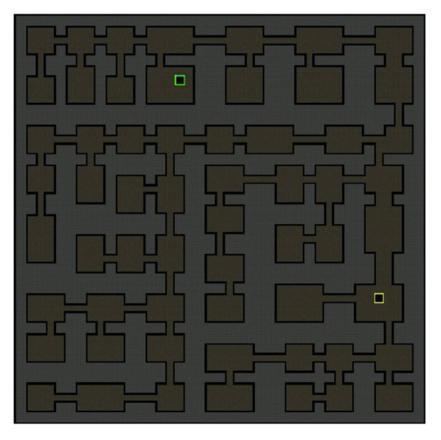
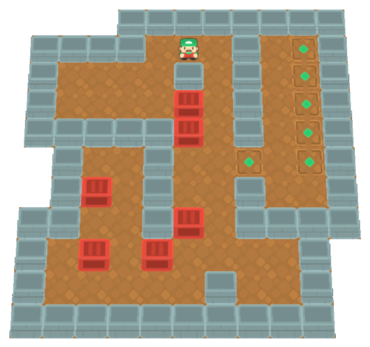
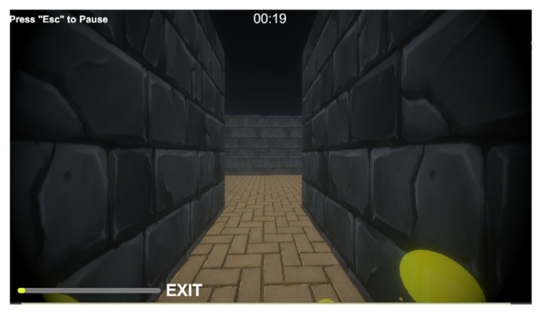
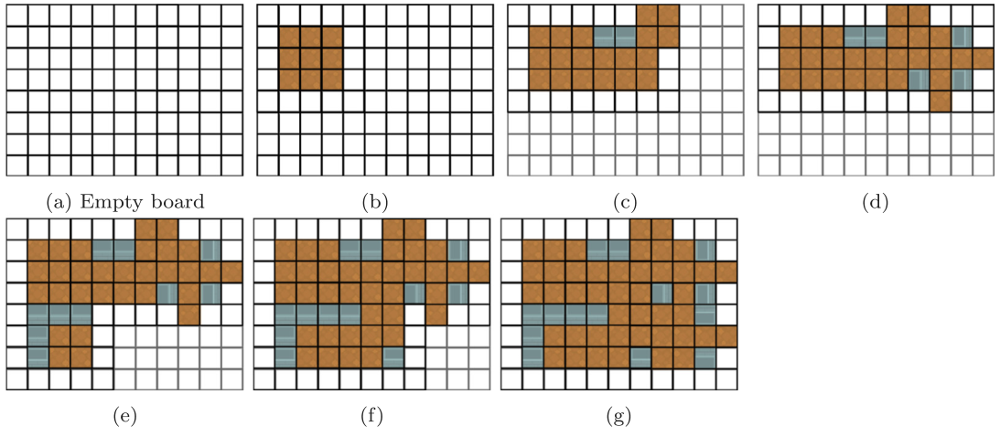
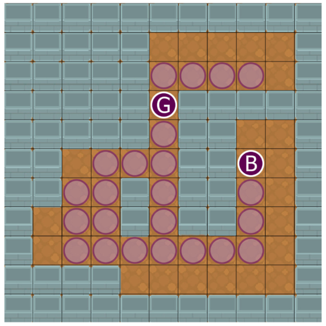
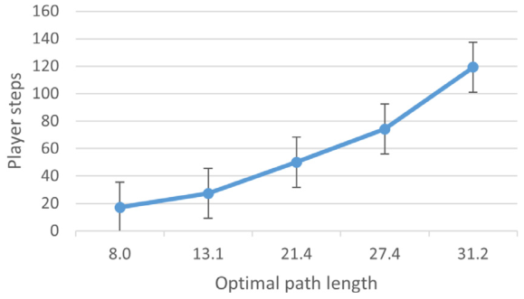
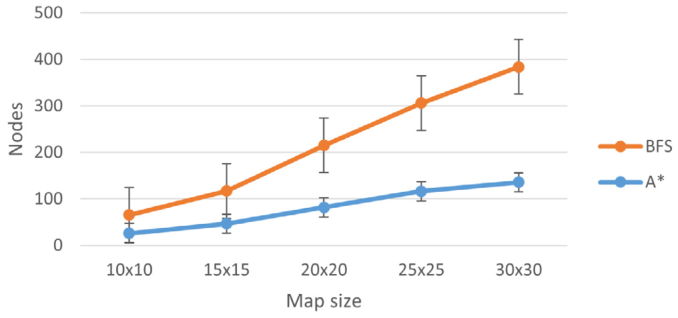
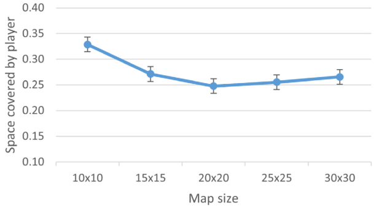

# Using search algorithm statistics for assessing maze and puzzle difficulty

Elio Valenzuela$^{a,1}$, Hans Schaa$^{b,1}$, Nicolas A. Barriga$^{c}$, Gustavo Patow$^{d,*}$

- $^a$ School of Videogames Development and Virtual Reality Engineering, Universidad de Talca, Campus Talca, Talca, Chile
- $^b$ Doctoral Program in Engineering Systems, Faculty of Engineering, Universidad de Talca, Campus Curicó, Curicó, Chile
- $^c$ Department of Interactive Visualization and Virtual Reality, Faculty of Engineering, Universidad de Talca, Campus Talca, Talca, Chile
- $^d$ ViRVIG, Universitat de Girona, Spain

$^*$ Corresponding author. E-mail address: gustavo.patow@udg.edu (G. Patow).
$^1$ These authors contributed equally to this work.

Received 24 September 2022; Received in revised form 31 October 2024; Accepted 23 January 2025; Available online 15 February 2025.

**Keywords:** Maze/puzzle difficulty estimation; Procedural content generation; Maze generation; Sokoban; Heuristic search

## Abstract

A video game's difficulty has a large impact on player engagement. For instance, it is crucial in some genres to give the players a challenge difficult enough without frustrating them. We propose a simple method for assessing game-level difficulty as a precursor to adapting it to a specific player. In particular, we propose using simple performance metrics of algorithms such as $A^*$ and Breadth-First Search (BFS) as a proxy for the difficulty of puzzles. We performed user studies using a 2D maze simulator and a Sokoban game implementation; both built into the Unity game engine. We show that, for 2D mazes generated by Binary Space Partitioning, the number of nodes expanded by BFS highly correlates with the number of steps a human player takes to reach the goal. For Sokoban puzzles, the closed list length of an A* search is highly correlated to perceived difficulty and the number of movements a human player takes to solve the puzzle. These results show that simple metrics are probably good enough to assess a given level's difficulty, which is a first step towards being able to personalize the difficulty of a maze or a puzzle to a particular player.

## 1. Introduction

Balancing videogame difficulty according to the player's skill has been a crucial customization aspect for the industry since its beginning. However, this skill-based adaptation has proven to be an elusive yet critical open problem [1]. Several attempts have been made to automatically determine a given level's complexity without resorting to extensive and expensive user tests. This is especially true for procedurally-generated levels in games such as those in the popular rogue-like genre.

However, despite its importance, automating difficulty assessment remains an elusive target. Thus, procedural generation-based games have to rely on constrained heuristics that guarantee, one way or another, the feasibility of the generated levels and usually use brute-force techniques to increase the complexity of the successive levels during game-play, for instance, resorting to increased maze dimensions. This results in extensive beta-testing evaluations, which are expensive, error-prone, and could lead to an incomplete release of the game. One could say that the gaming industry is in need of automated evaluation techniques.

This paper presents a methodology and two user studies to use correlations to assess the difficulty of a given (generated) maze/puzzle. We will show that, for simple 2D environments, using statistics from standard search algorithms, such as $A^*$ or BFS, is sufficient to estimate a human's difficulty in solving the maze/puzzle.

In the following section, we will cover some standard maze-generation algorithms, as well as some maze-difficulty metrics. Sections 3 and 4 describe our experiments and present experimental results. Finally, we present our conclusions and avenues for further research.

## 2. Background

In recent years, different methods for a procedural content generation have been proposed, with varying degrees of success [2]. In particular, currently, popular genres such as Roguelike/Roguelite are based on the procedural construction of maps and dungeons. In this project, we wanted to create game levels from scratch and get the maximum content variation possible with different room structures and connections between them. There are various options to create levels, such as the constructionist approach, which takes pre-created pieces of building blocks to create whole rooms and levels. Another content creation approach is constraint-driven, in which designers set a number of variables (constraints) and generate the content based on those variables. To have more variety in our study, we have decided to focus on two target scenarios: maze and Sokoban puzzle generation.

Previous work on evaluating the difficulty of mazes and puzzles has focused on the time it takes for a given algorithm [3,4], or even a human user [5] to solve it. Although reliable and accurate, the last approach involves slow evaluation processes, as well as the specificity of the test for a given maze or puzzle, without any possibility of generalizing to new contexts. Other research uses an ad-hoc linear combination of features of the board and its solution [6], an approach inspired by work for evaluating the enjoyability of games [7]. Similarly, in *Polymorph*, Jennings-Teats et al. [8] used techniques from level generation and machine learning to assess a given level difficulty, allowing the dynamic construction of levels for a 2D platformer game with continuous graduation of player challenge. Also, general systems based on Puzzle Script, a Video Game Description Language (VGDL) specifically tailored to puzzle game generation [9], can be used to generate and assess puzzle difficulty. Recently, Cook and Raad [10] defined the concept of *hyper state space graphs*, which are a compressed form of state-space graphs that can be constructed without any prior design knowledge about a game. In this work, they showed how these graphs could generate compact representations of games. In turn, these compact representations closely relate to hand-designed heuristics for search-based artificial intelligence agents. Nielsen and co-workers [11] explored the idea of playing a game with different controllers and comparing their performance as a metric of their difficulty. Togelius and Schmidhuber [12] generated the games themselves using a standard evolution strategy using a simple yet effective fitness function based on learning progress and inspired by Koster's theory of fun [13] and Schmidhuber's theory of artificial curiosity [14]. Zakaria et al. [15] experimentally studied four recent deep learning procedural level generators for Sokoban to assess their strengths and weaknesses. They also improved existing solutions to increase diversity, understood as the number of different scenarios generated for the game.

Chess has also been a domain where efforts to assess its difficulty have been made. Stoiljkovikj et al. [16] presented a computational approach to estimating the difficulty of combinatorial problems, such as chess, for humans. Their approach is based on heuristic search using *meaningful search trees* generated by an algorithm that attempted to emulate a human problem-solving approach. Also, Guid and Bratko [17] proposed a measure of difficulty that is based on modeling the problem-solving effort as the search process among alternatives and the relations among these alternative solutions. They applied their technique to the chess domain, using data obtained from very strong human players, resulting in a high level of statistical significance to be adequate as a genuine measure of difficulty for humans.

### 2.1. Maze generation

In this part of the project, we used a constructionist approach for maze generation because we wanted to create dungeon-like levels such as the one shown in Fig. 1. In this case, we set the size of the maze and the minimal size of the rooms [18], and the algorithm returns a fully generated level. In further developments, we would like to place other content, like enemies or objects, into the rooms of the generated level.

The most common methods for generating dungeons, mazes, and labyrinths are constructive methods [2]. These simple and fast methods incrementally build a pseudo-random solution from a seed according to predefined rules. Usually, there is no evaluation of the generated content involved. Typical examples are cellular automata, *digger agents*, and space partitioning algorithms. In this work, we will use the Binary Space Partioning (BSP) algorithm, applied to a 2-dimensional space, using axis-aligned partitions, to produce a *quadtree* that we can use to place rooms and corridors to form a dungeon-like maze.

*Fig. 1. Dungeon-like maze example generated using the binary tree partition algorithm. The yellow and green points are the entrance and exit points of the maze, respectively.*

### 2.2. Sokoban

Solving Sokoban boards is known to be NP-hard [19,20], which makes it an interesting research framework. There are several Procedural Content Generation (PCG) approaches for creating Sokoban boards: Constructive (top-down or bottom-up) [21–23], evolutionary algorithms [24,25], Monte Carlo Tree Search [26] and Machine Learning [27]. In particular, Murase and colleagues identified several interesting properties in their later work [28] (in Japanese). Nearly all of them are executed offline, mainly because they require too much time to finish. The most common approach is constructive, which basically creates the board in steps and then completes the puzzle with the placement of objects through search algorithms. Recently, evolutionary algorithms have been successfully used for creating Sokoban instances [24,25,29], by putting goals and boxes in a generate-and-test fashion, always guaranteeing that instances are solvable. In our case, we used an offline, bottom-up, generate-and-test, constructive, hybrid approach [24] for creating the Sokoban puzzles. Fig. 2 shows a board generated by the method we implemented here.

*Fig. 2. Sample Sokoban level created by our hybrid constructive generate-and-test algorithm.*

## 3. Methods: Difficulty assessment

As mentioned, previous work on evaluating the difficulty of mazes and puzzles has focused on the time it takes for a given algorithm to solve it, or use structural characteristics of the board to assess its difficulty. some even try to use the time a real player takes, but this is a slow process that is specifically tailored to a specific instance each time. Our method differs from the ones mentioned above in that it uses statistics from the execution of an algorithm used to solve the maze or puzzle, thus more closely resembling the actual performance of a human player.

### 3.1. Maze experiment

As previously stated, our objective is to find a functional relationship between the behavior of the player inside a maze searching for the exit and the equivalent search of well-known and established pathfinding algorithms. To do this, we used a random maze generator to produce configurable, increasingly large labyrinths, inside a gaming environment. Fig. 3 shows the player view of the test environment. Then, we asked several users to find the exit of these mazes, from sizes of $10 \times 10$ up to $30 \times 30$ in steps of 5 units for each side. We collected the results of multiple runs and analyzed the results in comparison with the evaluations of two well-known path-finding algorithms, $A^*$ and Breadth-First-Search (BFS). We did multiple tests to find the connections between the player steps and completion time of every maze with the path-finding data, such as the optimal path and the open (i.e., the unexpanded nodes at each step) and closed (i.e., the set of previously expanded nodes) lists of both the $A^*$ and BFS algorithms [30]. We use a Binary Tree Partition Algorithm [2] to create the maze with no inner obstacles, the maze being the only challenge posed to the players. To this end, we used the database of player runs to calculate the average results of different data combinations.

*Fig. 3. Player view of the maze experiment.*

### 3.2. Sokoban experiment

Sokoban board difficulty has been assessed using different variables, such as the time a solver takes, player movements, pushes, or direction changes the puzzle solution contains [22]. For example, Pattern Databases (PDB) have been used to approximate the difficulty of the board based on the sum of the solution of small game patterns [25]. We can also perform user tests to allow players to identify hard-to-solve boards.

We have generated relatively hard Sokoban boards for an average user. An offline hybrid approach (construct, plus generate-and-test) allows us to create different Sokoban boards modifying variables like the maximum number of boxes, mutation frequency, maximum generations, etc. A more detailed description can be found in [24,29]. Our process is divided into three phases:

1. **Construction:** Building the board using a set of predefined templates [22], which are selected from a predefined set and added to the board considering some restrictions. Phase final result is a board that only contains walls and empty spaces. Fig. 4 describes the process.
2. **Initialization:** Creates the initial population for an evolutionary algorithm. After randomly creating a goal, the Goal Range is calculated [19]. Fig. 5 shows an example where the goal range is calculated for a given goal, and the box is placed as far from it as possible.
3. **Evolution:** Evolutionary algorithm optimizes for solution length. Some relevant details are:
   - (a) **Fitness function:** We use JSoko's$^2$ "optimize pushes" solver to get the number of pushes needed to solve the puzzle instance
   - (b) **Selection:** 2-way Deterministic Tournament Selection.
   - (c) **Crossover:** The box-goal pairs of each board are combined. Initially, each individual has only one box-goal pair. As the generations progress, individuals gain more box-goal pairs, becoming more complex to solve.
   - (d) **Mutation:** We use two mutation types, these are:
     - i. Box-goal invert: A random box-goal pair is selected, and their positions are reversed.
     - ii. Player position change: A random board position that does not have a box is selected for the player.

*Fig. 4. Template placement on board. Figure b, c, d, e, f, and g show the position of each template.*

*Fig. 5. Goal Range for a Sokoban level, pink circles compound the Goal Range. The circle with the letter G is the goal, and the letter B is the box.*

For user testing, we developed a web application called Sokostigation.$^3$ We have created 40 Sokoban boards of which we selected 18 based on the appearance of each with the aim of having a diverse testing set. At the beginning of the gaming experience, each user is given 9 of these boards. It is important to mention that we used the levels made by our generator because we thought it would be interesting to take the opportunity to study whether procedurally-generated boards can achieve good quality in terms of perceived difficulty. In the long term, we plan to optimize this metric with other heuristics that are different from the ones used in the evolutionary algorithm (the number of push operations needed to solve the puzzle).

Notes:

2. Software to solve, create and play Sokoban boards: https://www.sokoban-online.de/
3. https://sokostigationutalca.github.io/Sokostigation.

## 4. Results

First, we will examine the results of the maze experiment, followed by the results of the Sokoban experiment.

### 4.1. Maze experiment results

We recruited 30 test subjects between 18 and 30 years old, without discriminating by gender, all with computer-gaming experience, which resulted in a total evaluation of 426 complete mazes. Subjects were recruited over specialized online forum boards and from the last courses at the University of Girona's Videogame Development degree. Fig. 6 shows that, in the first levels, the players always use more than twice the length of the optimal path found by $A^*$, i.e., if the algorithm finds a path that requires 7 nodes to get to the exit, the player will usually end up walking through 14 or more nodes. In later runs, i.e., more complex levels, this increase can be more than threefold with respect to the optimal path. This implies that the player gets increasingly lost in every maze, making it progressively more difficult to find the exit.

*Fig. 6. Numbers of steps human players take to reach the goal in the maze experiment, compared to the optimal path length for increasing map sizes ($10 \times 10$, $15 \times 15$, $20 \times 20$, $25 \times 25$ and $30 \times 30$). Error bars show one standard error.*

Values read off Fig. 6 (approximate):

| Map size | 10x10 | 15x15 | 20x20 | 25x25 | 30x30 |
|---|---|---|---|---|---|
| Mean optimal path length (axis label) | 8.0 | 13.1 | 21.4 | 27.4 | 31.2 |
| Mean player steps (read off) | ~17 | ~27 | ~50 | ~74 | ~119 |

Fig. 7 shows the difference between BFS and $A^*$ in the number of nodes examined to reach the end of the maze in every different size of the puzzles. The graph shows that the average size of the closed list remains significantly smaller than the total number of possible nodes, mainly because of the heuristic used in the $A^*$ algorithm, which acts as a "compass" for the algorithm that is trying to reach the exit in the smaller number of steps possible.

*Fig. 7. "Nodes" represents the size of the closed list of $A^*$ (Blue line) and BFS (Orange line) vs. the map size of each level for the maze experiment. Error bars show one standard error.*

Values read off Fig. 7 (approximate):

| Map size | 10x10 | 15x15 | 20x20 | 25x25 | 30x30 |
|---|---|---|---|---|---|
| BFS closed list | ~65 | ~117 | ~215 | ~305 | ~383 |
| A* closed list | ~26 | ~46 | ~82 | ~116 | ~135 |

We analyzed how many cells players visit (i.e., the number of steps) around the map and compared it to the "walkable" nodes of the map to estimate how much players wander in the maze. In Fig. 8 we can see the map percentage traversed by the player.

*Fig. 8. Walked map percentage for the maze experiment: the curve shows the mean values of the visited part of the map by the player. Error bars show one standard error. The graph shows that the players do not even visit 50% of the complete map, and they reach the exit before visiting the entire maze, or even a large part.*

This is the main information about the player's behavior. We analyzed further the relationship between the player steps, the optimal path, and the algorithm open and closed lists with correlation coefficient, as we see a relationship between the BFS, DFS, and $A^*$ opened nodes and the player steps. The results of Table 1 are the results of comparing different values and correlations to determine the highest ones.

**Table 1.** Pearson correlation coefficients for player steps, completion time, and percentage of steps taken over the optimal; versus different search algorithm statistics, p-values < 0.001 in bold.

| | Open+Closed (BFS) | Closed (BFS) | Open+Closed (A*) | Closed (A*) | Open (A*) | Closed (DFS) | Optimal path |
|---|---|---|---|---|---|---|---|
| Player steps | **0.680** | **0.676** | **0.584** | **0.565** | **0.533** | **0.474** | **0.578** |
| Completion time | **0.678** | **0.673** | **0.594** | **0.578** | **0.527** | **0.471** | **0.578** |
| % of Steps over optimal | **0.234** | **0.223** | 0.084 | 0.070 | **0.137** | **0.239** | 0.054 |

These are the values that correlate best with the player's steps. We can see that the number of nodes in the closed list plus the open list of BFS is strongly correlated [31] to the player steps ($r = 0.68$) and to the player's completion time ($r = 0.678$), and weakly correlated to the % of player steps over the optimal path ($r = 0.234$). We can observe that the Closed list of the BFS algorithm is also strongly correlated to the player steps and the optimal path.

We can conclude that player steps are strongly correlated to the size of the list of visited nodes (closed list) of the BFS algorithm, mainly because players actually have approximately the same amount of information for orienting themselves as they wander about the map and search for the exit, so they all have to "walk" through all the possible nodes until they find the exit. This can give us a reliable test to be used in generated mazes, allowing us to extract information about the algorithm's performance and use it to assess a given level of intrinsic difficulty.

### 4.2. Sokoban experiment results

The Sokoban testing session had 77 volunteer participants over 4 days. Invitations were sent to groups of expert Sokoban players, puzzle enthusiasts, videogames groups, and social media groups from the Videogame and Virtual Reality Development Engineering program at the University of Talca, Chile. After completing each game level, they were asked to rate the board on a Likert scale regarding how entertaining, diverse, and difficult it was. Subsequently, the data was sent to a Firebase server for analysis.

After users have played our Sokoban boards, they evaluate their difficulty. We use these values to study the Spearman correlation between some JSoko solver values and the difficulty perceived by users. We used Spearman's over Pearson's correlations because some data is ordinal, such as "Perceived Difficulty". Additionally, Spearman is more reliable than Pearson in terms of critical values [32].

**Table 2.** Spearman correlation coefficients for different difficulty metrics measured on users versus different search statistics, p-values < 0.05 in bold. The red value represents the correlation between the perceived difficulty by the users and the number of JSoko pushes, which is the metric used as a fitness function for the Sokoban board generation. The green value is the new metric that correlates better with the perceived difficulty.

| | Final A* closed list length | JSoko optimizer moves | JSoko optimizer pushes |
|---|---|---|---|
| Player movements | **0.762** | **0.856** | **0.34** |
| Player pushes | **0.518** | **0.591** | **0.867** |
| % of movements over Jsoko | **0.433** | **0.408** | **0.216** |
| Player time to solve | **0.4** | **0.437** | **0.34** |
| Perceived difficulty | **0.286** (green) | **0.187** | 0.089 (red) |
| % of surrenders | 0.207 | 0.45 | **0.614** |

Table 2 shows the results. Concretely, our main conclusions are:

1. Spearman correlation between difficulty perceived and JSoko solver pushes (metric that we used in the evolutionary algorithm) is not significant, furthermore, it is close to zero. We believe a greater correlation can help the PCG algorithm converge to more difficult-to-solve configurations.
2. Spearman correlation between difficulty perceived and final A* closed list length is better than the correlation with the solution found by JSoko's solver. The final A* closed list length is a good approximation to the perceived difficulty of a board, so running our generation algorithm using this metric may result in harder boards. The value of 0.286 presents a weak positive correlation [31]. However, it is better than the number of push operations needed to solve the puzzle, the heuristic used in the generation of Sokoban boards. Furthermore, this value is significant with confidence intervals equal to [0.1585, 0.4039] at a 95% significance level. On the other hand, for the JSoko optimizer pushes versus Perceived Difficulty, the interval is [-0.0446, 0.2201], with a negative value in the lower limit.
3. The % of surrenders is more strongly correlated to the solution length (moves or pushes) rather than to A*'s close list size. This leads us to believe that they are abandoning because they find these boards tedious, but not necessarily difficult.

## 5. Discussion

In this paper, we have presented and shown correlations between user performance in the case of mazes and user-perceived difficulty in the case of puzzles; and easily automated algorithmic metrics, namely Breadth-First Search (BFS) and $A^*$, respectively. These correlations allow us to have an overall idea of human behavior in these situations and make assessments. In particular, the use of statistical metrics derived from search algorithms is a low-cost tool that facilitates the evaluation of difficulty in puzzle levels [5]. This knowledge of the search space, obtained from solving a puzzle level, constitutes a valuable resource in areas such as automatic content generation, contributing to the creation of high-quality content [33].

Although implementing and explicitly comparing our results with other works requires running (or developing) code we do not have and are often tailored for specific games other than the ones shown here (e.g., chess, platformers, etc.), is beyond the scope of the present article, we will discuss some similarities and differences among the different developments and results obtained.

Our results and conclusions are similar to other projects that use procedural generation to create personalized levels. As done in the project Polymorph [8], we used a correlation coefficient to find the best relation between the player performance and what we wanted to measure. However, their approach is specifically tailored to platformer games, taking into account metrics such as the number of upward-rising gaps in a game segment, or the number of gap-enemy adjacencies, so their results cannot be directly extrapolated to our puzzle-based setting. Jarušek and Pelánek [5] study the difficulty rating of games, in particular a Sokoban game, as both a problem decomposition metric and a computational model which simulates human traversal of state space. Our approach is similar to the second one, but more related to the *steps* taken by the players instead of the success scores of finishing a given puzzle.

Mantere and Koljonen [4] observed that Sudoku can be regarded as a multi-objective optimization problem, in particular as a constraint satisfaction problem, which can be solved with genetic algorithms. They used the execution of the algorithm to assess the difficulty for a human player of a given level. Ashlock and Schonfeld [3] followed these ideas by using an evolutionary algorithm as a tool to automatically grade the difficulty of boards for a version of the game Sokoban. They employed the average time for the algorithm to find the solution and the number of failures to solve a game level as a surrogate for the difficulty of a board, which is related, but not as exact or reliable to the approach we propose here. A similar approach was used by Browne and Maire [7], who formalized the concept of game quality as the likelihood that a given game will be of interest to human players. This quality was measured by 57 aesthetic criteria, including Completion, reflecting that games should produce more victories than draws; Duration, reflecting that games should neither be too short nor too long; Drama, quantifying that players should have at least a hope of recovering from bad positions if they are to maintain a vested interest in a game; and Uncertainty, measuring that the outcome of each game should remain as uncertain for as long as possible if all players are to maintain a vested interest in it; among others. In this sense, our metrics are related to some of theirs, such as the mentioned Duration, which could also be measured as the number of steps necessary to solve a puzzle.

As mentioned, recently Khalifa and Fayek [9] use a variant of the Breadth First Search (BFS) algorithm, sorting states according to a heuristic fitness score based on a weighted sum of six specific scores. Contrary to the simple metrics designed here, these heuristics require careful tuning to achieve meaningful results. In any case, our approach and theirs can be considered as *complementary*, since some of their heuristics require a player performance approximation, while our approach directly provides that information by correlating actual player performances to values easily extracted from simple algorithms. Cook and Raad [10], defined Hyperstate Space Graphs as a means to conceptually represent the possible changes in Sokoban puzzles. In their work, they postulate that Hyperstates, and by extension, the length of the reversibility chain that creates a hyperstate, could be used to evaluate the player's actions. In our case, we use a more concrete, close-to-the-design approach, as we measure the number of concrete steps needed to achieve a goal instead of the *possible* space of actions.

## 6. Conclusion and future work

In this paper, we have shown the existence of correlations between simple algorithm metrics, namely BFS for maze games and $A^*$ for puzzle games, and the user performance or the puzzle-perceived difficulty. These correlations range from weak to strong, depending on the difficulty measures used. Our results show that these simple metrics are probably good enough to assess a given level's difficulty, which is a first step towards being able to personalize the difficulty of a maze or a puzzle to a particular player. Using them as proxies to evaluate difficulty will potentially accelerate level design work in video game development companies, streamlining evaluation processes, in order to provide a balanced difficulty progression to the player.

Experiments show that the uninformed algorithm BFS works well in scenarios where the player is "blind", while the informed $A^*$ works better as a user-performance predictor for games where the player has more information about the puzzle. These results can help with the difficult assessments of unknown games or puzzles by choosing a solving algorithm that uses similar information to what the human player can access.

We consider this work as a first step towards estimating puzzle difficulty directly from simple algorithms such as BFS and A*, which may have considerable utility, particularly in the context of automatic level generation. We think it would have been beneficial to conduct a deeper analysis comparing why these search algorithms are effective concerning the thought processes and search patterns of human players, and this is left as an avenue for further research.

In future work, the following step would be assessing the user's skill level, dynamically creating different puzzles of difficulty appropriate for each player [34]. However, in this case, we have found reliable metrics to test, in advance the player tries them, the perceived difficulty of puzzle games, which is a piece of information not available to game developers up to now. We also believe it is compelling to experiment with new metrics such as the relative algorithm performance profiles [11] or the evaluation of counterintuitive [5] moves to guide the search towards more difficult contexts to solve. Evaluating difficulty allows us to have an idea of the complexity of the problem, however, it is necessary to design prediction strategies that allow us to measure with greater certainty how complicated a game level is.

Finally, we consider it would be interesting to observe the changes in user performance when a compass is added to aid users in finding their way while traversing the maze. In this case, the compass would represent a visual equivalent to the information the $A^*$ algorithm has available during navigation. Alternatives such as a minimap would be discouraged, as it would unfairly shift the balance towards the players as they would have a general idea of the general maze layout, something $A^*$ does not use.

## CRediT authorship contribution statement

**Elio Valenzuela:** Conceptualization, Data curation, Investigation, Methodology, Software, Writing – original draft. **Hans Schaa:** Formal analysis, Investigation, Methodology, Software, Writing – original draft, Writing – review & editing. **Nicolas A. Barriga:** Conceptualization, Formal analysis, Investigation, Methodology, Supervision, Writing – original draft, Writing – review & editing. **Gustavo Patow:** Conceptualization, Formal analysis, Investigation, Methodology, Supervision, Writing – original draft, Writing – review & editing.

## Declaration of competing interest

The authors declare that they have no known competing financial interests or personal relationships that could have appeared to influence the work reported in this paper.

## Acknowledgments

This research was partially funded by the National Agency for Research and Development (Agencia Nacional de Investigación y Desarrollo, ANID Chile), ANID-Subdirección del Capital Humano/Doctorado Nacional/2023-21230824 and FONDECYT Iniciación grant 11220438. This work was also partially funded by project PID2021-122136OB-C22 from Ministerio de Ciencia e Innovación, Spain.

## Data availability

Data will be made available on request.

## References

1. N.A. Barriga, A short introduction to procedural content generation algorithms for videogames, Int. J. Artif. Intell. Tools 28 (02) (2019) 1930001.
2. N. Shaker, A. Liapis, J. Togelius, R. Lopes, R. Bidarra, Constructive generation methods for dungeons and levels, in: N. Shaker, J. Togelius, M.J. Nelson (Eds.), Procedural Content Generation in Games: A Textbook and an Overview of Current Research, Springer, 2016, pp. 31–55.
3. D. Ashlock, J. Schonfeld, Evolution for automatic assessment of the difficulty of sokoban boards, in: IEEE Congress on Evolutionary Computation, 2010, pp. 1–8, http://dx.doi.org/10.1109/CEC.2010.5586239.
4. T. Mantere, J. Koljonen, Solving, rating and generating Sudoku puzzles with GA, in: 2007 IEEE Congress on Evolutionary Computation, 2007, pp. 1382–1389, http://dx.doi.org/10.1109/CEC.2007.4424632.
5. P. Jarušek, R. Pelánek, Difficulty rating of sokoban puzzle, in: Proc. of the Fifth Starting AI Researchers' Symposium, STAIRS 2010, 2010, pp. 140–150.
6. M. van Kreveld, M. Löffler, P. Mutser, Automated puzzle difficulty estimation, in: 2015 IEEE Conference on Computational Intelligence and Games, CIG, 2015, pp. 415–422, http://dx.doi.org/10.1109/CIG.2015.7317913.
7. C. Browne, F. Maire, Evolutionary game design, IEEE Trans. Comput. Intell. AI Games 2 (1) (2010) 1–16, http://dx.doi.org/10.1109/TCIAIG.2010.2041928.
8. M. Jennings-Teats, G. Smith, N. Wardrip-Fruin, Polymorph: A model for dynamic level generation, Proc. AAAI Conf. Artif. Intell. Interact. Digit. Entertain. 6 (1) (2010) 138–143, http://dx.doi.org/10.1609/aiide.v6i1.12417.
9. A. Khalifa, M. Fayek, Automatic puzzle level generation: a general approach using a description language, in: Sixth International Conference on Computational Creativity, ICCC, Park City, 2015, pp. 1–8.
10. M. Cook, A. Raad, Hyperstate space graphs, IEEE Trans. Games 14 (3) (2022) 435–445, http://dx.doi.org/10.1109/tg.2021.3095393.
11. T.S. Nielsen, G.A.B. Barros, J. Togelius, M.J. Nelson, General video game evaluation using relative algorithm performance profiles, in: Applications of Evolutionary Computation, Springer International Publishing, 2015, pp. 369–380, URL https://doi.org/10.1007/978-3-319-16549-3_30.
12. J. Togelius, J. Schmidhuber, An experiment in automatic game design, in: 2008 IEEE Symposium on Computational Intelligence and Games, IEEE, 2008, pp. 111–118, http://dx.doi.org/10.1109/cig.2008.5035629.
13. R. Koster, Theory of Fun for Game Design, "O'Reilly Media, Inc.", 2013.
14. J. Schmidhuber, Developmental robotics, optimal artificial curiosity, creativity, music, and the fine arts, Connect. Sci. 18 (2) (2006) 173–187.
15. Y. Zakaria, M. Fayek, M. Hadhoud, Procedural level generation for sokoban via deep learning: An experimental study, IEEE Trans. Games 15 (1) (2023) 108–120, http://dx.doi.org/10.1109/tg.2022.3175795.
16. S. Stoiljkovikj, I. Bratko, M. Guid, A computational model for estimating the difficulty of chess problems, in: Proceedings of the Third Annual Conference on Advances in Cognitive Systems, in: ACS, 2015, pp. 1–16, Article 7.
17. M. Guid, I. Bratko, Search-based estimation of problem difficulty for humans, in: Lecture Notes in Computer Science, Springer Berlin Heidelberg, 2013, pp. 860–863, http://dx.doi.org/10.1007/978-3-642-39112-5_131.
18. G. Smith, Game AI Pro 2, Procedural Content Generation An Overview, CRC Press, 2015.
19. J. Culberson, Sokoban is PSPACE-Complete, Tech. Rep., University of Alberta, 1997.
20. D. Dor, U. Zwick, Sokoban and other motion planning problems, Comput. Geom. 13 (4) (1999) 215–228, http://dx.doi.org/10.1016/s0925-7721(99)00017-6.
21. Y. Murase, H. Matsubara, Y. Hiraga, Automatic making of Sokoban problems, in: Pacific Rim International Conference on Artificial Intelligence, Springer, 1996, pp. 592–600.
22. J. Taylor, I. Parberry, Procedural generation of Sokoban levels, in: Proceedings of the International North American Conference on Intelligent Games and Simulation, 2011, pp. 5–12.
23. J. Taylor, The Procedural Generation of Interesting Sokoban Levels, University of North Texas, 2015.
24. H. Schaa, N. Barriga, Generación Procedural de niveles Interesantes de Sokoban (Bachelor thesis), Video Games Development and Virtual Reality Engineering, Universidad de Talca, 2021.
25. D.S. Bento, A.G. Pereira, L.H. Lelis, Procedural generation of initial states of Sokoban, 2019, arXiv preprint arXiv:1907.02548.
26. B. Kartal, N. Sohre, S. Guy, Generating Sokoban puzzle game levels with Monte-Carlo tree search, in: The IJCAI-16 Workshop on General Game Playing, Vol. 47, 2016, pp. 47–54.
27. Y. Zakaria, M. Hadhoud, M. Fayek, Procedural level generation for Sokoban via deep learning: An experimental study, 2021.
28. Y. Murase, H. Matsubara, Y. Hiraga, Automatic generation of "Sokoban" problems (in Japanese), J. Inf. Process. Soc. Jpn. 39 (3) (1998) 567–574, URL http://id.nii.ac.jp/1001/00013161/.
29. H. Schaa, N.A. Barriga, Generating entertaining human-like sokoban initial states, in: 2021 40th International Conference of the Chilean Computer Science Society, SCCC, IEEE, 2021, pp. 1–6.
30. S.J. Russell, P. Norvig, Artificial Intelligence: A Modern Approach, fourth ed., Pearson, 2021.
31. H. Khamis, Measures of association: how to choose? J. Diagn. Med. Sonogr. 24 (3) (2008) 155–162.
32. P. Schober, C. Boer, L.A. Schwarte, Correlation coefficients: appropriate use and interpretation, Anesth. Analg. 126 (5) (2018) 1763–1768.
33. J. Togelius, G.N. Yannakakis, K.O. Stanley, C. Browne, Search-based procedural content generation: A taxonomy and survey, IEEE Trans. Comput. Intell. AI Games 3 (3) (2011) 172–186.
34. G.K. Sepulveda, F. Besoain, N.A. Barriga, Exploring dynamic difficulty adjustment in videogames, in: 2019 IEEE CHILEAN Conference on Electrical, Electronics Engineering, Information and Communication Technologies, CHILECON, 2019, pp. 1–6, http://dx.doi.org/10.1109/CHILECON47746.2019.8988068.
